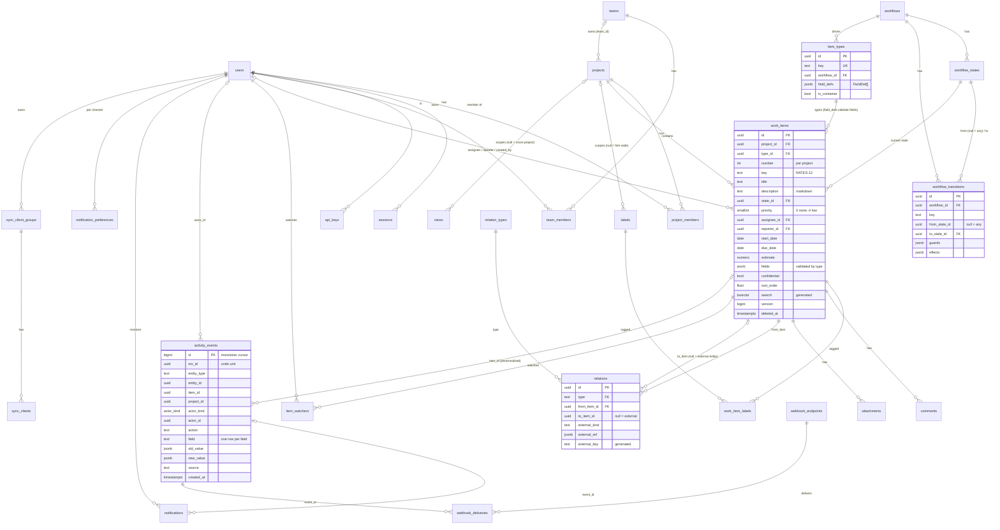
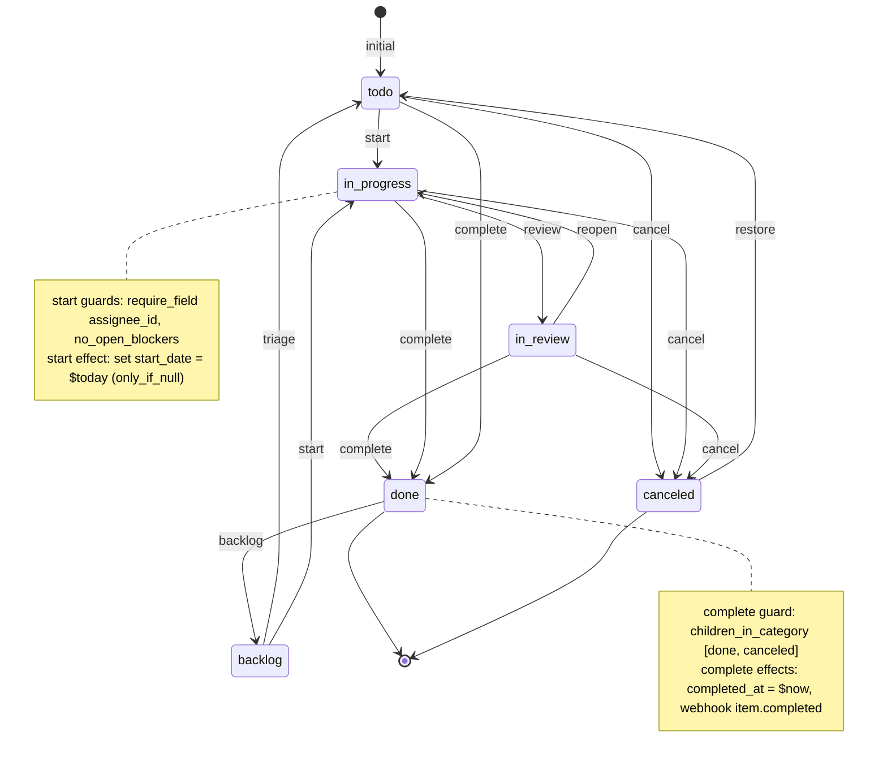

# 01 — The data model

> **Standalone document.** Everything here is defined by one file,
> `packages/db/migrations/0001_init.sql` (≈940 lines of plain SQL, Postgres 15+,
> no extensions beyond `pgcrypto` and `pg_trgm`). You can apply it with
> `psql -f`, use it from any language, and iterate on it without the rest of the
> monorepo. The TypeScript in `@pm/core` mirrors it; it never replaces it.

## 1. Design goals

The model was built for a regulated firm with desks and strategies that wants to
start generic and specialise later. Five non-negotiables drove every table:

| # | Requirement | How the schema answers it |
|---|---|---|
| 1 | One generic work item with a **type** and **typed columns + validated JSONB**; no table per type | `work_items` + `item_types.field_defs` + `trg_validate_item_fields` |
| 2 | **Workflow as an explicit, data-driven state machine** per type: states, transitions, guards, side effects | `workflows` → `workflow_states` → `workflow_transitions(guards jsonb, effects jsonb)` |
| 3 | A **typed relation edge table** (parent/child, blocks, duplicates, external links); dependencies and rollups are **graph queries** | `relations` + `relation_types` registry + `item_descendants/ancestors/open_blockers/rollup()` |
| 4 | **Append-only activity log, one event per field change** — history, audit, notifications, undo, analytics | `activity_events` with `trg_append_only` on UPDATE/DELETE/TRUNCATE, grouped by `txn_id` |
| 5 | An **early, explicit permissions decision** | Per-project roles + firm role + project visibility + confidential flag; `effective_project_role()`, `can_view_item()`, `visible_project_ids()` |

Two further pillars are baked in because the tool built on top needs them, but
they cost nothing if you only use the SQL:

* **Views are saved queries** (`views.spec` is a JSON query, not a screen).
* **Every synced table carries `version` and `deleted_at`** so a local-first
  client can converge (global version sequence + tombstones).

Conventions: UUID primary keys (client-generatable), `snake_case` everywhere,
`timestamptz`, soft deletes via `deleted_at`, enums for closed vocabularies that
should never be user-editable (`firm_role`, `project_role`, `state_category`,
…), registries (rows) for vocabularies that should (`item_types`,
`relation_types`, `workflows`).

## 2. Entity overview



Table catalogue (section numbers refer to the comment headers in the SQL):

| § | Tables | Role |
|---|---|---|
| 0 | `sync_version_seq`, `trg_set_version()`, `install_sync_trigger()` | Global version stamping for sync |
| 1 | `users`, `sessions`, `api_keys`, `teams`, `team_members` | Principals |
| 2 | `workflows`, `workflow_states`, `workflow_transitions` | State machines as data |
| 3 | `item_types` | Type registry with `field_defs` |
| 4 | `projects`, `project_members` | Permission backbone |
| 5 | `work_items`, `labels`, `work_item_labels`, `comments`, `attachments` | The generic entity and its satellites |
| 6 | `relation_types`, `relations`, graph functions | Typed edges |
| 7 | `activity_events` | Append-only log |
| 8 | `views` | Saved queries |
| 9 | `item_watchers`, `notification_preferences`, `notifications`, `notification_deliveries` | Low-noise notifications |
| 10 | `webhook_endpoints`, `webhook_deliveries`, `integration_configs`, `inbound_events` | Integrations |
| 11 | `sync_client_groups`, `sync_clients` | Replicache-style bookkeeping |
| 12 | `effective_project_role()`, `can_view_item()`, `visible_project_ids()` | Permissions |
| 13 | `settings` | Firm-level key/value |
| 14 | seeded `standard` + `simple` workflows, `task`/`bug`/`initiative`/`request` types | Usable immediately |
| 15 | `work_items_v` | Display view with resolved joins |

## 3. The generic work item

### 3.1 `work_items`

```sql
create table work_items (
  id            uuid primary key default gen_random_uuid(),
  project_id    uuid not null references projects(id),
  type_id       uuid not null references item_types(id),
  number        integer not null,                       -- per project; filled by trigger when omitted
  key           text not null unique,                   -- "RATES-12" (denormalized for search/links)
  title         text not null check (length(title) between 1 and 500),
  description   text not null default '',               -- markdown
  state_id      uuid not null references workflow_states(id),
  priority      smallint not null default 0 check (priority between 0 and 4), -- 0 none,1 urgent..4 low
  assignee_id   uuid references users(id),
  reporter_id   uuid references users(id),
  start_date    date,
  due_date      date,
  estimate      numeric(10,2),                           -- points/hours; unit per project settings
  fields        jsonb not null default '{}'::jsonb check (jsonb_typeof(fields) = 'object'),
  confidential  boolean not null default false,         -- visible to project admins + assignee + reporter only
  sort_order    double precision not null default 0,    -- manual ordering within a board column
  search        tsvector generated always as (
                  setweight(to_tsvector('english', coalesce(key, '')), 'A') ||
                  setweight(to_tsvector('english', coalesce(title, '')), 'A') ||
                  setweight(to_tsvector('english', coalesce(description, '')), 'C')
                ) stored,
  version       bigint not null default 0,
  created_by    uuid references users(id),
  created_at    timestamptz not null default now(),
  updated_at    timestamptz not null default now(),
  completed_at  timestamptz,
  canceled_at   timestamptz,
  archived_at   timestamptz,
  deleted_at    timestamptz,
  unique (project_id, number)
);
```

The rule for what goes in a typed column versus `fields`: a column is for what
*every* type has and *every* view wants to sort/filter/group on cheaply
(title, state, priority, assignee, dates, estimate, confidential). Everything
type-specific goes in `fields`, with a GIN `jsonb_path_ops` index for
containment queries and a per-key cast at query time (`fields->>'notional'`
cast to numeric, for example).

The key `RATES-12` is assigned by `trg_assign_item_number` on insert: it bumps
`projects.item_seq` and writes `number` and `key`. Clients never choose keys;
they choose UUIDs.

### 3.2 The type registry: `item_types.field_defs`

```sql
create table item_types (
  id            uuid primary key default gen_random_uuid(),
  key           text not null unique,          -- "task", "bug", "initiative", "trade_idea"
  name          text not null,
  plural_name   text,
  icon          text,
  color         text,
  description   text,
  workflow_id   uuid not null references workflows(id),
  field_defs    jsonb not null default '[]'::jsonb check (jsonb_typeof(field_defs) = 'array'),
  is_container  boolean not null default false,  -- can have children (epic/initiative)
  sort          integer not null default 0,
  is_active     boolean not null default true,
  version       bigint not null default 0,
  created_at    timestamptz not null default now(),
  updated_at    timestamptz not null default now(),
  deleted_at    timestamptz
);
```

Each element of `field_defs` is a `FieldDef`. The canonical shape (zod, from
`@pm/core`):

```ts
export const FieldKind = z.enum(['text', 'long_text', 'number', 'bool', 'date', 'datetime', 'select', 'multi_select', 'user', 'url']);

export const FieldDef = z.object({
  key: z.string().regex(/^[a-z][a-z0-9_]*$/),
  label: z.string(),
  kind: FieldKind,
  required: z.boolean().optional(),
  multi: z.boolean().optional(),
  options: z.array(z.object({ value: z.string(), label: z.string(), color: z.string().optional() })).optional(),
  description: z.string().optional(),
  default: z.unknown().optional(),
  min: z.number().optional(),
  max: z.number().optional(),
  show_in_list: z.boolean().optional(),
});
```

The seeded `bug` type, as stored:

```json
[
  {"key":"severity","label":"Severity","kind":"select","required":true,
   "options":[{"value":"s1","label":"S1 – Critical"},{"value":"s2","label":"S2 – High"},
              {"value":"s3","label":"S3 – Medium"},{"value":"s4","label":"S4 – Low"}]},
  {"key":"environment","label":"Environment","kind":"select",
   "options":[{"value":"prod","label":"Production"},{"value":"uat","label":"UAT"},{"value":"dev","label":"Dev"}]},
  {"key":"steps","label":"Steps to reproduce","kind":"long_text"}
]
```

Storage encoding of each kind inside `work_items.fields`:

| kind | JSON type | notes |
|---|---|---|
| `text`, `long_text` | string | `long_text` is markdown |
| `number` | number | `min`/`max` enforced in `@pm/core` |
| `bool` | boolean | |
| `date` | string `YYYY-MM-DD` | |
| `datetime` | string ISO-8601 | |
| `select` | string (an `options[].value`) | option membership checked in `@pm/core` |
| `multi_select` | array of strings | always an array |
| `user` | string (users.id) | existence checked in `@pm/core` |
| `url` | string | |
| any kind with `multi: true` | array of the above | |

### 3.3 Validation in the database

The trigger keeps `fields` honest regardless of which client wrote the row.
It rejects unknown keys, missing required keys and wrong JSON types; deep
checks (option membership, user existence, `min`/`max`) run in `@pm/core`
`validateFields()` before the write so the user gets a friendly error.

```sql
create or replace function trg_validate_item_fields() returns trigger
language plpgsql as $$
declare
  def jsonb;
  k text;
  kind text;
  v jsonb;
  defs jsonb;
begin
  select field_defs into defs from item_types where id = new.type_id;
  if defs is null then
    raise exception 'unknown item type %', new.type_id;
  end if;
  -- unknown keys are rejected: keeps JSONB honest
  for k in select jsonb_object_keys(new.fields) loop
    if not exists (select 1 from jsonb_array_elements(defs) d where d->>'key' = k) then
      raise exception 'field "%" is not defined for this item type', k using errcode = '23514';
    end if;
  end loop;
  for def in select * from jsonb_array_elements(defs) loop
    k := def->>'key';
    kind := def->>'kind';
    v := new.fields -> k;
    if coalesce((def->>'required')::boolean, false) and (v is null or v = 'null'::jsonb) then
      raise exception 'field "%" is required', k using errcode = '23514';
    end if;
    if v is null or v = 'null'::jsonb then continue; end if;
    if coalesce((def->>'multi')::boolean, false) or kind = 'multi_select' then
      if jsonb_typeof(v) <> 'array' then
        raise exception 'field "%" must be an array', k using errcode = '23514';
      end if;
      continue;
    end if;
    if kind in ('text','long_text','select','user','url','date','datetime') and jsonb_typeof(v) <> 'string' then
      raise exception 'field "%" must be a string', k using errcode = '23514';
    elsif kind = 'number' and jsonb_typeof(v) <> 'number' then
      raise exception 'field "%" must be a number', k using errcode = '23514';
    elsif kind = 'bool' and jsonb_typeof(v) <> 'boolean' then
      raise exception 'field "%" must be a boolean', k using errcode = '23514';
    end if;
  end loop;
  return new;
end $$;
create trigger validate_item_fields before insert or update of fields, type_id on work_items
  for each row execute function trg_validate_item_fields();
```

A second trigger, `trg_validate_item_state`, refuses any `state_id` that does
not belong to the workflow of the item's type, so changing `type_id` on an item
requires a valid state in the new workflow in the same statement.

Note the errcode `23514` (check_violation): application code can map it to a
`validation` error without parsing messages.

## 4. Workflows as data

### 4.1 Tables

```sql
create table workflows (
  id uuid primary key default gen_random_uuid(),
  key text not null unique, name text not null, description text,
  version bigint not null default 0, created_at timestamptz not null default now(),
  updated_at timestamptz not null default now(), deleted_at timestamptz
);

create type state_category as enum ('backlog', 'todo', 'in_progress', 'done', 'canceled');

create table workflow_states (
  id            uuid primary key default gen_random_uuid(),
  workflow_id   uuid not null references workflows(id) on delete cascade,
  key           text not null,
  name          text not null,
  category      state_category not null,
  color         text,
  sort          integer not null default 0,
  is_initial    boolean not null default false,
  -- version/created_at/updated_at/deleted_at ...
  unique (workflow_id, key)
);
create unique index workflow_states_one_initial on workflow_states(workflow_id) where is_initial and deleted_at is null;

create table workflow_transitions (
  id            uuid primary key default gen_random_uuid(),
  workflow_id   uuid not null references workflows(id) on delete cascade,
  key           text not null,
  name          text not null,
  from_state_id uuid references workflow_states(id) on delete cascade,   -- NULL = from ANY state
  to_state_id   uuid not null references workflow_states(id) on delete cascade,
  guards        jsonb not null default '[]'::jsonb check (jsonb_typeof(guards) = 'array'),
  effects       jsonb not null default '[]'::jsonb check (jsonb_typeof(effects) = 'array'),
  sort          integer not null default 0,
  -- version/created_at/updated_at/deleted_at ...
  unique (workflow_id, key)
);
```

`category` is what makes workflows composable: a board, a rollup, a "not done"
filter or a `children_in_category` guard reasons about categories, so a desk
can rename or add states without breaking anything generic.

### 4.2 The guard and effect vocabulary

Guards and effects are JSON arrays validated by the zod discriminated unions in
`@pm/core` and evaluated by the pure `workflowEngine` (same code on client and
server). The database stores them; it does not interpret them.

```ts
export const Guard = z.discriminatedUnion('type', [
  z.object({ type: z.literal('require_field'), field: z.string() }),           // field must be non-null/non-empty
  z.object({ type: z.literal('field_equals'), field: z.string(), value: z.unknown() }),
  z.object({ type: z.literal('field_in'), field: z.string(), values: z.array(z.unknown()) }),
  z.object({ type: z.literal('no_open_blockers') }),
  z.object({ type: z.literal('children_in_category'), categories: z.array(StateCategory) }), // all children in one of these
  z.object({ type: z.literal('require_role'), roles: z.array(ProjectRole) }),
  z.object({ type: z.literal('require_assignee_is_actor') }),
  z.object({ type: z.literal('require_label'), label: z.string() }),
]);

export const Effect = z.discriminatedUnion('type', [
  // value may be a literal or a macro: "$now" | "$today" | "$actor" | null
  z.object({ type: z.literal('set_field'), field: z.string(), value: z.unknown(), only_if_null: z.boolean().optional() }),
  z.object({ type: z.literal('notify'), audience: z.array(z.enum(['watchers', 'assignee', 'reporter', 'project_admins'])), template: z.string() }),
  z.object({ type: z.literal('webhook'), event: z.string() }),
  z.object({ type: z.literal('add_label'), label: z.string() }),
  z.object({ type: z.literal('remove_label'), label: z.string() }),
  z.object({ type: z.literal('transition_parent_if'), all_children_category: z.array(StateCategory), to: z.string() }), // to = state key
  z.object({ type: z.literal('transition_children'), to: z.string() }),
]);
```

| Guard | Passes when | Typical use |
|---|---|---|
| `require_field` | the column or `fields.<key>` is non-null / non-empty | "needs an assignee before Start" |
| `field_equals` / `field_in` | value matches | "`fields.risk_signoff` must be `true`" |
| `no_open_blockers` | `item_open_blockers(id)` is empty | dependency gating |
| `children_in_category` | every direct child's state category ∈ `categories` | "can't complete an initiative with open children" |
| `require_role` | actor's effective project role ∈ `roles` | "only admins cancel" |
| `require_assignee_is_actor` | `assignee_id = actor` | "only the owner marks it done" |
| `require_label` | item has the label | "needs `approved` label" |

| Effect | Does | Executed by |
|---|---|---|
| `set_field` | patches a column or `fields.<key>`; macros `$now`, `$today`, `$actor`; `only_if_null` | engine (in the same patch as `state_id`) |
| `notify` | notification to `watchers`/`assignee`/`reporter`/`project_admins` with a template | server after commit of the patch |
| `webhook` | enqueue an outbound webhook with the named event kind | server |
| `add_label` / `remove_label` | by label name | server |
| `transition_parent_if` | if all siblings' categories ∈ list, run transition to state key `to` on the parent | server (recursive) |
| `transition_children` | run transition to state key `to` on every child | server (recursive) |

Attribute-based access rules deliberately live here (who may move what, under
which field values) rather than in an ACL system — see §7.

### 4.3 The seeded `standard` workflow



Transitions whose `from_state_id` is NULL (`start`, `complete`, `cancel`,
`backlog`) are allowed from any state; the diagram draws the edges that make
sense in practice. Exactly as inserted by the migration:

| key | from | to | guards | effects |
|---|---|---|---|---|
| `triage` | backlog | todo | — | — |
| `start` | *(any)* | in_progress | `require_field assignee_id`, `no_open_blockers` | `set_field start_date = $today only_if_null` |
| `review` | in_progress | in_review | — | `notify watchers, template review_requested` |
| `reopen` | in_review | in_progress | — | — |
| `complete` | *(any)* | done | `children_in_category [done, canceled]` | `set_field completed_at = $now`, `webhook item.completed` |
| `cancel` | *(any)* | canceled | `require_role [admin, editor]` | `set_field canceled_at = $now` |
| `restore` | canceled | todo | — | `set_field canceled_at = null` |
| `backlog` | *(any)* | backlog | — | `set_field completed_at = null` |

States: `backlog` (backlog), `todo` (todo, **initial**), `in_progress`
(in_progress), `in_review` (in_progress), `done` (done), `canceled` (canceled).

A second workflow `simple` (Todo → Doing → Done + Canceled, all transitions
from any state) backs lightweight types such as `request`.

### 4.4 Adding a desk-specific workflow with INSERTs only

A trade-idea approval flow for a rates desk. No migration, no code; the UI's
transition buttons and the API's guard evaluation follow the rows.

```sql
begin;
insert into workflows (id, key, name, description) values
  ('11111111-0000-0000-0000-000000000001', 'trade_idea_review', 'Trade idea review',
   'Draft → Desk review → Risk review → Approved → Live | Rejected');

insert into workflow_states (id, workflow_id, key, name, category, color, sort, is_initial) values
  ('11111111-0000-0000-0000-000000000011', '11111111-0000-0000-0000-000000000001', 'draft',       'Draft',       'todo',        '#9ca3af', 0, true),
  ('11111111-0000-0000-0000-000000000012', '11111111-0000-0000-0000-000000000001', 'desk_review', 'Desk review', 'in_progress', '#60a5fa', 1, false),
  ('11111111-0000-0000-0000-000000000013', '11111111-0000-0000-0000-000000000001', 'risk_review', 'Risk review', 'in_progress', '#f59e0b', 2, false),
  ('11111111-0000-0000-0000-000000000014', '11111111-0000-0000-0000-000000000001', 'approved',    'Approved',    'in_progress', '#a78bfa', 3, false),
  ('11111111-0000-0000-0000-000000000015', '11111111-0000-0000-0000-000000000001', 'live',        'Live',        'done',        '#10b981', 4, false),
  ('11111111-0000-0000-0000-000000000016', '11111111-0000-0000-0000-000000000001', 'rejected',    'Rejected',    'canceled',    '#6b7280', 5, false);

insert into workflow_transitions (workflow_id, key, name, from_state_id, to_state_id, guards, effects, sort) values
  ('11111111-0000-0000-0000-000000000001', 'submit', 'Submit for desk review',
   '11111111-0000-0000-0000-000000000011', '11111111-0000-0000-0000-000000000012',
   '[{"type":"require_field","field":"fields.strategy"},{"type":"require_field","field":"fields.notional"},{"type":"require_assignee_is_actor"}]',
   '[{"type":"notify","audience":["project_admins"],"template":"review_requested"}]', 0),
  ('11111111-0000-0000-0000-000000000001', 'desk_approve', 'Desk head approves',
   '11111111-0000-0000-0000-000000000012', '11111111-0000-0000-0000-000000000013',
   '[{"type":"require_role","roles":["admin"]}]',
   '[{"type":"set_field","field":"fields.desk_approved_by","value":"$actor"},{"type":"add_label","label":"desk-approved"}]', 1),
  ('11111111-0000-0000-0000-000000000001', 'risk_approve', 'Risk approves',
   '11111111-0000-0000-0000-000000000013', '11111111-0000-0000-0000-000000000014',
   '[{"type":"require_role","roles":["admin"]},{"type":"field_equals","field":"fields.risk_signoff","value":true},{"type":"no_open_blockers"}]',
   '[{"type":"set_field","field":"fields.approved_at","value":"$now"},{"type":"webhook","event":"item.transitioned"}]', 2),
  ('11111111-0000-0000-0000-000000000001', 'go_live', 'Go live',
   '11111111-0000-0000-0000-000000000014', '11111111-0000-0000-0000-000000000015',
   '[{"type":"require_label","label":"desk-approved"}]',
   '[{"type":"set_field","field":"completed_at","value":"$now"},{"type":"webhook","event":"item.completed"},{"type":"notify","audience":["watchers"],"template":"state_changed"}]', 3),
  ('11111111-0000-0000-0000-000000000001', 'reject', 'Reject',
   null, '11111111-0000-0000-0000-000000000016',
   '[{"type":"require_role","roles":["admin","editor"]}]',
   '[{"type":"set_field","field":"canceled_at","value":"$now"}]', 4),
  ('11111111-0000-0000-0000-000000000001', 'redraft', 'Back to draft',
   '11111111-0000-0000-0000-000000000016', '11111111-0000-0000-0000-000000000011',
   '[]', '[{"type":"set_field","field":"canceled_at","value":null},{"type":"remove_label","label":"desk-approved"}]', 5);

insert into item_types (key, name, plural_name, icon, color, workflow_id, is_container, sort, field_defs) values
  ('trade_idea', 'Trade idea', 'Trade ideas', 'trending-up', '#10b981', '11111111-0000-0000-0000-000000000001', false, 10,
   '[{"key":"strategy","label":"Strategy","kind":"select","required":true,
      "options":[{"value":"curve","label":"Curve"},{"value":"basis","label":"Basis"},{"value":"vol","label":"Vol"}]},
     {"key":"notional","label":"Notional (USD mm)","kind":"number","min":0},
     {"key":"horizon","label":"Horizon","kind":"select","options":[{"value":"1w","label":"1 week"},{"value":"1m","label":"1 month"},{"value":"3m","label":"3 months"}]},
     {"key":"risk_signoff","label":"Risk sign-off","kind":"bool"},
     {"key":"desk_approved_by","label":"Desk approved by","kind":"user"},
     {"key":"approved_at","label":"Approved at","kind":"datetime"},
     {"key":"thesis","label":"Thesis","kind":"long_text"}]');
commit;
```

Four-eyes is expressed as two transitions with `require_role admin` on
different states; "the submitter cannot approve" can be added as a guard
(`field_equals fields.desk_approved_by != $actor` is not in the vocabulary —
adding a guard type is a `@pm/core` change plus nothing in the database).

## 5. Relations: one typed edge table

### 5.1 Registry and edges

```sql
create table relation_types (
  key           text primary key,
  name          text not null,          -- forward label  ("blocks")
  inverse_name  text not null,          -- inverse label  ("is blocked by")
  is_hierarchy  boolean not null default false,
  is_blocking   boolean not null default false,
  is_symmetric  boolean not null default false,
  sort          integer not null default 0
);
insert into relation_types (key, name, inverse_name, is_hierarchy, is_blocking, is_symmetric, sort) values
  ('parent_of',  'parent of',  'child of',       true,  false, false, 0),
  ('blocks',     'blocks',     'is blocked by',  false, true,  false, 1),
  ('duplicates', 'duplicates', 'is duplicated by', false, false, true, 2),
  ('relates_to', 'relates to', 'relates to',     false, false, true,  3),
  ('links_to',   'links to',   'linked from',    false, false, false, 4); -- external entities

create table relations (
  id            uuid primary key default gen_random_uuid(),
  type          text not null references relation_types(key),
  from_item_id  uuid not null references work_items(id) on delete cascade,
  to_item_id    uuid references work_items(id) on delete cascade,
  external_kind text,                                   -- github_pr | github_issue | slack_thread | email | url | doc | ...
  external_ref  jsonb,                                  -- {"url":..., "repo":..., "number":..., "title":...}
  external_key  text generated always as (
                  case when external_kind is not null then external_kind || ':' || coalesce(external_ref->>'id', external_ref->>'url', '') end
                ) stored,
  meta          jsonb not null default '{}'::jsonb,
  created_by    uuid references users(id),
  -- version/created_at/updated_at/deleted_at ...
  check ((to_item_id is not null and external_kind is null and external_ref is null)
      or (to_item_id is null and external_kind is not null and external_ref is not null)),
  check (to_item_id is null or to_item_id <> from_item_id)
);
create unique index relations_item_edge_uq     on relations(type, from_item_id, to_item_id) where to_item_id is not null and deleted_at is null;
create unique index relations_external_edge_uq on relations(type, from_item_id, external_key) where external_key is not null and deleted_at is null;
-- single parent in the hierarchy
create unique index relations_single_parent_uq on relations(to_item_id) where type = 'parent_of' and deleted_at is null;
```

Direction is always `from → to` in the forward sense of the type: `A parent_of
B`, `A blocks B`, `A links_to <external>`. The `is_symmetric` flag tells the UI
to render one edge from both ends; it is stored once.

**External entities** (a GitHub PR, a Slack thread, an email, a document in
another system) are rows with `to_item_id = null` and `external_kind` +
`external_ref`. The generated `external_key` (`github_pr:<url>`) gives a unique
index so re-linking is idempotent. "Everything connected to RATES-12" is one
query on one table.

### 5.2 Acyclicity and single parent

The single-parent rule is a partial unique index (above). Cycles in `parent_of`
and `blocks` are refused by a trigger that walks the existing graph of the same
type before accepting an edge:

```sql
create or replace function trg_relations_no_cycle() returns trigger
language plpgsql as $$
declare rt relation_types%rowtype; found boolean;
begin
  if new.to_item_id is null or new.deleted_at is not null then return new; end if;
  select * into rt from relation_types where key = new.type;
  if not (rt.is_hierarchy or rt.is_blocking) then return new; end if;
  -- is there already a path to_item -> ... -> from_item of the same type?
  with recursive walk(item_id, depth) as (
    select new.to_item_id, 0
    union all
    select r.to_item_id, w.depth + 1
    from relations r join walk w on r.from_item_id = w.item_id
    where r.type = new.type and r.deleted_at is null and w.depth < 1000
  )
  select exists(select 1 from walk where item_id = new.from_item_id) into found;
  if found then
    raise exception 'relation % from % to % would create a cycle', new.type, new.from_item_id, new.to_item_id using errcode = '23514';
  end if;
  return new;
end $$;
create trigger relations_no_cycle before insert or update on relations
  for each row execute function trg_relations_no_cycle();
```

Because the check is keyed off `relation_types.is_hierarchy/is_blocking`, a new
edge kind registered with one of those flags gets cycle protection for free.

### 5.3 Graph functions

```sql
item_descendants(root uuid)   returns table(item_id uuid, depth int)   -- subtree via parent_of, depth ≤ 100
item_ancestors(leaf uuid)     returns table(item_id uuid, depth int)   -- parent, grandparent, ...
item_open_blockers(item uuid) returns setof uuid                        -- direct `blocks` sources not in done/canceled
item_rollup(root uuid)        returns table(total, done, in_progress, todo, canceled, estimate_total, estimate_done)
```

`item_rollup` as defined:

```sql
create or replace function item_rollup(root uuid)
returns table(total int, done int, in_progress int, todo int, canceled int, estimate_total numeric, estimate_done numeric)
language sql stable as $$
  select count(*)::int,
         count(*) filter (where s.category = 'done')::int,
         count(*) filter (where s.category = 'in_progress')::int,
         count(*) filter (where s.category in ('todo','backlog'))::int,
         count(*) filter (where s.category = 'canceled')::int,
         coalesce(sum(w.estimate), 0),
         coalesce(sum(w.estimate) filter (where s.category = 'done'), 0)
  from item_descendants(root) d
  join work_items w on w.id = d.item_id and w.deleted_at is null
  join workflow_states s on s.id = w.state_id
$$;
```

**Everything blocking an initiative, transitively** (its own blockers, the
blockers of its children, and the blockers of those blockers):

```sql
with recursive
scope as (
  select id from work_items where key = 'RATES-7'
  union
  select d.item_id from item_descendants((select id from work_items where key = 'RATES-7')) d
),
blockers(item_id, depth, blocked_item_id) as (
  select b, 1, s.id from scope s cross join lateral item_open_blockers(s.id) b
  union all
  select b2, bl.depth + 1, bl.item_id
  from blockers bl cross join lateral item_open_blockers(bl.item_id) b2
  where bl.depth < 50
)
select distinct on (w.key) w.key, w.title, st.name as state, bl.depth, bk.key as blocks
from blockers bl
join work_items w on w.id = bl.item_id
join workflow_states st on st.id = w.state_id
join work_items bk on bk.id = bl.blocked_item_id
order by w.key, bl.depth;
```

**Roll up estimate by target quarter** (initiatives carry `fields.quarter`;
their subtrees carry the estimates):

```sql
select i.fields->>'quarter'      as quarter,
       count(*)                   as initiatives,
       sum(r.total)               as items,
       sum(r.estimate_total)      as estimate_total,
       sum(r.estimate_done)       as estimate_done,
       round(100.0 * sum(r.estimate_done) / nullif(sum(r.estimate_total), 0), 1) as pct_done
from work_items i
join item_types t on t.id = i.type_id and t.key = 'initiative'
cross join lateral item_rollup(i.id) r
where i.deleted_at is null
group by 1
order by 1;
```

**Breadcrumb for an item:**

```sql
select a.depth, w.key, w.title
from item_ancestors((select id from work_items where key = 'RATES-42')) a
join work_items w on w.id = a.item_id
order by a.depth desc;
```

## 6. The append-only activity log

### 6.1 Schema

```sql
create type actor_kind as enum ('user', 'api_key', 'integration', 'system', 'agent');

create table activity_events (
  id            bigint generated always as identity primary key,  -- monotonic cursor
  txn_id        uuid not null,                     -- groups events from one mutation (undo unit)
  entity_type   text not null,                     -- work_item | comment | relation | project | view | label | ...
  entity_id     uuid not null,
  item_id       uuid,                              -- denormalized: the work item this touches (for timelines)
  project_id    uuid,                              -- denormalized: for scoping/permissions
  actor_kind    actor_kind not null default 'user',
  actor_id      uuid,                              -- users.id (also for api_key/agent: the owning user)
  actor_label   text,                              -- "github", "slack", api key name, agent name
  action        text not null,                     -- create | update | delete | restore | transition | relation_add | relation_remove | comment | ...
  field         text,                              -- "title", "state_id", "fields.severity", null for create/delete
  old_value     jsonb,
  new_value     jsonb,
  mutation_name text,                              -- client mutator / API op that produced it
  source        text not null default 'app',       -- app | api | mcp | slack | email | github | system
  created_at    timestamptz not null default now()
);
create index activity_item_idx    on activity_events(item_id, id) where item_id is not null;
create index activity_project_idx on activity_events(project_id, id);
create index activity_entity_idx  on activity_events(entity_type, entity_id, id);
create index activity_actor_idx   on activity_events(actor_id, id);
create index activity_txn_idx     on activity_events(txn_id);
create index activity_created_idx on activity_events(created_at);

-- Physically block mutation of history.
create or replace function trg_append_only() returns trigger
language plpgsql as $$
begin
  raise exception 'activity_events is append-only (% denied)', tg_op using errcode = '42501';
end $$;
create trigger activity_events_append_only before update or delete on activity_events
  for each row execute function trg_append_only();
-- Also block TRUNCATE
create trigger activity_events_no_truncate before truncate on activity_events
  for each statement execute function trg_append_only();
```

**One row per field.** An edit that changes title, priority and
`fields.severity` produces three rows with the same `txn_id`; a transition
produces a row for `state_id` plus one per `set_field` effect; a bulk edit of
200 items produces 200 × *n* rows under one `txn_id`. Writers are the
application's `applyMutation()` (every REST route, sync push, MCP tool and
integration passes through it) and nothing else; there is no trigger-based
auditing because triggers cannot know the actor, source or mutation name.

Tracked columns (from `@pm/core` `TRACKED_ITEM_FIELDS`): `title`,
`description`, `type_id`, `state_id`, `priority`, `assignee_id`, `reporter_id`,
`start_date`, `due_date`, `estimate`, `confidential`, `archived_at`,
`project_id`, `sort_order`, plus every key of `fields` as `fields.<key>`.

### 6.2 What derives from the log

| Consumer | How |
|---|---|
| **History / item timeline** | `select * from activity_events where item_id = $1 order by id` |
| **Audit** | who (`actor_id`, `actor_kind`, `actor_label`), via what (`source`, `mutation_name`), what (`field`, `old_value`, `new_value`), when (`created_at`), grouped (`txn_id`) |
| **Notifications** | computed from the diff of each transaction; `notifications.event_id` points at the triggering row |
| **Webhooks** | `webhook_deliveries.event_id` references the row; changes in one `txn_id` for one item are coalesced into one delivery with `changes:[{field, old, new}]` |
| **Undo** | select the rows of a `txn_id`, apply `old_value` back to each `field` in reverse `id` order as a *new* mutation (new events; nothing is ever erased) |
| **Feeds / cursors** | `id` is monotonic: `where id > :since` is a stable cursor for project feeds and for the webhook dispatcher |
| **Analytics** | cycle time = time between `state_id` events whose `new_value` enters/leaves `in_progress`; throughput = `action='transition'` into `done` per week; who changes what how often |

### 6.3 Regulated-shop notes

* **Who/what/when is structural.** Every row names an actor (a user, the user
  behind an API key or agent, or a labelled integration/system actor), the
  channel it came through and the exact before/after value. Nothing is
  summarised into prose that would need re-interpretation later.
* **Immutability is enforced in the database**, not by convention: UPDATE,
  DELETE and TRUNCATE raise `42501` even for the application role. Schema
  changes to the table (DROP, ALTER) remain possible for a superuser, so pair
  this with role separation: the application role gets `INSERT, SELECT` only;
  `DROP`/`ALTER` require the migration role.
* **Soft deletes everywhere else** (`deleted_at`) mean a deleted item still
  exists for the audit trail; the log records the delete (`action='delete'`)
  and the restore.
* **Export**: the table is plain rows with JSON values, so `\copy` to CSV or a
  nightly `pg_dump -t activity_events` satisfies "give me everything that
  happened to initiative X between dates" without application code.
* **Retention**: keep forever by default. If a retention policy requires
  purging, do it by *partitioning by `created_at`* and detaching partitions
  (a DDL operation performed by the migration role under change control),
  never by `DELETE`. Legal hold = do not detach.
* **PII**: `old_value`/`new_value` contain whatever users typed into the
  fields; treat the table with the same classification as `work_items`.

### 6.4 Example audit queries

```sql
-- Full history of one item, grouped by transaction
select e.id, e.txn_id, e.created_at, e.actor_kind, u.name as actor, e.source,
       e.action, e.field, e.old_value, e.new_value
from activity_events e left join users u on u.id = e.actor_id
where e.item_id = (select id from work_items where key = 'RATES-12')
order by e.id;

-- Every state change made by one person in Q3, with the before/after state names
select e.created_at, w.key, s_old.name as from_state, s_new.name as to_state, e.source
from activity_events e
join work_items w on w.id = e.item_id
left join workflow_states s_old on s_old.id = (e.old_value #>> '{}')::uuid
left join workflow_states s_new on s_new.id = (e.new_value #>> '{}')::uuid
where e.actor_id = (select id from users where email = 'alice@firm.com')
  and e.field = 'state_id'
  and e.created_at >= '2026-07-01' and e.created_at < '2026-10-01'
order by e.created_at;

-- Reconstruct the value of every tracked field of an item as of a point in time
select distinct on (field) field, new_value as value_at, created_at
from activity_events
where item_id = (select id from work_items where key = 'RATES-12')
  and field is not null
  and created_at <= '2026-09-30 23:59:59+00'
order by field, id desc;

-- Who touched confidential items via integrations or agents this month
select e.actor_kind, e.actor_label, e.source, count(*)
from activity_events e join work_items w on w.id = e.item_id
where w.confidential and e.created_at >= date_trunc('month', now())
  and e.actor_kind in ('integration', 'agent', 'api_key')
group by 1, 2, 3 order by 4 desc;

-- Undo plan for a transaction (apply as a new mutation; do not update the log)
select field, old_value as restore_to
from activity_events
where txn_id = '…' and entity_type = 'work_item' and action = 'update'
order by id desc;
```

## 7. Permissions

### 7.1 The decision

**Per-project roles (RBAC), with three modifiers — firm role, project
visibility, and a per-item `confidential` flag. Attribute-style conditions live
in workflow guards, not in access control.**

Concretely:

| Dimension | Values | Where |
|---|---|---|
| Firm role | `owner`, `admin`, `member`, `guest` | `users.firm_role` |
| Project role | `admin`, `editor`, `viewer` | `project_members.role` |
| Project visibility | `firm`, `private` | `projects.visibility` |
| Item confidentiality | `true`/`false` | `work_items.confidential` |

Resolution rules, in order:

1. An explicit, non-deleted `project_members` row wins.
2. Otherwise firm `owner`/`admin` are `admin` on every project.
3. Otherwise firm `member` is `editor` on every `firm`-visible project and has
   no access to `private` projects.
4. Otherwise (`guest`, or `member` on a private project) no access.
5. A confidential item is visible only to the project `admin`s and to its
   assignee, reporter or creator.

### 7.2 Why this and not attribute-based rules

* **Explainability.** "Why can Alice see this?" has a two-line answer: her
  firm role and her membership row. Compliance can read the `project_members`
  table. ABAC answers are "because policy P evaluated to true against
  attributes at time T", which is hard to audit retrospectively.
* **Audit.** Membership changes are rows (and are themselves logged as
  `project.*` events); policy changes in an ABAC engine are code or opaque JSON.
* **It matches the firm's shape.** Desks and strategies are projects; the
  desk head is a project admin; compliance gets `viewer` on what it must see;
  external counsel is a `guest` added to one private project.
* **Sync needs a cheap, set-based visibility predicate.** `visible_project_ids
  (user)` and `can_view_item(user, id)` are one function each, callable in the
  sync pull and in every API query. ABAC predicates over arbitrary item
  attributes make "what changed that *you* can see since version N" expensive
  and hard to make correct (an attribute edit must re-evaluate visibility for
  every user).
* **The attribute-shaped requirements that actually come up** ("only risk can
  approve", "needs sign-off before going live", "the submitter cannot
  self-approve") are *transition* rules, and transitions already have guards
  with `require_role`, `require_label`, `field_equals`,
  `require_assignee_is_actor`. They are explainable per transition and logged
  per transition.

### 7.3 The SQL functions

```sql
-- Effective project role for a user (null = no access).
create or replace function effective_project_role(p_user uuid, p_project uuid) returns project_role
language sql stable as $$
  select coalesce(
    (select pm.role from project_members pm where pm.user_id = p_user and pm.project_id = p_project and pm.deleted_at is null),
    (select case
              when u.firm_role in ('owner','admin') then 'admin'::project_role
              when u.firm_role = 'member' and p.visibility = 'firm' then 'editor'::project_role
              else null end
     from users u, projects p where u.id = p_user and p.id = p_project and u.deleted_at is null and p.deleted_at is null)
  )
$$;

-- Can the user see this item? (membership/visibility + confidential flag)
create or replace function can_view_item(p_user uuid, p_item uuid) returns boolean
language sql stable as $$
  select exists (
    select 1 from work_items w
    where w.id = p_item and w.deleted_at is null
      and effective_project_role(p_user, w.project_id) is not null
      and (not w.confidential
           or w.assignee_id = p_user or w.reporter_id = p_user or w.created_by = p_user
           or effective_project_role(p_user, w.project_id) = 'admin')
  )
$$;

-- Projects visible to a user (drives sync pull scope)
create or replace function visible_project_ids(p_user uuid) returns setof uuid
language sql stable as $$
  select p.id from projects p
  where p.deleted_at is null and effective_project_role(p_user, p.id) is not null
$$;
```

The application mirrors the same lattice in `@pm/core` (`permissions.can()`),
with the minimum role per action:

| Action | Minimum | Action | Minimum |
|---|---|---|---|
| `project.view`, `item.view`, `activity.view`, `export` | viewer | `item.create`, `item.edit`, `item.delete`, `item.transition`, `item.bulk_edit` | editor |
| `comment.create`, `comment.edit_own`, `view.create`, `view.edit_own` | viewer | `relation.edit`, `label.manage`, `view.edit_shared` | editor |
| `project.edit`, `project.admin`, `comment.edit_any`, `comment.delete_any` | admin | `project.create` | any user |
| `workflow.manage`, `type.manage`, `webhook.manage`, `integration.manage`, `user.manage` | firm admin | | |

### 7.4 What it costs

* A user's access is only as fine-grained as projects and the confidential
  flag. "Everyone on the desk except the two juniors may see the P&L field" is
  not expressible; the answer is a separate private project or a confidential
  item.
* Confidentiality is per item, not per field.
* Moving an item between projects (`moveItem`) changes who can see it; the
  sync layer marks affected clients for resync (`sync_client_groups.
  resync_required`).

### 7.5 The extension path if ABAC is ever needed

Everything that decides visibility goes through `effective_project_role()` /
`can_view_item()` on the server and `permissions.can()` in `@pm/core`. That is
the seam:

1. **Attribute rules on transitions** — add a guard type (e.g.
   `require_user_attribute: {attr, values}` read from `users.settings`). Core
   change only.
2. **Attribute rules on visibility** — add an `access_rules` table (project,
   predicate over `work_items` columns/`fields`, allowed firm/desk attribute)
   and extend `can_view_item()` to OR/AND it in. Because the sync pull, REST
   queries and CSV export all call that function, the change is one function
   plus a resync flag for everyone.
3. **Row-level security** — the functions are written to be usable as RLS
   policy expressions (`using (can_view_item(current_setting('app.user_id')
   ::uuid, id))`) if the firm later wants database-enforced isolation for
   direct SQL access by analysts.

## 8. Supporting tables (brief)

| Table | Purpose | Notes |
|---|---|---|
| `views` | Saved queries: `spec` (JSON `ViewSpec`), `kind` ∈ list/board/timeline/dashboard, `project_id` null = cross-project, `owner_id`, `is_shared`, `is_default` | One spec drives every presentation |
| `labels`, `work_item_labels` | Labels, firm-wide (`project_id` null) or per project; unique by lowercase name within scope | |
| `comments` | Markdown threads (`parent_id`), `source` app/email/slack/github/mcp/api, `external_ref` (Slack ts, Message-ID) | mentions as `@[Name](user:<uuid>)` |
| `attachments` | name/url/mime/size per item | storage is external (URL) |
| `item_watchers` | (item, user, reason ∈ assignee/reporter/mention/commenter/manual, muted) | auto-maintained |
| `notification_preferences` | per (user, channel ∈ in_app/email/slack): cadence, `rules` JSON, `quiet_hours` | defaults: mention, assigned, reply, state_change_assigned, due_soon on |
| `notifications` | in-app inbox rows; `event_id` → activity | one unread row per (user, item, kind) |
| `notification_deliveries` | scheduled email/Slack sends, batches of notification ids | digests |
| `webhook_endpoints`, `webhook_deliveries` | subscriptions (`event_kinds[]`, `secret`) and the retry queue (`status`, `attempts`, `next_attempt_at`) | |
| `integration_configs` | one JSON row per kind (slack/github/email) | |
| `inbound_events` | (source, external_id) idempotency for Slack retries, GitHub redeliveries, email dupes | |
| `sync_client_groups`, `sync_clients` | Replicache client bookkeeping; `resync_required` flag; `last_mutation_id` | |
| `sessions`, `api_keys` | cookie sessions (`token_hash`), bearer keys (`key_hash` = sha256, `scopes[]`, `key_prefix` for display) | |
| `teams`, `team_members` | desks/teams; `projects.team_id` | |
| `settings` | firm key/value (`firm`, `sync`) | |
| `work_items_v` | `work_items` joined with type/state/project/assignee + `label_names`, `parent_id`, `is_blocked` | query target for the API |

The sync columns on every synced table:

```sql
create or replace function trg_set_version() returns trigger
language plpgsql as $$
begin
  new.version := nextval('sync_version_seq');
  if tg_op = 'UPDATE' then
    new.updated_at := now();
  end if;
  return new;
end $$;
```

If you use the schema standalone you can ignore `version` entirely; it costs
one sequence call per write.

## 9. How to iterate

| Change | What you do | Migration? |
|---|---|---|
| Add a field to a type | `update item_types set field_defs = field_defs \|\| '[{"key":"desk","label":"Desk","kind":"text"}]'::jsonb where key = 'task'` | No. Existing rows simply lack the key; make it `required` only after backfilling. |
| Rename a field label / add select options | edit the JSON element | No |
| Remove a field | remove the def **after** `update work_items set fields = fields - 'desk' where type_id = …` (the trigger rejects unknown keys on the next write of `fields`) | No |
| Add an item type | one `insert into item_types` pointing at an existing or new workflow | No |
| Add a state | `insert into workflow_states` + the transitions into/out of it | No |
| Change guards/effects | `update workflow_transitions set guards = …` | No |
| Add a relation kind | `insert into relation_types` (set `is_hierarchy`/`is_blocking` for cycle protection) | No |
| Add a new *guard or effect type* | code in `@pm/core` (the JSON is opaque to SQL) | No (code) |
| Add a column every type needs (e.g. `cost_center`) | `alter table work_items add column …` + index + add to `work_items_v` and `BUILTIN_FIELDS` | **Yes** |
| New enum member (e.g. a fifth firm role) | `alter type firm_role add value` + update `effective_project_role()` | **Yes** |
| New `state_category` | avoid; categories are the generic contract | **Yes**, and touches every consumer |
| Change the visibility model | edit the three functions | **Yes** |

Rule of thumb: if it is a row, it is a product decision; if it is DDL, it is an
engineering decision with a migration file `000N_*.sql`.

## 10. Standalone quick start

```bash
createdb pmtool
psql pmtool -v ON_ERROR_STOP=1 -f packages/db/migrations/0001_init.sql
```

```sql
-- A user, a project, membership
insert into users (id, email, name, firm_role) values
  ('00000000-0000-0000-0000-000000000001', 'alice@firm.com', 'Alice', 'owner');
insert into projects (id, key, name) values
  ('00000000-0000-0000-0000-000000000010', 'RATES', 'Rates desk');

-- Items (number/key assigned by trigger; state = the workflow's initial state)
with t as (select id, workflow_id from item_types where key = 'initiative'),
     s as (select s.id from workflow_states s join t on t.workflow_id = s.workflow_id where s.is_initial)
insert into work_items (id, project_id, type_id, state_id, title, fields, estimate, created_by)
select '00000000-0000-0000-0000-000000000100', '00000000-0000-0000-0000-000000000010', t.id, s.id,
       'Migrate curve builder', '{"owner_desk":"Rates","quarter":"2026Q4","budget":250000}', null,
       '00000000-0000-0000-0000-000000000001'
from t, s;

with t as (select id, workflow_id from item_types where key = 'task'),
     s as (select s.id from workflow_states s join t on t.workflow_id = s.workflow_id where s.is_initial)
insert into work_items (id, project_id, type_id, state_id, title, estimate, assignee_id)
select x.id, '00000000-0000-0000-0000-000000000010', t.id, s.id, x.title, x.est, '00000000-0000-0000-0000-000000000001'
from t, s, (values
  ('00000000-0000-0000-0000-000000000101'::uuid, 'Port bootstrap to new engine', 5),
  ('00000000-0000-0000-0000-000000000102'::uuid, 'Parallel-run vs legacy',       8),
  ('00000000-0000-0000-0000-000000000103'::uuid, 'Sign-off from risk',           2)) as x(id, title, est);

-- Hierarchy + dependency
insert into relations (type, from_item_id, to_item_id) values
  ('parent_of', '00000000-0000-0000-0000-000000000100', '00000000-0000-0000-0000-000000000101'),
  ('parent_of', '00000000-0000-0000-0000-000000000100', '00000000-0000-0000-0000-000000000102'),
  ('parent_of', '00000000-0000-0000-0000-000000000100', '00000000-0000-0000-0000-000000000103'),
  ('blocks',    '00000000-0000-0000-0000-000000000101', '00000000-0000-0000-0000-000000000102'),
  ('blocks',    '00000000-0000-0000-0000-000000000102', '00000000-0000-0000-0000-000000000103');

-- An external link (GitHub PR)
insert into relations (type, from_item_id, external_kind, external_ref) values
  ('links_to', '00000000-0000-0000-0000-000000000101', 'github_pr',
   '{"url":"https://github.com/firm/curves/pull/42","repo":"firm/curves","number":42,"title":"Bootstrap port"}');

-- Validation in action (fails: severity is required on bugs)
-- insert into work_items (project_id, type_id, state_id, title) select '00000000-0000-0000-0000-000000000010', t.id, s.id, 'Crash'
--   from item_types t join workflow_states s on s.workflow_id = t.workflow_id and s.is_initial where t.key = 'bug';
-- ERROR:  field "severity" is required

-- Cycle protection in action (fails)
-- insert into relations (type, from_item_id, to_item_id) values ('blocks', '…103', '…101');
-- ERROR:  relation blocks from … to … would create a cycle

-- Queries
select key, title, state_name, is_blocked, parent_id from work_items_v where project_key = 'RATES' order by key;
select * from item_rollup('00000000-0000-0000-0000-000000000100');
select w.key from item_open_blockers('00000000-0000-0000-0000-000000000103') b join work_items w on w.id = b;
select effective_project_role('00000000-0000-0000-0000-000000000001', '00000000-0000-0000-0000-000000000010');
select key, name, guards, effects from workflow_transitions t join workflows w on w.id = t.workflow_id where w.key = 'standard' order by sort;
```

Writing an activity row by hand (the application does this for you):

```sql
insert into activity_events (txn_id, entity_type, entity_id, item_id, project_id, actor_kind, actor_id, action, field, old_value, new_value, source)
values (gen_random_uuid(), 'work_item', '00000000-0000-0000-0000-000000000101', '00000000-0000-0000-0000-000000000101',
        '00000000-0000-0000-0000-000000000010', 'user', '00000000-0000-0000-0000-000000000001', 'update', 'priority', '0', '2', 'api');
-- update activity_events set new_value = '3';   -- ERROR: activity_events is append-only (UPDATE denied)
```

That is the whole model. The rest of this documentation set describes the tool
built on it; none of it changes the tables above.
