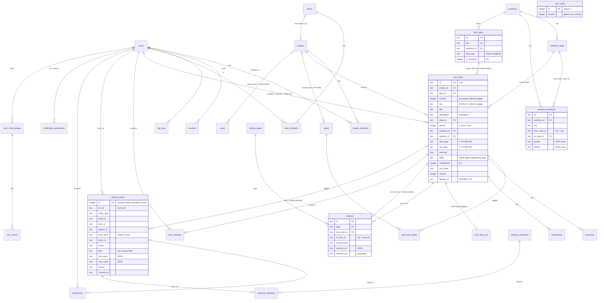
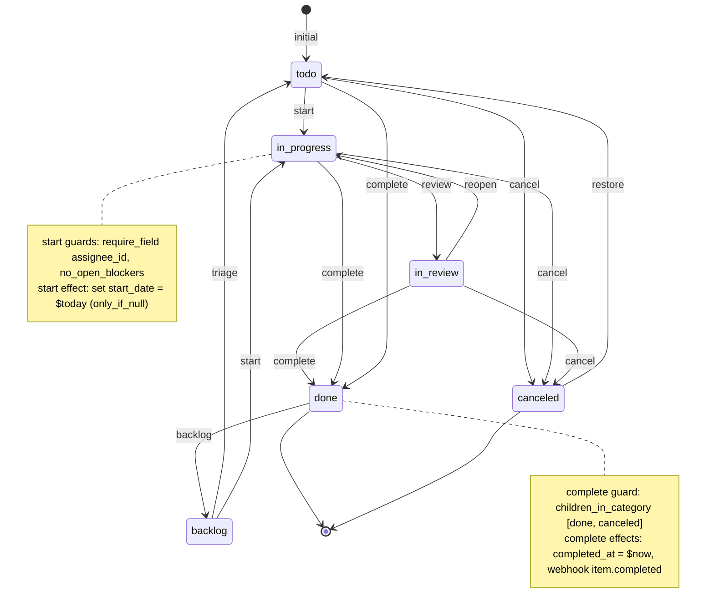

# 01 — The data model

> **Standalone document.** Everything here is defined by one file,
> `packages/db/migrations/0001_init.sql` (≈1,070 lines of plain SQL for SQLite
> 3.38+, 3.45+ recommended; no extensions, no native modules, no server
> process). You can apply it with `sqlite3 pmtool.db < 0001_init.sql`, use it
> from any language that ships a SQLite driver, and iterate on it without the
> rest of the monorepo. The TypeScript in `@pm/core` mirrors it; it never
> replaces it. The application opens the file with Node's built-in
> `node:sqlite` through the `@pm/db` runtime (`openDb`, the `sql` tag).

## 1. Design goals

The model was built for a regulated firm with desks and strategies that wants to
start generic and specialise later. Five non-negotiables drove every table:

| # | Requirement | How the schema answers it |
|---|---|---|
| 1 | One generic work item with a **type** and **typed columns + validated JSON**; no table per type | `work_items` + `item_types.field_defs` + the `work_items_validate_fields_*` triggers |
| 2 | **Workflow as an explicit, data-driven state machine** per type: states, transitions, guards, side effects | `workflows` → `workflow_states` → `workflow_transitions(guards, effects)` (JSON arrays) |
| 3 | A **typed relation edge table** (parent/child, blocks, duplicates, external links); dependencies and rollups are **graph queries** | `relations` + `relation_types` registry + the views `item_parents`, `item_ancestry`, `open_blockers`, `item_rollups` |
| 4 | **Append-only activity log, one event per field change** — history, audit, notifications, undo, analytics | `activity_events` with `activity_events_no_update` / `activity_events_no_delete` triggers, grouped by `txn_id` |
| 5 | An **early, explicit permissions decision** | Per-project roles + firm role + project visibility + confidential flag; views `effective_roles(user_id, project_id, role)` and `visible_items(user_id, item_id)` |

Two further pillars are baked in because the tool built on top needs them, but
they cost nothing if you only use the SQL:

* **Views are saved queries** (`views.spec` is a JSON query, not a screen).
* **Every synced table carries `version` and `deleted_at`** so a local-first
  client can converge (one global version counter in `sync_state`, stamped by
  triggers, plus tombstones).

Conventions, exactly as the header of the migration states them:

* ids are UUID strings (`text`); the column default generates a v4 UUID in SQL,
  and clients may supply their own (`crypto.randomUUID()`).
* timestamps are ISO-8601 UTC text (`2026-10-21T04:55:21.249Z`, produced by
  `strftime('%Y-%m-%dT%H:%M:%fZ','now')`); dates are `YYYY-MM-DD` text. Both
  sort and compare correctly as text.
* booleans are `integer` 0/1 with a `check (x in (0,1))`; enums are `text`
  with a `check (x in (...))`.
* JSON columns are `text` validated with `json_valid()` and `json_type()`.
* arrays (`scopes`, `event_kinds`, `allowed_type_ids`, `notification_ids`,
  `label_names`) are JSON arrays.
* `snake_case` everywhere; soft deletes via `deleted_at`; closed vocabularies
  that should never be user-editable (`firm_role`, `project_members.role`,
  `state_category`, …) are CHECK constraints, vocabularies that should be
  user-extensible are registries (rows: `item_types`, `relation_types`,
  `workflows`).

SQLite has no SQL functions, no stored procedures and no `TRUNCATE`. Where the
model needs behaviour in the database it uses triggers (numbering, validation,
cycle checks, append-only, version stamping) and views (graph helpers,
permissions). The application sets `PRAGMA journal_mode = WAL`,
`PRAGMA foreign_keys = ON` and `PRAGMA busy_timeout = 5000` on every
connection; the migration itself only needs `PRAGMA foreign_keys = ON`.

## 2. Entity overview



Table catalogue (section numbers refer to the comment headers in the SQL):

| § | Objects | Role |
|---|---|---|
| 0 | `sync_state` | The one-row global version counter for sync |
| 1 | `users`, `sessions`, `api_keys`, `teams`, `team_members` | Principals |
| 2 | `workflows`, `workflow_states`, `workflow_transitions` | State machines as data |
| 3 | `item_types` | Type registry with `field_defs` |
| 4 | `projects`, `project_members` | Permission backbone |
| 5 | `work_items`, `work_items_fts` (+ sync triggers), `assign_item_number`, `work_items_validate_fields_*`, `work_items_validate_state_*`, `labels`, `work_item_labels`, `comments`, `attachments` | The generic entity, its search index, its invariants and its satellites |
| 6 | `relation_types`, `relations`, `relations_no_cycle_*`, views `item_parents`, `item_ancestry`, `open_blockers`, `item_rollups` | Typed edges and graph helpers |
| 7 | `activity_events`, `activity_events_no_update`, `activity_events_no_delete` | Append-only log |
| 8 | `views` | Saved queries |
| 9 | `item_watchers`, `notification_preferences`, `notifications`, `notification_deliveries` | Low-noise notifications |
| 10 | `webhook_endpoints`, `webhook_deliveries`, `integration_configs`, `inbound_events` | Integrations |
| 11 | `sync_client_groups`, `sync_clients` | Replicache-style bookkeeping |
| 12 | views `effective_roles`, `visible_items` | Permissions |
| 13 | `settings` | Firm-level key/value |
| 14 | `<table>_version_ins` / `<table>_version_upd` triggers | Version + `updated_at` stamping for every synced table |
| 15 | seeded `standard` + `simple` workflows, `task`/`bug`/`initiative`/`request` types (fixed UUIDs) | Usable immediately |
| 16 | `work_items_v` | Display view with resolved joins |

The migration runner (`pnpm db:migrate`) additionally creates
`schema_migrations(name, applied_at)` and records each applied file. A database
whose schema was applied out of band with `sqlite3` is adopted: the runner sees
`work_items` and records `0001_init.sql` instead of re-running it.

## 3. The generic work item

### 3.1 `work_items`

```sql
create table work_items (
  id            text primary key default (lower(hex(randomblob(4))) || '-' || lower(hex(randomblob(2))) || '-4' || substr(lower(hex(randomblob(2))),2) || '-' || substr('89ab', abs(random()) % 4 + 1, 1) || substr(lower(hex(randomblob(2))),2) || '-' || lower(hex(randomblob(6)))),
  project_id    text not null references projects(id),
  type_id       text not null references item_types(id),
  number        integer,                                 -- per project; filled by trigger when omitted
  key           text,                                    -- "RATES-12" (denormalized for search/links)
  title         text not null check (length(title) between 1 and 500),
  description   text not null default '',               -- markdown
  state_id      text not null references workflow_states(id),
  priority      integer not null default 0 check (priority between 0 and 4), -- 0 none,1 urgent..4 low
  assignee_id   text references users(id),
  reporter_id   text references users(id),
  start_date    text,
  due_date      text,
  estimate      real,                                    -- points/hours; unit per project settings
  fields        text not null default '{}' check (json_valid(fields) and json_type(fields) = 'object'),
  confidential  integer not null default 0 check (confidential in (0,1)),  -- visible to project admins + assignee + reporter + creator only
  sort_order    real not null default 0,                 -- manual ordering within a board column
  version       integer not null default 0,
  created_by    text references users(id),
  created_at    text not null default (strftime('%Y-%m-%dT%H:%M:%fZ','now')),
  updated_at    text not null default (strftime('%Y-%m-%dT%H:%M:%fZ','now')),
  completed_at  text,
  canceled_at   text,
  archived_at   text,
  deleted_at    text,
  unique (project_id, number)
);
create unique index work_items_key_uq on work_items(key);
create index work_items_project_state_idx on work_items(project_id, state_id) where deleted_at is null;
create index work_items_assignee_idx on work_items(assignee_id) where deleted_at is null;
create index work_items_type_idx on work_items(type_id) where deleted_at is null;
create index work_items_due_idx on work_items(due_date) where deleted_at is null and due_date is not null;
create index work_items_version_idx on work_items(version);
```

The `id` default is the same expression on every table: a version-4 UUID built
from `randomblob()`. It only matters when a row is inserted without an id; the
application always supplies one so optimistic UI is stable.

The rule for what goes in a typed column versus `fields`: a column is for what
*every* type has and *every* view wants to sort/filter/group on cheaply
(title, state, priority, assignee, dates, estimate, confidential). Everything
type-specific goes in `fields`, read at query time with
`json_extract(w.fields, '$.notional')`. SQLite's JSON functions return typed
values (integers, reals, text), so no cast is needed for comparisons; an index
on a hot key is an ordinary expression index
(`create index … on work_items(json_extract(fields, '$.quarter'))`).

### 3.2 Per-project numbering: the `assign_item_number` trigger

```sql
-- Assign per-project number + key on insert (when omitted)
create trigger assign_item_number after insert on work_items
when new.number is null or new.number = 0 or new.key is null
begin
  update projects set item_seq = item_seq + 1 where id = new.project_id and (new.number is null or new.number = 0);
  update work_items
     set number = case when new.number is null or new.number = 0 then (select item_seq from projects where id = new.project_id) else new.number end,
         key    = (select key from projects where id = new.project_id) || '-' ||
                  case when new.number is null or new.number = 0 then (select item_seq from projects where id = new.project_id) else new.number end
   where rowid = new.rowid;
end;
```

SQLite triggers cannot rewrite `NEW` before the row exists, so the key is
assigned by an **AFTER INSERT** trigger that updates the row just written.
Two consequences:

* `number` and `key` are nullable at the column level (the trigger fills them
  a few microseconds later, inside the same statement). `unique (project_id,
  number)` and the unique index on `key` still hold for every committed row.
* `insert … returning number, key` shows the **pre-trigger** row: both columns
  come back `NULL` (and `version` comes back `0`, see §8). Read the row back
  after the insert, in the same transaction, to get `RATES-12`. The `@pm/db`
  runtime does exactly that in `createItem`.

Clients never choose keys; they choose UUIDs.

### 3.3 The type registry: `item_types.field_defs`

```sql
create table item_types (
  id            text primary key default (lower(hex(randomblob(4))) || '-' || lower(hex(randomblob(2))) || '-4' || substr(lower(hex(randomblob(2))),2) || '-' || substr('89ab', abs(random()) % 4 + 1, 1) || substr(lower(hex(randomblob(2))),2) || '-' || lower(hex(randomblob(6)))),
  key           text not null unique,          -- "task", "bug", "initiative", "trade_idea"
  name          text not null,
  plural_name   text,
  icon          text,
  color         text,
  description   text,
  workflow_id   text not null references workflows(id),
  field_defs    text not null default '[]' check (json_valid(field_defs) and json_type(field_defs) = 'array'),
  is_container  integer not null default 0 check (is_container in (0,1)),  -- can have children (epic/initiative)
  sort          integer not null default 0,
  is_active     integer not null default 1 check (is_active in (0,1)),
  version       integer not null default 0,
  created_at    text not null default (strftime('%Y-%m-%dT%H:%M:%fZ','now')),
  updated_at    text not null default (strftime('%Y-%m-%dT%H:%M:%fZ','now')),
  deleted_at    text
);
```

Each element of `field_defs` is a `FieldDef`. The canonical shape (zod, from
`@pm/core`):

```ts
export const FieldKind = z.enum(['text', 'long_text', 'number', 'bool', 'date', 'datetime', 'select', 'multi_select', 'user', 'url']);

export const FieldDef = z.object({
  key: z.string().regex(/^[a-z][a-z0-9_]*$/),
  label: z.string(),
  kind: FieldKind,
  required: z.boolean().optional(),
  multi: z.boolean().optional(),
  options: z.array(z.object({ value: z.string(), label: z.string(), color: z.string().optional() })).optional(),
  description: z.string().optional(),
  default: z.unknown().optional(),
  min: z.number().optional(),
  max: z.number().optional(),
  show_in_list: z.boolean().optional(),
});
```

The seeded `bug` type, as stored (id `00000000-0000-4000-8000-000000000d02`):

```json
[
  {"key":"severity","label":"Severity","kind":"select","required":true,
   "options":[{"value":"s1","label":"S1 – Critical"},{"value":"s2","label":"S2 – High"},
              {"value":"s3","label":"S3 – Medium"},{"value":"s4","label":"S4 – Low"}]},
  {"key":"environment","label":"Environment","kind":"select",
   "options":[{"value":"prod","label":"Production"},{"value":"uat","label":"UAT"},{"value":"dev","label":"Dev"}]},
  {"key":"steps","label":"Steps to reproduce","kind":"long_text"}
]
```

Storage encoding of each kind inside `work_items.fields` (what `json_type()`
reports is in the third column; the trigger below checks it):

| kind | JSON type | `json_type()` | notes |
|---|---|---|---|
| `text`, `long_text` | string | `text` | `long_text` is markdown |
| `number` | number | `integer` or `real` | `min`/`max` enforced in `@pm/core` |
| `bool` | boolean | `true` or `false` | JSON `true`/`false`, not 0/1 (0/1 is for *columns*) |
| `date` | string `YYYY-MM-DD` | `text` | |
| `datetime` | string ISO-8601 | `text` | |
| `select` | string (an `options[].value`) | `text` | option membership checked in `@pm/core` |
| `multi_select` | array of strings | `array` | always an array |
| `user` | string (users.id) | `text` | existence checked in `@pm/core` |
| `url` | string | `text` | |
| any kind with `multi: true` | array of the above | `array` | |

### 3.4 Validation in the database

The trigger keeps `fields` honest regardless of which client wrote the row.
It rejects unknown keys, missing required keys and wrong JSON types; deep
checks (option membership, user existence, `min`/`max`) run in `@pm/core`
`validateFields()` before the write so the user gets a friendly error. Each
rule is one `select raise(abort, …) … where <violation>` statement; SQLite
runs them in order and the first row produced aborts the statement with that
message. The INSERT trigger is shown; `work_items_validate_fields_upd` is the
same body declared `before update of fields, type_id on work_items`.

```sql
create trigger work_items_validate_fields_ins before insert on work_items begin
  select raise(abort, 'unknown item type') where not exists (select 1 from item_types where id = new.type_id);
  select raise(abort, 'field "' || k.key || '" is not defined for this item type')
    from json_each(new.fields) k
   where not exists (select 1 from json_each((select field_defs from item_types where id = new.type_id)) d where json_extract(d.value, '$.key') = k.key);
  select raise(abort, 'field "' || json_extract(d.value, '$.key') || '" is required')
    from json_each((select field_defs from item_types where id = new.type_id)) d
   where json_extract(d.value, '$.required') = 1 and json_extract(new.fields, '$.' || json_extract(d.value, '$.key')) is null;
  select raise(abort, 'field "' || json_extract(d.value, '$.key') || '" must be an array')
    from json_each((select field_defs from item_types where id = new.type_id)) d
   where (json_extract(d.value, '$.multi') = 1 or json_extract(d.value, '$.kind') = 'multi_select')
     and json_type(new.fields, '$.' || json_extract(d.value, '$.key')) not in ('array', 'null')
     and json_type(new.fields, '$.' || json_extract(d.value, '$.key')) is not null;
  select raise(abort, 'field "' || json_extract(d.value, '$.key') || '" must be a string')
    from json_each((select field_defs from item_types where id = new.type_id)) d
   where json_extract(d.value, '$.multi') is not 1 and json_extract(d.value, '$.kind') in ('text','long_text','select','user','url','date','datetime')
     and json_type(new.fields, '$.' || json_extract(d.value, '$.key')) not in ('text', 'null')
     and json_type(new.fields, '$.' || json_extract(d.value, '$.key')) is not null;
  select raise(abort, 'field "' || json_extract(d.value, '$.key') || '" must be a number')
    from json_each((select field_defs from item_types where id = new.type_id)) d
   where json_extract(d.value, '$.multi') is not 1 and json_extract(d.value, '$.kind') = 'number'
     and json_type(new.fields, '$.' || json_extract(d.value, '$.key')) not in ('integer', 'real', 'null')
     and json_type(new.fields, '$.' || json_extract(d.value, '$.key')) is not null;
  select raise(abort, 'field "' || json_extract(d.value, '$.key') || '" must be a boolean')
    from json_each((select field_defs from item_types where id = new.type_id)) d
   where json_extract(d.value, '$.multi') is not 1 and json_extract(d.value, '$.kind') = 'bool'
     and json_type(new.fields, '$.' || json_extract(d.value, '$.key')) not in ('true', 'false', 'null')
     and json_type(new.fields, '$.' || json_extract(d.value, '$.key')) is not null;
end;
```

A second pair of triggers refuses any `state_id` that does not belong to the
workflow of the item's type, so changing `type_id` on an item requires a valid
state in the new workflow in the same statement:

```sql
create trigger work_items_validate_state_ins before insert on work_items begin
  select raise(abort, 'state does not belong to the workflow of this item type')
   where not exists (select 1 from workflow_states s join item_types t on t.workflow_id = s.workflow_id where s.id = new.state_id and t.id = new.type_id);
end;
```

`raise(abort, …)` surfaces as `SQLITE_CONSTRAINT_TRIGGER` (extended code
1811) with the message text. The `@pm/db` runtime classifies it with
`sqliteErrorKind(e) === 'trigger'`, which the API maps to a 400 `validation`
error carrying the message; `'unique'` (2067) maps to 409 `conflict`,
`'check'` (275) and `'not_null'` (1299) to 400 `validation`, `'busy'` (5/6)
to a retry. No message parsing is needed to pick the status code.

## 4. Workflows as data

### 4.1 Tables

```sql
create table workflows (
  id            text primary key default (…uuid expression…),
  key           text not null unique,
  name          text not null,
  description   text,
  version       integer not null default 0,
  created_at    text not null default (strftime('%Y-%m-%dT%H:%M:%fZ','now')),
  updated_at    text not null default (strftime('%Y-%m-%dT%H:%M:%fZ','now')),
  deleted_at    text
);

create table workflow_states (
  id            text primary key default (…uuid expression…),
  workflow_id   text not null references workflows(id) on delete cascade,
  key           text not null,
  name          text not null,
  category      text not null check (category in ('backlog','todo','in_progress','done','canceled')),
  color         text,
  sort          integer not null default 0,
  is_initial    integer not null default 0 check (is_initial in (0,1)),
  version       integer not null default 0,
  created_at    text not null default (strftime('%Y-%m-%dT%H:%M:%fZ','now')),
  updated_at    text not null default (strftime('%Y-%m-%dT%H:%M:%fZ','now')),
  deleted_at    text,
  unique (workflow_id, key)
);
create unique index workflow_states_one_initial on workflow_states(workflow_id) where is_initial = 1 and deleted_at is null;

create table workflow_transitions (
  id            text primary key default (…uuid expression…),
  workflow_id   text not null references workflows(id) on delete cascade,
  key           text not null,
  name          text not null,
  from_state_id text references workflow_states(id) on delete cascade,
  to_state_id   text not null references workflow_states(id) on delete cascade,
  guards        text not null default '[]' check (json_valid(guards) and json_type(guards) = 'array'),
  effects       text not null default '[]' check (json_valid(effects) and json_type(effects) = 'array'),
  sort          integer not null default 0,
  version       integer not null default 0,
  created_at    text not null default (strftime('%Y-%m-%dT%H:%M:%fZ','now')),
  updated_at    text not null default (strftime('%Y-%m-%dT%H:%M:%fZ','now')),
  deleted_at    text,
  unique (workflow_id, key)
);
create index workflow_transitions_from_idx on workflow_transitions(workflow_id, from_state_id);
```

`category` is what makes workflows composable: a board, a rollup, a "not done"
filter or a `children_in_category` guard reasons about categories, so a desk
can rename or add states without breaking anything generic. A transition with
`from_state_id = NULL` is allowed from any state.

### 4.2 The guard and effect vocabulary

Guards and effects are JSON arrays validated by the zod discriminated unions in
`@pm/core` and evaluated by the pure `workflowEngine` (same code on client and
server). The database stores them and checks that they are JSON arrays; it
does not interpret them.

```ts
export const Guard = z.discriminatedUnion('type', [
  z.object({ type: z.literal('require_field'), field: z.string() }),           // field must be non-null/non-empty
  z.object({ type: z.literal('field_equals'), field: z.string(), value: z.unknown() }),
  z.object({ type: z.literal('field_in'), field: z.string(), values: z.array(z.unknown()) }),
  z.object({ type: z.literal('no_open_blockers') }),
  z.object({ type: z.literal('children_in_category'), categories: z.array(StateCategory) }), // all children in one of these
  z.object({ type: z.literal('require_role'), roles: z.array(ProjectRole) }),
  z.object({ type: z.literal('require_assignee_is_actor') }),
  z.object({ type: z.literal('require_label'), label: z.string() }),
]);

export const Effect = z.discriminatedUnion('type', [
  // value may be a literal or a macro: "$now" | "$today" | "$actor" | null
  z.object({ type: z.literal('set_field'), field: z.string(), value: z.unknown(), only_if_null: z.boolean().optional() }),
  z.object({ type: z.literal('notify'), audience: z.array(z.enum(['watchers', 'assignee', 'reporter', 'project_admins'])), template: z.string() }),
  z.object({ type: z.literal('webhook'), event: z.string() }),
  z.object({ type: z.literal('add_label'), label: z.string() }),
  z.object({ type: z.literal('remove_label'), label: z.string() }),
  z.object({ type: z.literal('transition_parent_if'), all_children_category: z.array(StateCategory), to: z.string() }), // to = state key
  z.object({ type: z.literal('transition_children'), to: z.string() }),
]);
```

| Guard | Passes when | Typical use |
|---|---|---|
| `require_field` | the column or `fields.<key>` is non-null / non-empty | "needs an assignee before Start" |
| `field_equals` / `field_in` | value matches | "`fields.risk_signoff` must be `true`" |
| `no_open_blockers` | `select 1 from open_blockers where item_id = ?` is empty | dependency gating |
| `children_in_category` | every direct child's state category ∈ `categories` | "can't complete an initiative with open children" |
| `require_role` | actor's effective project role ∈ `roles` | "only admins cancel" |
| `require_assignee_is_actor` | `assignee_id = actor` | "only the owner marks it done" |
| `require_label` | item has the label | "needs `approved` label" |

| Effect | Does | Executed by |
|---|---|---|
| `set_field` | patches a column or `fields.<key>`; macros `$now`, `$today`, `$actor`; `only_if_null` | engine (in the same patch as `state_id`) |
| `notify` | notification to `watchers`/`assignee`/`reporter`/`project_admins` with a template | server after commit of the patch |
| `webhook` | enqueue an outbound webhook with the named event kind | server |
| `add_label` / `remove_label` | by label name | server |
| `transition_parent_if` | if all siblings' categories ∈ list, run transition to state key `to` on the parent | server (recursive) |
| `transition_children` | run transition to state key `to` on every child | server (recursive) |

Attribute-based access rules deliberately live here (who may move what, under
which field values) rather than in an ACL system — see §7.

### 4.3 The seeded `standard` workflow

The migration seeds two workflows and four item types with **fixed UUIDs** so
the schema is usable the moment it is applied and so tests and documentation can
name rows: workflows `…a01` (`standard`) and `…a02` (`simple`); states
`…b01`–`…b06` (standard) and `…b11`–`…b14` (simple); transitions `…c01`–`…c08`
and `…c11`–`…c14`; types `…d01` `task`, `…d02` `bug`, `…d03` `initiative`,
`…d04` `request`. The full id is `00000000-0000-4000-8000-000000000a01` and so
on.



Transitions whose `from_state_id` is NULL (`start`, `complete`, `cancel`,
`backlog`) are allowed from any state; the diagram draws the edges that make
sense in practice. Exactly as inserted by the migration:

| id | key | from | to | guards | effects |
|---|---|---|---|---|---|
| `…c01` | `triage` | backlog `…b01` | todo `…b02` | — | — |
| `…c02` | `start` | *(any)* | in_progress `…b03` | `require_field assignee_id`, `no_open_blockers` | `set_field start_date = $today only_if_null` |
| `…c03` | `review` | in_progress | in_review `…b04` | — | `notify watchers, template review_requested` |
| `…c04` | `reopen` | in_review | in_progress | — | — |
| `…c05` | `complete` | *(any)* | done `…b05` | `children_in_category [done, canceled]` | `set_field completed_at = $now`, `webhook item.completed` |
| `…c06` | `cancel` | *(any)* | canceled `…b06` | `require_role [admin, editor]` | `set_field canceled_at = $now` |
| `…c07` | `restore` | canceled | todo | — | `set_field canceled_at = null` |
| `…c08` | `backlog` | *(any)* | backlog | — | `set_field completed_at = null` |

States: `backlog` (backlog), `todo` (todo, **initial**), `in_progress`
(in_progress), `in_review` (in_progress), `done` (done), `canceled` (canceled).

A second workflow `simple` (`…a02`: Todo `…b11` → Doing `…b12` → Done `…b13` +
Canceled `…b14`, all transitions from any state) backs lightweight types such
as `request`.

### 4.4 Adding a desk-specific workflow with INSERTs only

A trade-idea approval flow for a rates desk. No migration, no code; the UI's
transition buttons and the API's guard evaluation follow the rows. This runs
unchanged in the `sqlite3` shell (booleans are `1`/`0`, JSON is a string
literal).

```sql
begin;
insert into workflows (id, key, name, description) values
  ('11111111-0000-4000-8000-000000000001', 'trade_idea_review', 'Trade idea review',
   'Draft → Desk review → Risk review → Approved → Live | Rejected');

insert into workflow_states (id, workflow_id, key, name, category, color, sort, is_initial) values
  ('11111111-0000-4000-8000-000000000011', '11111111-0000-4000-8000-000000000001', 'draft',       'Draft',       'todo',        '#9ca3af', 0, 1),
  ('11111111-0000-4000-8000-000000000012', '11111111-0000-4000-8000-000000000001', 'desk_review', 'Desk review', 'in_progress', '#60a5fa', 1, 0),
  ('11111111-0000-4000-8000-000000000013', '11111111-0000-4000-8000-000000000001', 'risk_review', 'Risk review', 'in_progress', '#f59e0b', 2, 0),
  ('11111111-0000-4000-8000-000000000014', '11111111-0000-4000-8000-000000000001', 'approved',    'Approved',    'in_progress', '#a78bfa', 3, 0),
  ('11111111-0000-4000-8000-000000000015', '11111111-0000-4000-8000-000000000001', 'live',        'Live',        'done',        '#10b981', 4, 0),
  ('11111111-0000-4000-8000-000000000016', '11111111-0000-4000-8000-000000000001', 'rejected',    'Rejected',    'canceled',    '#6b7280', 5, 0);

insert into workflow_transitions (workflow_id, key, name, from_state_id, to_state_id, guards, effects, sort) values
  ('11111111-0000-4000-8000-000000000001', 'submit', 'Submit for desk review',
   '11111111-0000-4000-8000-000000000011', '11111111-0000-4000-8000-000000000012',
   '[{"type":"require_field","field":"fields.strategy"},{"type":"require_field","field":"fields.notional"},{"type":"require_assignee_is_actor"}]',
   '[{"type":"notify","audience":["project_admins"],"template":"review_requested"}]', 0),
  ('11111111-0000-4000-8000-000000000001', 'desk_approve', 'Desk head approves',
   '11111111-0000-4000-8000-000000000012', '11111111-0000-4000-8000-000000000013',
   '[{"type":"require_role","roles":["admin"]}]',
   '[{"type":"set_field","field":"fields.desk_approved_by","value":"$actor"},{"type":"add_label","label":"desk-approved"}]', 1),
  ('11111111-0000-4000-8000-000000000001', 'risk_approve', 'Risk approves',
   '11111111-0000-4000-8000-000000000013', '11111111-0000-4000-8000-000000000014',
   '[{"type":"require_role","roles":["admin"]},{"type":"field_equals","field":"fields.risk_signoff","value":true},{"type":"no_open_blockers"}]',
   '[{"type":"set_field","field":"fields.approved_at","value":"$now"},{"type":"webhook","event":"item.transitioned"}]', 2),
  ('11111111-0000-4000-8000-000000000001', 'go_live', 'Go live',
   '11111111-0000-4000-8000-000000000014', '11111111-0000-4000-8000-000000000015',
   '[{"type":"require_label","label":"desk-approved"}]',
   '[{"type":"set_field","field":"completed_at","value":"$now"},{"type":"webhook","event":"item.completed"},{"type":"notify","audience":["watchers"],"template":"state_changed"}]', 3),
  ('11111111-0000-4000-8000-000000000001', 'reject', 'Reject',
   null, '11111111-0000-4000-8000-000000000016',
   '[{"type":"require_role","roles":["admin","editor"]}]',
   '[{"type":"set_field","field":"canceled_at","value":"$now"}]', 4),
  ('11111111-0000-4000-8000-000000000001', 'redraft', 'Back to draft',
   '11111111-0000-4000-8000-000000000016', '11111111-0000-4000-8000-000000000011',
   '[]', '[{"type":"set_field","field":"canceled_at","value":null},{"type":"remove_label","label":"desk-approved"}]', 5);

insert into item_types (key, name, plural_name, icon, color, workflow_id, is_container, sort, field_defs) values
  ('trade_idea', 'Trade idea', 'Trade ideas', 'trending-up', '#10b981', '11111111-0000-4000-8000-000000000001', 0, 10,
   '[{"key":"strategy","label":"Strategy","kind":"select","required":true,
      "options":[{"value":"curve","label":"Curve"},{"value":"basis","label":"Basis"},{"value":"vol","label":"Vol"}]},
     {"key":"notional","label":"Notional (USD mm)","kind":"number","min":0},
     {"key":"horizon","label":"Horizon","kind":"select","options":[{"value":"1w","label":"1 week"},{"value":"1m","label":"1 month"},{"value":"3m","label":"3 months"}]},
     {"key":"risk_signoff","label":"Risk sign-off","kind":"bool"},
     {"key":"desk_approved_by","label":"Desk approved by","kind":"user"},
     {"key":"approved_at","label":"Approved at","kind":"datetime"},
     {"key":"thesis","label":"Thesis","kind":"long_text"}]');
commit;
```

Four-eyes is expressed as two transitions with `require_role admin` on
different states; "the submitter cannot approve" can be added as a guard
(`field_equals fields.desk_approved_by != $actor` is not in the vocabulary —
adding a guard type is a `@pm/core` change plus nothing in the database).

## 5. Relations: one typed edge table

### 5.1 Registry and edges

```sql
create table relation_types (
  key           text primary key,
  name          text not null,          -- forward label  ("blocks")
  inverse_name  text not null,          -- inverse label  ("is blocked by")
  is_hierarchy  integer not null default 0 check (is_hierarchy in (0,1)),
  is_blocking   integer not null default 0 check (is_blocking in (0,1)),
  is_symmetric  integer not null default 0 check (is_symmetric in (0,1)),
  sort          integer not null default 0
);
insert into relation_types (key, name, inverse_name, is_hierarchy, is_blocking, is_symmetric, sort) values
  ('parent_of',  'parent of',  'child of',         1, 0, 0, 0),
  ('blocks',     'blocks',     'is blocked by',    0, 1, 0, 1),
  ('duplicates', 'duplicates', 'is duplicated by', 0, 0, 1, 2),
  ('relates_to', 'relates to', 'relates to',       0, 0, 1, 3),
  ('links_to',   'links to',   'linked from',      0, 0, 0, 4); -- external entities

create table relations (
  id            text primary key default (…uuid expression…),
  type          text not null references relation_types(key),
  from_item_id  text not null references work_items(id) on delete cascade,
  to_item_id    text references work_items(id) on delete cascade,
  external_kind text,                                   -- github_pr | github_issue | slack_thread | email | url | doc | ...
  external_ref  text check (external_ref is null or json_valid(external_ref)),  -- {"url":..., "repo":..., "number":..., "title":...}
  external_key  text generated always as (
                  case when external_kind is not null
                       then external_kind || ':' || coalesce(json_extract(external_ref, '$.id'), json_extract(external_ref, '$.url'), '')
                  end) stored,
  meta          text not null default '{}' check (json_valid(meta) and json_type(meta) = 'object'),
  created_by    text references users(id),
  version       integer not null default 0,
  created_at    text not null default (strftime('%Y-%m-%dT%H:%M:%fZ','now')),
  updated_at    text not null default (strftime('%Y-%m-%dT%H:%M:%fZ','now')),
  deleted_at    text,
  check ((to_item_id is not null and external_kind is null and external_ref is null)
      or (to_item_id is null and external_kind is not null and external_ref is not null)),
  check (to_item_id is null or to_item_id <> from_item_id)
);
create unique index relations_item_edge_uq on relations(type, from_item_id, to_item_id) where to_item_id is not null and deleted_at is null;
create unique index relations_external_edge_uq on relations(type, from_item_id, external_key) where external_key is not null and deleted_at is null;
create index relations_from_idx on relations(from_item_id) where deleted_at is null;
create index relations_to_idx on relations(to_item_id) where deleted_at is null;
create index relations_external_idx on relations(external_kind, json_extract(external_ref, '$.url')) where deleted_at is null;
-- single parent in the hierarchy
create unique index relations_single_parent_uq on relations(to_item_id) where type = 'parent_of' and deleted_at is null;
```

Direction is always `from → to` in the forward sense of the type: `A parent_of
B`, `A blocks B`, `A links_to <external>`. The `is_symmetric` flag tells the UI
to render one edge from both ends; it is stored once, and the trigger below
refuses the reverse duplicate.

**External entities** (a GitHub PR, a Slack thread, an email, a document in
another system) are rows with `to_item_id = null` and `external_kind` +
`external_ref`. The generated `external_key` (`github_pr:<url>`) gives a unique
index so re-linking is idempotent. "Everything connected to RATES-12" is one
query on one table.

### 5.2 Acyclicity, single parent and symmetric dedupe

The single-parent rule is a partial unique index (above). Cycles in `parent_of`
and `blocks` are refused by a trigger that walks the existing graph of the same
type with a recursive CTE before accepting an edge; the same trigger rejects the
reverse of an existing symmetric edge. The INSERT trigger is shown;
`relations_no_cycle_upd` is the same body for `before update of from_item_id,
to_item_id, type, deleted_at` with `r.id <> new.id` added so an edge does not
collide with itself.

```sql
-- Reject reverse duplicates of symmetric edges; prevent cycles in hierarchy and blocking graphs.
create trigger relations_no_cycle_ins before insert on relations
when new.to_item_id is not null and new.deleted_at is null
begin
  select raise(abort, 'symmetric relation already exists in the other direction')
   where (select is_symmetric from relation_types where key = new.type) = 1
     and exists (select 1 from relations r where r.type = new.type and r.from_item_id = new.to_item_id and r.to_item_id = new.from_item_id and r.deleted_at is null);
  select raise(abort, 'relation would create a cycle')
   where (select is_hierarchy = 1 or is_blocking = 1 from relation_types where key = new.type)
     and exists (
       with recursive walk(item_id, depth) as (
         select new.to_item_id, 0
         union all
         select r.to_item_id, w.depth + 1 from relations r join walk w on r.from_item_id = w.item_id
          where r.type = new.type and r.deleted_at is null and w.depth < 1000
       )
       select 1 from walk where item_id = new.from_item_id);
end;
```

Because the check is keyed off `relation_types.is_hierarchy/is_blocking`, a new
edge kind registered with one of those flags gets cycle protection for free.

### 5.3 Graph views

SQLite has no SQL functions, so the graph helpers are **views** you join and
filter rather than functions you call. Each is one recursive or plain SELECT;
the planner pushes `where root_id = ?` style predicates into them.

```sql
-- Graph helpers (views; SQLite has no SQL functions) -------------------------
-- Direct parent of each item
create view item_parents as
  select r.to_item_id as item_id, r.from_item_id as parent_id
    from relations r where r.type = 'parent_of' and r.deleted_at is null;

-- Every (ancestor, descendant) pair with depth, through parent_of
create view item_ancestry as
  with recursive a(ancestor_id, item_id, depth) as (
    select r.from_item_id, r.to_item_id, 1 from relations r where r.type = 'parent_of' and r.deleted_at is null
    union all
    select a.ancestor_id, r.to_item_id, a.depth + 1
      from relations r join a on r.from_item_id = a.item_id
     where r.type = 'parent_of' and r.deleted_at is null and a.depth < 100
  )
  select ancestor_id, item_id, depth from a;

-- Open blockers: (blocked item, blocker) where the blocker is not done/canceled
create view open_blockers as
  select r.to_item_id as item_id, r.from_item_id as blocker_id
    from relations r
    join work_items b on b.id = r.from_item_id and b.deleted_at is null
    join workflow_states s on s.id = b.state_id
   where r.type = 'blocks' and r.deleted_at is null and s.category not in ('done', 'canceled');

-- Rollup over each subtree: counts by category + estimate sums
--   select * from item_rollups where root_id = ?
create view item_rollups as
  select a.ancestor_id as root_id,
         count(*) as total,
         sum(case when s.category = 'done' then 1 else 0 end) as done,
         sum(case when s.category = 'in_progress' then 1 else 0 end) as in_progress,
         sum(case when s.category in ('todo','backlog') then 1 else 0 end) as todo,
         sum(case when s.category = 'canceled' then 1 else 0 end) as canceled,
         coalesce(sum(w.estimate), 0) as estimate_total,
         coalesce(sum(case when s.category = 'done' then w.estimate end), 0) as estimate_done
    from item_ancestry a
    join work_items w on w.id = a.item_id and w.deleted_at is null
    join workflow_states s on s.id = w.state_id
   group by a.ancestor_id;
```

| View | Columns | Replaces |
|---|---|---|
| `item_parents` | `item_id, parent_id` | the parent lookup in `work_items_v` |
| `item_ancestry` | `ancestor_id, item_id, depth` | `item_descendants(root)` (filter on `ancestor_id`) and `item_ancestors(leaf)` (filter on `item_id`) |
| `open_blockers` | `item_id, blocker_id` | `item_open_blockers(item)` |
| `item_rollups` | `root_id, total, done, in_progress, todo, canceled, estimate_total, estimate_done` | `item_rollup(root)` |

A root with no children has no row in `item_rollups` (use `left join` and
`coalesce` when listing initiatives).

**Everything blocking an initiative, transitively** (its own blockers, the
blockers of its children, and the blockers of those blockers):

```sql
with recursive
scope(item_id) as (
  select id from work_items where key = 'RATES-7'
  union
  select a.item_id from item_ancestry a join work_items r on r.id = a.ancestor_id where r.key = 'RATES-7'
),
blockers(item_id, depth, blocked_item_id) as (
  select ob.blocker_id, 1, ob.item_id
    from open_blockers ob join scope s on s.item_id = ob.item_id
  union all
  select ob.blocker_id, b.depth + 1, b.item_id
    from blockers b join open_blockers ob on ob.item_id = b.item_id
   where b.depth < 50
)
select w.key, w.title, st.name as state, min(b.depth) as depth, group_concat(distinct bk.key) as blocks
  from blockers b
  join work_items w on w.id = b.item_id
  join workflow_states st on st.id = w.state_id
  join work_items bk on bk.id = b.blocked_item_id
 group by w.key, w.title, st.name
 order by depth, w.key;
```

**Roll up estimate by target quarter** (initiatives carry `fields.quarter`;
their subtrees carry the estimates):

```sql
select json_extract(i.fields, '$.quarter')  as quarter,
       count(*)                              as initiatives,
       coalesce(sum(r.total), 0)             as items,
       coalesce(sum(r.estimate_total), 0)    as estimate_total,
       coalesce(sum(r.estimate_done), 0)     as estimate_done,
       round(100.0 * sum(r.estimate_done) / nullif(sum(r.estimate_total), 0), 1) as pct_done
  from work_items i
  join item_types t on t.id = i.type_id and t.key = 'initiative'
  left join item_rollups r on r.root_id = i.id
 where i.deleted_at is null
 group by 1
 order by 1;
```

**Breadcrumb for an item:**

```sql
select a.depth, w.key, w.title
  from item_ancestry a
  join work_items w on w.id = a.ancestor_id
 where a.item_id = (select id from work_items where key = 'RATES-42')
 order by a.depth desc;
```

**Is this item blocked, and by what?**

```sql
select b.key, b.title, s.name as state
  from open_blockers ob
  join work_items b on b.id = ob.blocker_id
  join workflow_states s on s.id = b.state_id
 where ob.item_id = (select id from work_items where key = 'RATES-103');
```

## 6. The append-only activity log

### 6.1 Schema

```sql
create table activity_events (
  id            integer primary key autoincrement,  -- monotonic cursor
  txn_id        text not null,                     -- groups events from one mutation (undo unit)
  entity_type   text not null,                     -- work_item | comment | relation | project | view | label | ...
  entity_id     text not null,
  item_id       text,                              -- denormalized: the work item this touches (for timelines)
  project_id    text,                              -- denormalized: for scoping/permissions
  actor_kind    text not null default 'user' check (actor_kind in ('user','api_key','integration','system','agent')),
  actor_id      text,                              -- users.id (also for api_key/agent: the owning user)
  actor_label   text,                              -- "github", "slack", api key name, agent name
  action        text not null,                     -- create | update | delete | restore | transition | relation_add | relation_remove | comment | ...
  field         text,                              -- "title", "state_id", "fields.severity", null for create/delete
  old_value     text check (old_value is null or json_valid(old_value)),   -- JSON
  new_value     text check (new_value is null or json_valid(new_value)),   -- JSON
  mutation_name text,                              -- client mutator / API op that produced it
  source        text not null default 'app',       -- app | api | mcp | slack | email | github | system
  created_at    text not null default (strftime('%Y-%m-%dT%H:%M:%fZ','now'))
);
create index activity_item_idx on activity_events(item_id, id) where item_id is not null;
create index activity_project_idx on activity_events(project_id, id);
create index activity_entity_idx on activity_events(entity_type, entity_id, id);
create index activity_actor_idx on activity_events(actor_id, id);
create index activity_txn_idx on activity_events(txn_id);
create index activity_created_idx on activity_events(created_at);

-- Physically block mutation of history.
create trigger activity_events_no_update before update on activity_events begin
  select raise(abort, 'activity_events is append-only (UPDATE denied)');
end;
create trigger activity_events_no_delete before delete on activity_events begin
  select raise(abort, 'activity_events is append-only (DELETE denied)');
end;
```

`integer primary key autoincrement` guarantees ids are never reused even after
a rollback, so `id` is a safe monotonic cursor. SQLite has no `TRUNCATE`; a
bare `delete from activity_events` is still a DELETE and fires the trigger for
the first row it meets, so the statement fails as a whole. (`drop table` is DDL
and is not covered by triggers; see §6.3.)

**One row per field.** An edit that changes title, priority and
`fields.severity` produces three rows with the same `txn_id`; a transition
produces a row for `state_id` plus one per `set_field` effect; a bulk edit of
200 items produces 200 × *n* rows under one `txn_id`. Writers are the
application's `applyMutation()` (every REST route, sync push, MCP tool and
integration passes through it) and nothing else; there is no trigger-based
auditing because triggers cannot know the actor, source or mutation name.

Tracked columns (from `@pm/core` `TRACKED_ITEM_FIELDS`): `title`,
`description`, `type_id`, `state_id`, `priority`, `assignee_id`, `reporter_id`,
`start_date`, `due_date`, `estimate`, `confidential`, `archived_at`,
`project_id`, `sort_order`, plus every key of `fields` as `fields.<key>`.

### 6.2 What derives from the log

| Consumer | How |
|---|---|
| **History / item timeline** | `select * from activity_events where item_id = ? order by id` |
| **Audit** | who (`actor_id`, `actor_kind`, `actor_label`), via what (`source`, `mutation_name`), what (`field`, `old_value`, `new_value`), when (`created_at`), grouped (`txn_id`) |
| **Notifications** | computed from the diff of each transaction; `notifications.event_id` points at the triggering row |
| **Webhooks** | `webhook_deliveries.event_id` references the row; changes in one `txn_id` for one item are coalesced into one delivery with `changes:[{field, old, new}]` |
| **Undo** | select the rows of a `txn_id`, apply `old_value` back to each `field` in reverse `id` order as a *new* mutation (new events; nothing is ever erased) |
| **Feeds / cursors** | `id` is monotonic: `where id > :since` is a stable cursor for project feeds and for the webhook dispatcher |
| **Analytics** | cycle time = time between `state_id` events whose `new_value` enters/leaves `in_progress`; throughput = `action='transition'` into `done` per week; who changes what how often |

### 6.3 Regulated-shop notes

* **Who/what/when is structural.** Every row names an actor (a user, the user
  behind an API key or agent, or a labelled integration/system actor), the
  channel it came through and the exact before/after value. Nothing is
  summarised into prose that would need re-interpretation later.
* **Immutability is enforced in the database**, not by convention: UPDATE and
  DELETE raise even for the application. SQLite has no roles, so the remaining
  gap is DDL (`drop table`, `alter table`) and the file itself: whoever can
  write the file can alter history. Close that gap at the operating-system
  level (the API's service account is the only writer; backups are immutable
  copies; see [05-operations.md §2.6](05-operations.md#26-the-activity-log-as-the-audit-source)).
  Role separation inside the database is one of the reasons to move to
  Postgres later ([ADR-009](adr/ADR-009-sqlite-over-postgres.md)).
* **Soft deletes everywhere else** (`deleted_at`) mean a deleted item still
  exists for the audit trail; the log records the delete (`action='delete'`)
  and the restore.
* **Export**: the table is plain rows with JSON text values, so
  `sqlite3 -csv -header pmtool.db "select * from activity_events where …"`
  satisfies "give me everything that happened to initiative X between dates"
  without application code.
* **Retention**: keep forever by default. If a retention policy requires
  purging, do it by exporting and archiving whole date ranges to a separate
  archive database (`attach database 'archive.db' as a; insert into a.activity_events select …`)
  under change control, then dropping and recreating the table from the
  retained range; never by `DELETE` in the live table. Legal hold = exclude the
  held projects from the purge.
* **PII**: `old_value`/`new_value` contain whatever users typed into the
  fields; treat the table with the same classification as `work_items`.

### 6.4 Example audit queries

All of these run in the `sqlite3` shell. JSON scalars in `old_value` /
`new_value` are JSON text (`"…uuid…"` with quotes), so compare them through
`json_extract(x, '$')`.

```sql
-- Full history of one item, grouped by transaction
select e.id, e.txn_id, e.created_at, e.actor_kind, u.name as actor, e.source,
       e.action, e.field, e.old_value, e.new_value
  from activity_events e left join users u on u.id = e.actor_id
 where e.item_id = (select id from work_items where key = 'RATES-12')
 order by e.id;

-- Every state change made by one person in Q3, with the before/after state names
select e.created_at, w.key, s_old.name as from_state, s_new.name as to_state, e.source
  from activity_events e
  join work_items w on w.id = e.item_id
  left join workflow_states s_old on s_old.id = json_extract(e.old_value, '$')
  left join workflow_states s_new on s_new.id = json_extract(e.new_value, '$')
 where e.actor_id = (select id from users where email = 'alice@firm.com')
   and e.field = 'state_id'
   and e.created_at >= '2026-07-01' and e.created_at < '2026-10-01'
 order by e.created_at;

-- Reconstruct the value of every tracked field of an item as of a point in time
select field, new_value as value_at, created_at
  from (select field, new_value, created_at,
               row_number() over (partition by field order by id desc) as rn
          from activity_events
         where item_id = (select id from work_items where key = 'RATES-12')
           and field is not null
           and created_at <= '2026-09-30T23:59:59.999Z')
 where rn = 1
 order by field;

-- Who touched confidential items via integrations or agents this month
select e.actor_kind, e.actor_label, e.source, count(*) as n
  from activity_events e join work_items w on w.id = e.item_id
 where w.confidential = 1
   and e.created_at >= strftime('%Y-%m-01T00:00:00.000Z', 'now')
   and e.actor_kind in ('integration', 'agent', 'api_key')
 group by 1, 2, 3 order by 4 desc;

-- Undo plan for a transaction (apply as a new mutation; do not update the log)
select field, old_value as restore_to
  from activity_events
 where txn_id = '…' and entity_type = 'work_item' and action = 'update'
 order by id desc;
```

## 7. Permissions

### 7.1 The decision

**Per-project roles (RBAC), with three modifiers — firm role, project
visibility, and a per-item `confidential` flag. Attribute-style conditions live
in workflow guards, not in access control.**

Concretely:

| Dimension | Values | Where |
|---|---|---|
| Firm role | `owner`, `admin`, `member`, `guest` | `users.firm_role` |
| Project role | `admin`, `editor`, `viewer` | `project_members.role` |
| Project visibility | `firm`, `private` | `projects.visibility` |
| Item confidentiality | `1`/`0` | `work_items.confidential` |

Resolution rules, in order:

1. An explicit, non-deleted `project_members` row wins.
2. Otherwise firm `owner`/`admin` are `admin` on every project.
3. Otherwise firm `member` is `editor` on every `firm`-visible project and has
   no access to `private` projects.
4. Otherwise (`guest`, or `member` on a private project) no access.
5. A confidential item is visible only to the project `admin`s and to its
   assignee, reporter or creator.

### 7.2 Why this and not attribute-based rules

* **Explainability.** "Why can Alice see this?" has a two-line answer: her
  firm role and her membership row. Compliance can read the `project_members`
  table. ABAC answers are "because policy P evaluated to true against
  attributes at time T", which is hard to audit retrospectively.
* **Audit.** Membership changes are rows (and are themselves logged as
  `project.*` events); policy changes in an ABAC engine are code or opaque JSON.
* **It matches the firm's shape.** Desks and strategies are projects; the
  desk head is a project admin; compliance gets `viewer` on what it must see;
  external counsel is a `guest` added to one private project.
* **Sync needs a cheap, set-based visibility predicate.** `effective_roles` and
  `visible_items` are one view each, joinable in the sync pull and in every
  API query. ABAC predicates over arbitrary item attributes make "what changed
  that *you* can see since version N" expensive and hard to make correct (an
  attribute edit must re-evaluate visibility for every user).
* **The attribute-shaped requirements that actually come up** ("only risk can
  approve", "needs sign-off before going live", "the submitter cannot
  self-approve") are *transition* rules, and transitions already have guards
  with `require_role`, `require_label`, `field_equals`,
  `require_assignee_is_actor`. They are explainable per transition and logged
  per transition.

### 7.3 The SQL views

```sql
-- Effective project role for every (active user, live project) pair that has
-- access: explicit membership wins; else firm owner/admin → admin; else firm
-- member on a firm-visible project → editor; guests only via membership.
create view effective_roles as
  select user_id, project_id, role from (
    select u.id as user_id, p.id as project_id,
           coalesce(pm.role,
                    case when u.firm_role in ('owner','admin') then 'admin'
                         when u.firm_role = 'member' and p.visibility = 'firm' then 'editor'
                    end) as role
      from users u
      cross join projects p
      left join project_members pm on pm.user_id = u.id and pm.project_id = p.id and pm.deleted_at is null
     where u.deleted_at is null and u.is_active = 1 and p.deleted_at is null
  ) where role is not null;

-- Items each user may see: project access + the confidential rule.
--   exists (select 1 from visible_items vi where vi.user_id = ? and vi.item_id = w.id)
create view visible_items as
  select er.user_id, w.id as item_id
    from work_items w
    join effective_roles er on er.project_id = w.project_id
   where w.deleted_at is null
     and (w.confidential = 0
          or w.assignee_id = er.user_id or w.reporter_id = er.user_id or w.created_by = er.user_id
          or er.role = 'admin');
```

Conceptually `effective_roles` is a `users × projects` cross join; in practice
every caller pins `user_id` (and usually `project_id`), so the planner reads
one user row and the projects index. The three former function shapes become:

```sql
-- effective_project_role(user, project)
select role from effective_roles where user_id = ? and project_id = ?;
-- visible_project_ids(user)
select project_id from effective_roles where user_id = ?;
-- can_view_item(user, item)
select exists (select 1 from visible_items where user_id = ? and item_id = ?);
-- the WHERE fragment the query compiler appends to every item read (visibilityWhere)
… and exists (select 1 from visible_items vi where vi.user_id = ? and vi.item_id = w.id)
```

The application mirrors the same lattice in `@pm/core` (`permissions.can()`),
with the minimum role per action:

| Action | Minimum | Action | Minimum |
|---|---|---|---|
| `project.view`, `item.view`, `activity.view`, `export` | viewer | `item.create`, `item.edit`, `item.delete`, `item.transition`, `item.bulk_edit` | editor |
| `comment.create`, `comment.edit_own`, `view.create`, `view.edit_own` | viewer | `relation.edit`, `label.manage`, `view.edit_shared` | editor |
| `project.edit`, `project.admin`, `comment.edit_any`, `comment.delete_any` | admin | `project.create` | any user |
| `workflow.manage`, `type.manage`, `webhook.manage`, `integration.manage`, `user.manage` | firm admin | | |

### 7.4 What it costs

* A user's access is only as fine-grained as projects and the confidential
  flag. "Everyone on the desk except the two juniors may see the P&L field" is
  not expressible; the answer is a separate private project or a confidential
  item.
* Confidentiality is per item, not per field.
* Moving an item between projects (`moveItem`) changes who can see it; the
  sync layer marks affected clients for resync (`sync_client_groups.
  resync_required`).

### 7.5 The extension path if ABAC is ever needed

Everything that decides visibility goes through `effective_roles` /
`visible_items` on the server and `permissions.can()` in `@pm/core`. That is
the seam:

1. **Attribute rules on transitions** — add a guard type (e.g.
   `require_user_attribute: {attr, values}` read from `users.settings`). Core
   change only.
2. **Attribute rules on visibility** — add an `access_rules` table (project,
   predicate over `work_items` columns/`fields`, allowed firm/desk attribute)
   and recreate `visible_items` to OR/AND it in (`drop view` + `create view`
   in a migration). Because the sync pull, REST queries and CSV export all
   join that view, the change is one view plus a resync flag for everyone.
3. **Database-enforced isolation for direct SQL access** — SQLite has no
   roles or row-level security; the file is the boundary. Analysts get a
   read-only copy (`sqlite3 pmtool.db ".backup analysts.db"`) or go through
   the API. If the firm later moves to Postgres ([ADR-009](adr/ADR-009-sqlite-over-postgres.md)
   describes the path), `visible_items` is written so it can become an RLS
   policy expression.

## 8. Supporting tables, the search index and the sync columns

| Table | Purpose | Notes |
|---|---|---|
| `views` | Saved queries: `spec` (JSON `ViewSpec`), `kind` ∈ list/board/timeline/dashboard, `project_id` null = cross-project, `owner_id`, `is_shared`, `is_default` | One spec drives every presentation |
| `labels`, `work_item_labels` | Labels, firm-wide (`project_id` null) or per project; unique by lowercase name within scope (`labels_name_uq` on `coalesce(project_id, ''), lower(name)`) | |
| `comments` | Markdown threads (`parent_id`), `source` app/email/slack/github/mcp/api, `external_ref` JSON (Slack ts, Message-ID) | mentions as `@[Name](user:<uuid>)` |
| `attachments` | name/url/mime/size per item | storage is external (URL) |
| `item_watchers` | (item, user, reason ∈ assignee/reporter/mention/commenter/manual, muted) | auto-maintained |
| `notification_preferences` | per (user, channel ∈ in_app/email/slack): cadence, `rules` JSON object, `quiet_hours` JSON | defaults: mention, assigned, reply, state_change_assigned, due_soon on |
| `notifications` | in-app inbox rows; `event_id` → activity | one unread row per (user, item, kind) |
| `notification_deliveries` | scheduled email/Slack sends, `notification_ids` JSON array | digests |
| `webhook_endpoints`, `webhook_deliveries` | subscriptions (`event_kinds` JSON array, default `["*"]`, `secret`) and the retry queue (`status`, `attempts`, `next_attempt_at`) | |
| `integration_configs` | one JSON row per kind (slack/github/email) | |
| `inbound_events` | (source, external_id) idempotency for Slack retries, GitHub redeliveries, email dupes | |
| `sync_client_groups`, `sync_clients` | Replicache client bookkeeping; `resync_required` flag; `last_mutation_id` | |
| `sessions`, `api_keys` | cookie sessions (`token_hash`), bearer keys (`key_hash` = sha256, `scopes` JSON array, `key_prefix` for display) | |
| `teams`, `team_members` | desks/teams; `projects.team_id` | |
| `settings` | firm key/value (`firm`, `sync`) | values are JSON text |
| `schema_migrations` | `name`, `applied_at`; written by the migration runner | not in the migration file |
| `work_items_v` | `work_items` joined with type/state/project/assignee + `label_names` (JSON array), `parent_id`, `is_blocked` (0/1) | query target for the API |

### 8.1 Full-text search: `work_items_fts`

```sql
-- Full-text search: an FTS5 index over key/title/description, kept in sync by
-- triggers. Query with:  select id from work_items_fts where work_items_fts match ?
-- Rank with bm25(work_items_fts, 10.0, 5.0, 1.0) (key, title weigh more).
create virtual table work_items_fts using fts5(
  id unindexed, key, title, description,
  tokenize = 'porter unicode61'
);

create trigger work_items_fts_ai after insert on work_items begin
  insert into work_items_fts(id, key, title, description) values (new.id, coalesce(new.key,''), new.title, new.description);
end;
create trigger work_items_fts_au after update of key, title, description on work_items begin
  delete from work_items_fts where id = old.id;
  insert into work_items_fts(id, key, title, description) values (new.id, coalesce(new.key,''), new.title, new.description);
end;
create trigger work_items_fts_ad after delete on work_items begin
  delete from work_items_fts where id = old.id;
end;
```

A regular FTS5 table (it stores its own copy of the three text columns) keyed
by `id`. The `porter unicode61` tokenizer folds case and
diacritics and stems English words (`pricers` matches `pricer`). `id` is not
unique inside the FTS table: SQLite fires AFTER INSERT triggers most recent
first, so `assign_item_number` runs before `work_items_fts_ai`; its UPDATE
indexes the row with its real key through `_au`, and `_ai` then adds a second
entry for the same `id` with `key = ''`. Always resolve hits through the id
(`w.id in (select id from work_items_fts where …)` for an unranked hit set,
or the materialised CTE below when you need the rank); the extra entry
disappears on the next update of key/title/description because `_au` deletes
by id first. FTS5 auxiliary functions (`bm25`, `snippet`) may only appear in
the query that holds the `MATCH`, not inside aggregates or window functions,
hence the `materialized` CTE. Search and rank:

```sql
with hits as materialized (
  select id,
         bm25(work_items_fts, 10.0, 5.0, 1.0) as rank,                  -- lower is better
         snippet(work_items_fts, 3, '**', '**', '…', 18) as snippet
    from work_items_fts
   where work_items_fts match 'curve NOT legacy'
)
select w.key, w.title, min(h.rank) as rank, h.snippet
  from hits h
  join work_items_v w on w.id = h.id
 where w.deleted_at is null
 group by w.id
 order by rank
 limit 20;
```

The weights make a hit in `key` count 10×, in `title` 5× and in `description`
1×. FTS5 MATCH syntax: words are ANDed, `"exact phrase"`, `OR`, `NOT`, and a
trailing `*` for prefixes (`pric*`). It matches whole tokens, so for partial
words (a user typing `curv`) the API falls back to
`w.title like '%' || ? || '%' or w.key like …`, which is case-insensitive for
ASCII in SQLite. Soft-deleted rows stay in the FTS table (the row still
exists); filter them through the join as above.

### 8.2 The sync columns and `sync_state`

```sql
-- One monotonically increasing counter. Triggers below stamp every inserted or
-- updated row of a synced table with the next value. SQLite serialises writers
-- (BEGIN IMMEDIATE), so version order == commit order without any extra lock.
create table sync_state (
  id       integer primary key check (id = 1),
  version  integer not null default 0
);
insert into sync_state(id, version) values (1, 0);
```

Every synced table (`users`, `teams`, `workflows`, `workflow_states`,
`workflow_transitions`, `item_types`, `projects`, `project_members`,
`work_items`, `labels`, `work_item_labels`, `comments`, `attachments`,
`relations`, `views`, `item_watchers`, `notification_preferences`,
`notifications`) has a pair of triggers generated from the same template:

```sql
create trigger work_items_version_ins after insert on work_items begin
  update sync_state set version = version + 1 where id = 1;
  update work_items set version = (select version from sync_state where id = 1) where rowid = new.rowid;
end;
create trigger work_items_version_upd after update on work_items when new.version = old.version begin
  update sync_state set version = version + 1 where id = 1;
  update work_items set version = (select version from sync_state where id = 1), updated_at = strftime('%Y-%m-%dT%H:%M:%fZ','now') where rowid = new.rowid;
end;
```

Insert: bump the counter and stamp the row. Update: only when the statement
did not itself change `version` (an application write, not the trigger's own
stamp), bump, stamp and refresh `updated_at`. `recursive_triggers` is off by
default, so the stamping UPDATE cannot re-fire the same trigger. Because a
writing transaction in SQLite holds the database's single write lock from
`BEGIN IMMEDIATE` to `COMMIT`, two transactions can never interleave their
counter increments: version order is commit order and no advisory lock is
needed. A pull is `select … where version > ?` per table inside one deferred
read transaction, and the cookie it hands out is `sync_state.version` read in
that same snapshot.

As with `number`/`key`, `insert … returning version` shows `0`; the trigger
stamps the row after the statement's own write.

If you use the schema standalone you can ignore `version` entirely; it costs
two single-row UPDATEs per write.

## 9. How to iterate

| Change | What you do | Migration? |
|---|---|---|
| Add a field to a type | `update item_types set field_defs = json_insert(field_defs, '$[#]', json('{"key":"desk","label":"Desk","kind":"text"}')) where key = 'task'` | No. Existing rows simply lack the key; make it `required` only after backfilling. |
| Rename a field label / add select options | `json_set(field_defs, '$[2].label', 'Desk name')`, or rewrite the array | No |
| Remove a field | remove the def **after** `update work_items set fields = json_remove(fields, '$.desk') where type_id = …` (the trigger rejects unknown keys on the next write of `fields`) | No |
| Add an item type | one `insert into item_types` pointing at an existing or new workflow | No |
| Add a state | `insert into workflow_states` + the transitions into/out of it | No |
| Change guards/effects | `update workflow_transitions set guards = …` | No |
| Add a relation kind | `insert into relation_types` (set `is_hierarchy`/`is_blocking` for cycle protection) | No |
| Add a new *guard or effect type* | code in `@pm/core` (the JSON is opaque to SQL) | No (code) |
| Add a column every type needs (e.g. `cost_center`) | `alter table work_items add column …` + index; `work_items_v` selects `w.*` so the column appears in the view; add it to `BUILTIN_FIELDS` | **Yes** |
| New enum member (e.g. a fifth firm role) | SQLite cannot alter a CHECK constraint: rebuild the table (`create table users_new …; insert into users_new select …; drop table users; alter table users_new rename to users;` plus its indexes and triggers) and recreate `effective_roles` | **Yes** |
| New `state_category` | avoid; categories are the generic contract | **Yes**, same rebuild, and touches every consumer |
| Change the visibility model | `drop view visible_items; drop view effective_roles; create view …` | **Yes** |
| Add a synced table | `version`, `created_at`, `updated_at`, `deleted_at` columns + the two `_version_ins`/`_version_upd` triggers from §8.2 + `SYNCED_TABLES` in `@pm/core` + pull visibility rules | **Yes** |

Rule of thumb: if it is a row, it is a product decision; if it is DDL, it is an
engineering decision with a migration file `000N_*.sql`. Each migration file
runs inside one `BEGIN IMMEDIATE` transaction; SQLite DDL is transactional, so a
failing migration leaves no half-applied schema. Write any table rebuild with
`PRAGMA foreign_keys` in mind (the runner has it on; `drop table` on a
referenced table will fail unless the referencing rows are handled).

## 10. Standalone quick start

```bash
sqlite3 pmtool.db < packages/db/migrations/0001_init.sql     # or: pnpm db:migrate (uses DATABASE_URL, default ./data/pmtool.db)
sqlite3 pmtool.db                                           # open the shell
```

Everything below is typed at the `sqlite3>` prompt. Booleans are `0`/`1`,
JSON is a string, and the seeded ids are the fixed ones from §4.3.

```sql
.mode column
.headers on
pragma foreign_keys = on;

-- A user and a project (alice is firm owner, so no membership row is needed)
insert into users (id, email, name, firm_role) values
  ('00000000-0000-4000-8000-000000000001', 'alice@firm.com', 'Alice', 'owner');
insert into projects (id, key, name) values
  ('00000000-0000-4000-8000-000000000010', 'RATES', 'Rates desk');

-- Items. number/key are assigned by the assign_item_number trigger; the state is
-- the standard workflow's initial state (todo, …b02); initiative = type …d03, task = …d01.
insert into work_items (id, project_id, type_id, state_id, title, fields, created_by) values
  ('00000000-0000-4000-8000-000000000100', '00000000-0000-4000-8000-000000000010',
   '00000000-0000-4000-8000-000000000d03', '00000000-0000-4000-8000-000000000b02',
   'Migrate curve builder', '{"owner_desk":"Rates","quarter":"2026Q4","budget":250000}',
   '00000000-0000-4000-8000-000000000001');

insert into work_items (id, project_id, type_id, state_id, title, estimate, assignee_id) values
  ('00000000-0000-4000-8000-000000000101', '00000000-0000-4000-8000-000000000010', '00000000-0000-4000-8000-000000000d01', '00000000-0000-4000-8000-000000000b02', 'Port bootstrap to new engine', 5, '00000000-0000-4000-8000-000000000001'),
  ('00000000-0000-4000-8000-000000000102', '00000000-0000-4000-8000-000000000010', '00000000-0000-4000-8000-000000000d01', '00000000-0000-4000-8000-000000000b02', 'Parallel-run vs legacy',       8, '00000000-0000-4000-8000-000000000001'),
  ('00000000-0000-4000-8000-000000000103', '00000000-0000-4000-8000-000000000010', '00000000-0000-4000-8000-000000000d01', '00000000-0000-4000-8000-000000000b02', 'Sign-off from risk',           2, '00000000-0000-4000-8000-000000000001');

select key, number, title, version from work_items order by number;   -- RATES-1 .. RATES-4, versions stamped

-- Hierarchy + dependency
insert into relations (type, from_item_id, to_item_id) values
  ('parent_of', '00000000-0000-4000-8000-000000000100', '00000000-0000-4000-8000-000000000101'),
  ('parent_of', '00000000-0000-4000-8000-000000000100', '00000000-0000-4000-8000-000000000102'),
  ('parent_of', '00000000-0000-4000-8000-000000000100', '00000000-0000-4000-8000-000000000103'),
  ('blocks',    '00000000-0000-4000-8000-000000000101', '00000000-0000-4000-8000-000000000102'),
  ('blocks',    '00000000-0000-4000-8000-000000000102', '00000000-0000-4000-8000-000000000103');

-- An external link (GitHub PR); external_key becomes 'github_pr:https://github.com/firm/curves/pull/42'
insert into relations (type, from_item_id, external_kind, external_ref) values
  ('links_to', '00000000-0000-4000-8000-000000000101', 'github_pr',
   '{"url":"https://github.com/firm/curves/pull/42","repo":"firm/curves","number":42,"title":"Bootstrap port"}');

-- Validation in action (fails: severity is required on bugs, type …d02)
-- insert into work_items (project_id, type_id, state_id, title) values
--   ('00000000-0000-4000-8000-000000000010', '00000000-0000-4000-8000-000000000d02', '00000000-0000-4000-8000-000000000b02', 'Crash');
-- Runtime error: field "severity" is required

-- Wrong JSON type (fails: 0/1 is for columns, JSON booleans are true/false)
-- insert into work_items (project_id, type_id, state_id, title, fields) values
--   ('00000000-0000-4000-8000-000000000010', '00000000-0000-4000-8000-000000000d04', '00000000-0000-4000-8000-000000000b11', 'Access', '{"approved":1}');
-- Runtime error: field "approved" must be a boolean

-- Cycle protection in action (fails)
-- insert into relations (type, from_item_id, to_item_id) values ('blocks', '00000000-0000-4000-8000-000000000103', '00000000-0000-4000-8000-000000000101');
-- Runtime error: relation would create a cycle

-- Queries
select key, title, state_name, is_blocked, parent_id, label_names from work_items_v where project_key = 'RATES' order by number;
select * from item_rollups where root_id = '00000000-0000-4000-8000-000000000100';
select w.key from open_blockers ob join work_items w on w.id = ob.blocker_id where ob.item_id = '00000000-0000-4000-8000-000000000103';
select role from effective_roles where user_id = '00000000-0000-4000-8000-000000000001' and project_id = '00000000-0000-4000-8000-000000000010';
select count(*) from visible_items where user_id = '00000000-0000-4000-8000-000000000001';
select key, name, guards, effects from workflow_transitions t join workflows w on w.id = t.workflow_id where w.key = 'standard' order by sort;
select key, title from work_items_v where id in (select id from work_items_fts where work_items_fts match 'curve');
select version from sync_state;                                        -- the global sync version after all of the above
```

Writing an activity row by hand (the application does this for you):

```sql
insert into activity_events (txn_id, entity_type, entity_id, item_id, project_id, actor_kind, actor_id, action, field, old_value, new_value, source)
values (lower(hex(randomblob(16))), 'work_item', '00000000-0000-4000-8000-000000000101', '00000000-0000-4000-8000-000000000101',
        '00000000-0000-4000-8000-000000000010', 'user', '00000000-0000-4000-8000-000000000001', 'update', 'priority', '0', '2', 'api');
-- update activity_events set new_value = '3';   -- Runtime error: activity_events is append-only (UPDATE denied)
-- delete from activity_events;                  -- Runtime error: activity_events is append-only (DELETE denied)
```

From Node, the same database is opened with the `@pm/db` runtime, which
hydrates rows (JSON columns parsed, 0/1 booleans to `true`/`false`) and
serialises writers:

```ts
import { openDb } from '@pm/db';
const sql = openDb('./pmtool.db');                       // WAL, foreign_keys, busy_timeout 5000
const [item] = await sql`select * from work_items_v where key = ${'RATES-1'}`;
item.label_names;                                        // [] (parsed JSON), item.is_blocked === false
await sql.begin(async (tx) => {                          // BEGIN IMMEDIATE; nested begin() becomes a savepoint
  await tx`update work_items set priority = ${2} where id = ${item.id}`;
});
```

That is the whole model. The rest of this documentation set describes the tool
built on it; none of it changes the tables above.
