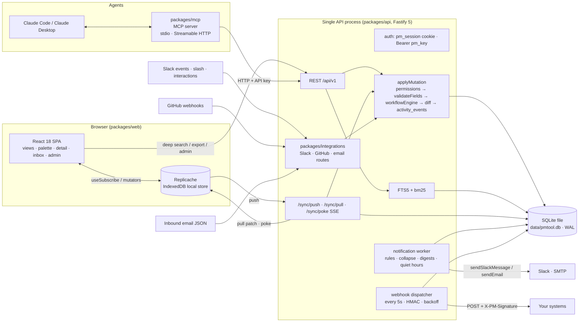
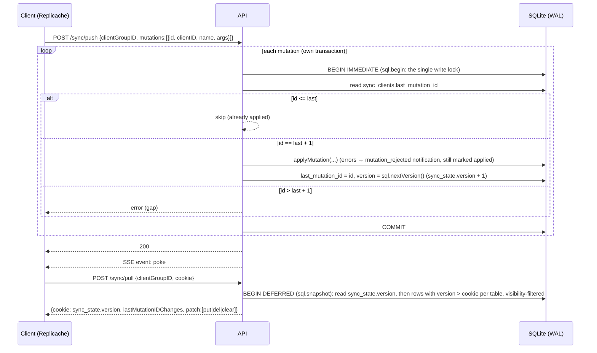

# 02 — Tool design

This document describes the tool built on the data model in
[01-data-model.md](01-data-model.md). The binding contract is
[ARCHITECTURE.md](ARCHITECTURE.md) plus the TypeScript in `packages/core/src`;
this document explains how the pieces fit and why. Where ARCHITECTURE.md is
silent, the text says "implementation detail".

## 1. Architecture overview



The whole server is one process against one SQLite file, opened through
Node's built-in `node:sqlite` by the `@pm/db` runtime. There is no database
server, no queue, no cache, no second service: the webhook dispatcher and the
notification worker are loops inside the API process reading tables
(`webhook_deliveries`, `notification_deliveries`) and claiming rows in short
write transactions. Poke fan-out is an in-process `EventEmitter`. This is
deliberate — see [ADR-008](adr/ADR-008-monolith-single-region.md) and
[ADR-009](adr/ADR-009-sqlite-over-postgres.md).

### 1.1 Packages and dependency direction

| Package | Depends on | Runs in |
|---|---|---|
| `@pm/core` | zod | browser, Node, MCP (pure, no I/O) |
| `@pm/db` | `node:sqlite` (built into Node 22.13+; no native module) | Node (runtime layer, migrate / seed / reset) |
| `@pm/integrations` | `@pm/core` (+ fastify types, nodemailer) | inside `@pm/api` |
| `@pm/api` | `@pm/core`, `@pm/db`, `@pm/integrations`, fastify | the server |
| `@pm/web` | `@pm/core`, replicache, react | browser |
| `@pm/mcp` | `@pm/core`, MCP SDK | agent host machine |

Everything that must agree between client and server (row shapes, query
semantics, mutation argument validation, workflow guards, permission lattice)
is in `@pm/core` and is tested there. The API and the web app are thin.

## 2. The query layer: one spec, two executors

### 2.1 Grammar

```ts
QuerySpec = {
  filter?: FilterExpr,
  sort?: SortSpec[],
  group_by?: FieldRef | null,
  limit?: 1..5000,
  offset?: ≥0,
  include_archived?: boolean,
}

FilterExpr = { field: FieldRef, op: FilterOp, value?: unknown }
           | { and: FilterExpr[] } | { or: FilterExpr[] } | { not: FilterExpr }

SortSpec   = { field: FieldRef, dir: 'asc' | 'desc' (default asc), nulls?: 'first' | 'last' }
FieldRef   = /^[a-z_]+(\.[a-z0-9_]+)?$/
```

**Field references** resolve on both sides:

| FieldRef | Resolves to |
|---|---|
| `title`, `state_id`, `priority`, `assignee_id`, `due_date`, … | `work_items` columns (`BUILTIN_FIELDS` lists kinds and sortability) |
| `state.category`, `state.key` | via `workflow_states` |
| `type.key` | via `item_types` |
| `project.key` | via `projects` |
| `fields.<key>` | JSON field read with `json_extract(w.fields, '$.<key>')`; typed by the type's `FieldDef.kind` |
| `labels` | array of label ids; ops `has`, `has_any`, `has_all`, `is_empty`, `not_empty` |
| `parent_id` | derived from `relations` (`parent_of`) |
| `is_blocked` | derived: has open blockers |
| `search` | full text; op `match` only |

**Operators** (exact set from `FilterOp`):

| Op | Applies to | Meaning |
|---|---|---|
| `eq`, `neq` | scalar | equality |
| `in`, `nin` | scalar vs array value | membership |
| `lt`, `lte`, `gt`, `gte` | number, date, datetime, text | ordering |
| `contains`, `starts_with` | text | case-insensitive substring / prefix |
| `is_null`, `not_null` | any | null test (no value) |
| `is_empty`, `not_empty` | arrays, text | empty array / empty string / null |
| `has`, `has_any`, `has_all` | arrays (`labels`, `multi_select` fields) | element membership |
| `match` | `search` | FTS5 `MATCH`; the search route falls back to `LIKE` on key/title for partial words |
| `before`, `after` | date / datetime | strictly before/after; value may be a macro |
| `within_days` | date / datetime | between `$today` and `$today + N days` inclusive (N = value) |

**Value macros** resolved at evaluation time from `QueryContext { userId, tz,
now }`: `$me` (user id), `$today` (`YYYY-MM-DD` in `ctx.tz`), `$now` (ISO
timestamp), `$start_of_week`, `$end_of_week`, `$start_of_month`.

Edge semantics (null ordering under `lt`/`gt`, `nin` against null, empty
`in`) are pinned by the parity fixture in `@pm/core` tests rather than prose;
both executors must give identical answers for every fixture case.

### 2.2 Server: `compileQuery`

```ts
compileQuery(spec: QuerySpec, ctx: QueryContext, opts: CompileOptions): CompiledQuery
// CompiledQuery = { text: string; values: unknown[]; isAggregate: boolean }   // text uses `?` placeholders, values in order
// CompileOptions = { from?: string; fieldDefs?: Record<typeKey, FieldDef[]>; extraWhere?: {text, values}[]; select?: string }
```

* The output is SQLite SQL with positional `?` placeholders; `values` are
  bound in order by the `@pm/db` `sql` tag (`sql.unsafe(text, values)`).
  Booleans are bound as 0/1, arrays and objects as JSON text.
* Base relation is `work_items_v w` (all `work_items` columns plus `type_key`,
  `type_name`, `state_key`, `state_name`, `state_category`, `project_key`,
  `project_name`, `assignee_name`, `label_names` (JSON array), `parent_id`,
  `is_blocked` (0/1)).
* `fields.<key>` compiles to `json_extract(w.fields, '$.<key>')`; SQLite's
  JSON functions return typed scalars, so numbers compare as numbers and the
  field kind only decides how the bound value is encoded (`date`/`datetime`
  as text, `bool` as JSON `true`/`false`). Multi kinds (`has`, `has_any`,
  `has_all`) compile to `exists (select 1 from json_each(w.fields, '$.<key>') e where e.value …)`.
* `labels` compiles to `EXISTS (select 1 from work_item_labels …)`.
* `search` with `match` compiles to
  `w.id in (select id from work_items_fts where work_items_fts match ?)` and,
  when it is the first `search` leaf, orders by
  `bm25(work_items_fts, 10.0, 5.0, 1.0)`. The `/api/v1/search` route adds a
  `LIKE` fallback on `key`/`title` when FTS returns nothing (partial words).
* The permission scope is appended as an extra WHERE from
  `visibilityWhere(userId)`, which is exactly
  `exists (select 1 from visible_items vi where vi.user_id = ? and vi.item_id = w.id)`.
* `group_by` produces an aggregate query (`isAggregate = true`) used by
  boards' column counts and by `compileWidget()`. Widget `time_bucket`s are
  computed in UTC with `strftime`: `day` → `%Y-%m-%d`, `month` → `%Y-%m-01`,
  `week` → the Monday of the ISO week; the client evaluator buckets the same
  way, so both executors agree.
* Soft-deleted rows are always excluded; `archived_at is not null` rows are
  excluded unless `include_archived`.

### 2.3 Client: `runSpec`

```ts
runSpec(spec, items: ItemRow[], ctx, lookups: EvalLookups)
  → { items: ItemRow[]; groups: { key, label, items }[] | null }
```

`ItemRow` is a `WorkItem` plus the same derived columns `work_items_v`
exposes; `EvalLookups` carries the local `states`, `types`, `projects`,
`labelIdsByItem`, `parentByItem`, `blockedItems` so dotted refs resolve
without joins. `matchesFilter` is the client-side twin of the SQL compiler;
the core test suite loads one fixture set into an in-memory SQLite database
(`openDb(':memory:')` + the migration) and into plain objects, and asserts
that `compileQuery` and `runSpec` return the same ids for every spec.
Everything on screen comes from `runSpec` over local rows; only deep search
(`/api/v1/search`) and dashboards over data you have not synced go to the
server.

### 2.4 One spec, four presentations

`views.spec` is a `ViewSpec = QuerySpec + presentation`:

```ts
ViewSpec = QuerySpec & {
  kind?: 'list' | 'board' | 'timeline' | 'dashboard',
  columns?: FieldRef[],                                   // list
  board?: { column_field (default 'state_id'), swimlane_field?, column_order?, hide_empty? },
  timeline?: { start_field (default 'start_date'), end_field (default 'due_date'), zoom: week|month|quarter, show_dependencies? },
  dashboard?: { widgets: Widget[] },
}
Widget = { id, title, viz: number|bar|pie|line|table|list, query: QuerySpec, group_by?, measure: count|sum_estimate|avg_estimate|sum_field|avg_field, measure_field?, time_bucket?: day|week|month, w: 1..12, h: 1..12 }
```

| kind | Runs | Presentation reads |
|---|---|---|
| list | `runSpec(spec)` | `columns`, `group_by` → section headers |
| board | `runSpec({...spec, group_by: board.column_field})` | groups become columns; `swimlane_field` nests a second grouping; drag between columns = `transitionItem` (when `column_field` is `state_id`) or `updateItem` (any other field) |
| timeline | `runSpec(spec)` | bars from `start_field`/`end_field`; `show_dependencies` draws `blocks` edges from local `relations` |
| dashboard | per widget: client `runSpec(widget.query).groups` + aggregate; server `compileWidget()` via `POST /views/:id/run` | `viz`, `w`/`h` grid |

The board column for an item is its value of `column_field`, so a board over
`assignee_id` or `fields.severity` is the same component as a status board.

#### Worked examples

**List** — "My open work, most urgent first":

```json
{
  "kind": "list",
  "filter": { "and": [
    { "field": "assignee_id", "op": "eq", "value": "$me" },
    { "field": "state.category", "op": "nin", "value": ["done", "canceled"] }
  ]},
  "sort": [ { "field": "priority", "dir": "asc", "nulls": "last" }, { "field": "due_date", "dir": "asc", "nulls": "last" } ],
  "columns": ["key", "title", "state_id", "priority", "due_date", "project.key"],
  "limit": 500
}
```

**Board** — Rates desk bugs by state, swimlane by severity:

```json
{
  "kind": "board",
  "filter": { "and": [
    { "field": "project.key", "op": "eq", "value": "RATES" },
    { "field": "type.key", "op": "eq", "value": "bug" },
    { "field": "state.category", "op": "nin", "value": ["canceled"] }
  ]},
  "sort": [ { "field": "sort_order", "dir": "asc" } ],
  "board": { "column_field": "state_id", "swimlane_field": "fields.severity", "hide_empty": false }
}
```

**Timeline** — this quarter's initiatives with dependencies:

```json
{
  "kind": "timeline",
  "filter": { "and": [
    { "field": "type.key", "op": "eq", "value": "initiative" },
    { "field": "fields.quarter", "op": "eq", "value": "2026Q4" }
  ]},
  "sort": [ { "field": "start_date", "dir": "asc" } ],
  "timeline": { "start_field": "start_date", "end_field": "due_date", "zoom": "quarter", "show_dependencies": true }
}
```

**Dashboard** — desk health:

```json
{
  "kind": "dashboard",
  "filter": { "field": "project.key", "op": "eq", "value": "RATES" },
  "dashboard": { "widgets": [
    { "id": "open", "title": "Open items", "viz": "number", "measure": "count",
      "query": { "filter": { "field": "state.category", "op": "nin", "value": ["done", "canceled"] } }, "w": 3, "h": 2 },
    { "id": "blocked", "title": "Blocked", "viz": "number", "measure": "count",
      "query": { "filter": { "field": "is_blocked", "op": "eq", "value": true } }, "w": 3, "h": 2 },
    { "id": "by_assignee", "title": "Open by assignee", "viz": "bar", "group_by": "assignee_id", "measure": "count",
      "query": { "filter": { "field": "state.category", "op": "in", "value": ["todo", "in_progress"] } }, "w": 6, "h": 4 },
    { "id": "sev", "title": "Open bugs by severity", "viz": "pie", "group_by": "fields.severity", "measure": "count",
      "query": { "filter": { "and": [ { "field": "type.key", "op": "eq", "value": "bug" },
                                       { "field": "state.category", "op": "nin", "value": ["done", "canceled"] } ] } }, "w": 4, "h": 4 },
    { "id": "burn", "title": "Completed per week", "viz": "line", "group_by": "completed_at", "time_bucket": "week", "measure": "sum_estimate",
      "query": { "filter": { "field": "completed_at", "op": "after", "value": "$start_of_month" } }, "w": 8, "h": 4 },
    { "id": "due", "title": "Due in 7 days", "viz": "list", "measure": "count",
      "query": { "filter": { "field": "due_date", "op": "within_days", "value": 7 }, "sort": [ { "field": "due_date", "dir": "asc" } ], "limit": 20 }, "w": 12, "h": 4 }
  ]}
}
```

The outer `filter` scopes every widget (widgets AND their own filter with it).
`POST /api/v1/views/:id/run` returns `{widgets:[{id, rows:[{key,label,value}]}]}`
for dashboards and `{items, groups?, total}` for the other kinds.

## 3. Mutations: the single write vocabulary

Every write in the system is one of the mutations in
`packages/core/src/mutations.ts`, validated by zod on both ends and applied by
`applyMutation(tx, actor, mutation, meta)` on the server. Callers: Replicache
mutators (optimistic) → `POST /sync/push` (authoritative replay), REST routes
(one route ↔ one mutation), MCP tools (via REST), integrations (via
`IntegrationDeps.runMutation`).

| Mutation | Rows written | Activity rows (`entity_type` / `action` / `field`) | Side effects |
|---|---|---|---|
| `createItem` | `work_items` (state defaults to workflow initial), `work_item_labels`, `relations(parent_of)` if `parent_id` | `work_item/create` + one `update`-style row per non-default field is an implementation detail; minimum is the `create` row | watchers: reporter/assignee; `assigned`/`mention` notifications; `item.created` webhook |
| `updateItem` | `work_items` (patch; `fields` shallow-merged) | one row per changed tracked field; JSON keys as `fields.<key>` | watchers (assignee/mention); `assigned`, `mention` notifications; `item.updated` webhook; resync if `confidential` changed |
| `bulkUpdateItems` | same as `updateItem` × ≤500 ids | all rows share one `txn_id` | same, per item |
| `transitionItem` | `work_items.state_id` + `set_field` effect patch; labels via effects | `work_item/transition/state_id` + one row per effect-set field | `notify`, `webhook`, `transition_parent_if`, `transition_children` effects; `state_change` notifications; `item.transitioned` (+ `item.completed` when the effect names it) |
| `bulkTransitionItems` | per item, each evaluated independently | one `txn_id` | returns `{ok:[], failed:[{id, failures}]}` |
| `deleteItem` / `restoreItem` | `work_items.deleted_at` | `work_item/delete` · `work_item/restore` | `item.deleted` · `item.restored` webhooks; tombstone propagates via sync |
| `moveItem` | `work_items.project_id` (new key assigned — implementation detail: number is re-issued in the target project) | `work_item/update/project_id` | **resync_required** for users whose visibility changes |
| `reorderItem` | `work_items.sort_order` | `work_item/update/sort_order` | none |
| `addLabel` / `removeLabel` | `work_item_labels` (insert / tombstone) | `work_item/update/labels` style row (implementation detail: entity `work_item`, field `labels`) | `item.updated` |
| `createLabel` | `labels` | `label/create` | — |
| `addRelation` / `removeRelation` | `relations` (insert / tombstone); triggers enforce acyclicity, single parent, external-shape check | `relation/relation_add` · `relation/relation_remove` with `item_id = from_item_id` | `relation.added` · `relation.removed` webhooks |
| `setParent` | replaces the `parent_of` edge pointing at the item | `relation_add`/`relation_remove` | as above |
| `addComment` / `editComment` / `deleteComment` | `comments` | `comment/comment` · `comment/update/body` · `comment/delete` | watchers: commenter + mentions; `mention`, `reply`, `comment` notifications; `comment.created/updated/deleted` webhooks |
| `watchItem` / `unwatchItem` | `item_watchers` (`reason = manual`) | implementation detail (no activity row required) | — |
| `markNotificationRead` / `markAllNotificationsRead` | `notifications.read_at` | none | — |
| `createView` / `updateView` / `deleteView` | `views` | `view/create` · `view/update` · `view/delete` | — |
| `createProject` / `updateProject` | `projects` | `project/create` · `project/update/<field>` | `project.created` / `project.updated` webhooks; **resync_required** for all users when `visibility` changes |
| `setProjectMember` / `removeProjectMember` | `project_members` | `project/update/members` (implementation detail) | **resync_required** for that user |
| `upsertItemType` | `item_types` (admin) | implementation detail | clients receive the new `field_defs` via sync |
| `upsertWorkflow` | `workflows`, `workflow_states`, `workflow_transitions` (admin; validated with `workflowEngine.validateDefinition`) | implementation detail | states/transitions not in the payload are tombstoned (implementation detail) |
| `updateNotificationPreference` | `notification_preferences` | none | — |

Common `applyMutation` pipeline for every mutation (ARCHITECTURE.md §Mutations):

1. `permissions.assert(actor, action, resource)`.
2. `validateFields(defs, fields)` for the item's type.
3. For transitions: build `GuardContext`, `workflowEngine.evaluate()`, apply
   `patch`, run `deferredEffects`.
4. Diff before/after → one `activity_events` row per changed field, all with
   the same `txn_id`.
5. Maintain `item_watchers`.
6. Notifications from the diff (never the actor; collapse unread per (user,
   item, kind)).
7. Enqueue `webhook_deliveries` for matching endpoints.
8. Set `sync_client_groups.resync_required` when visibility may have changed.

Every transaction that touches a synced table runs inside `sql.begin()` from
`@pm/db`, which issues `BEGIN IMMEDIATE`: SQLite hands the one write lock to
that transaction until it commits, so writers are serialised and the `version`
stamps drawn from `sync_state` commit in order. No advisory lock is needed.
Never hold such a transaction across network I/O (webhook POSTs, SMTP, Slack):
the dispatcher and notification workers claim rows in one short transaction,
do the I/O outside it, and record the outcome in another.

`meta = { source, txnId, mutationName, actorKind, actorLabel }` is what ends
up in `activity_events.source / txn_id / mutation_name / actor_kind /
actor_label`.

## 4. Workflow engine at runtime

`workflowEngine` (`@pm/core`, pure) is called on the client to grey out
buttons and on the server to decide.

```ts
GuardContext = { actorId, actorRole: ProjectRole | null, now, openBlockerCount, childrenCategories: StateCategory[], labelNames: string[] }
evaluate(def, item, transitionKey, ctx) → TransitionResult {
  ok, transition, toState, failures: {guard, reason}[],
  patch: Partial<WorkItem>,       // state_id + set_field effects (macros resolved: $now, $today, $actor)
  deferredEffects: Effect[],      // notify | webhook | add_label | remove_label | transition_parent_if | transition_children
}
```

Server sequence for `transitionItem`:

1. Load the item, its type's workflow definition (states + non-deleted
   transitions), the actor's role from `effective_roles`.
2. Load `GuardContext`: `openBlockerCount` =
   `select count(*) from open_blockers where item_id = ?`,
   `childrenCategories` from direct `parent_of` children's states
   (`item_parents`), `labelNames` from `work_item_labels`.
3. `evaluate()`. If `!ok` → HTTP 409 `guard_failed` with `failures`; in a sync
   push the mutation is marked applied and a `mutation_rejected` notification
   is written for the actor.
4. Apply `patch` (the state trigger verifies the state belongs to the type's
   workflow), diff, write activity rows.
5. Execute `deferredEffects` in order:
   * `notify` → notification rows for the audience, template name in `kind`/`title` (implementation detail of rendering);
   * `webhook` → enqueue with the named event kind;
   * `add_label` / `remove_label` → by label name within the project (then firm-wide);
   * `transition_parent_if` → if the parent exists and all its direct children's categories ∈ `all_children_category`, run the parent's transition that leads to state key `to` (recursively, same `txn_id`, as `system` actor kind with the original actor id);
   * `transition_children` → run the named transition on every direct child; a child whose guards fail is skipped and reported, it does not abort the parent (implementation detail).
6. Recursion is bounded by the hierarchy depth (`item_ancestry` caps at 100).

Client sequence (optimistic): the mutator calls `evaluate()` with a
best-effort context (`openBlockerCount` from local `relations` + states,
`childrenCategories` from local rows, `actorRole` from `/me` memberships) and
applies `patch` locally. If the server disagrees, the next pull reverts the
local change and the inbox shows the rejection.

`validateDefinition(def)` (used by `PUT /api/v1/workflows/:key`) rejects
definitions without exactly one initial state, with transitions referencing
unknown states, with duplicate keys, or with unreachable states.

## 5. Permission enforcement points

| Point | Mechanism |
|---|---|
| Every REST write and every push mutation | `permissions.assert(actor, action, resource)` in `applyMutation` before any SQL; failure → 403 `forbidden` |
| Every REST read of items | `visibilityWhere(userId)` appended by the query compiler; `GET /items/:key` → `exists (select 1 from visible_items where user_id = ? and item_id = ?)` |
| `GET /api/v1/activity`, `/export/items.csv`, `/search` | same visibility predicate |
| Sync pull | per-table visibility rules (ARCHITECTURE.md §Sync): `visible_items` for items, `effective_roles` for projects/members, parent-item visibility for comments/relations/labels/watchers, owner-or-shared for views, own rows for notifications/preferences |
| Visibility changes | `resync_required` → next pull sends `clear` + full snapshot, so a client never keeps rows it may no longer see |
| UI | `permissions.can()` with the actor from `/me` hides or disables actions; it is a convenience, never the authority |
| Workflow guards | `require_role` evaluated with the same effective role |
| API keys | `api_keys.scopes` (`read`, `write`; default both). Enforcement of scopes beyond read/write is an implementation detail |
| Firm-admin actions | `workflow.manage`, `type.manage`, `webhook.manage`, `integration.manage`, `user.manage` require `firm_role ∈ {owner, admin}` |

## 6. Sync design (Replicache-style)

### 6.1 Protocol



* **Push**: per mutation, in one `BEGIN IMMEDIATE` transaction: idempotent on
  `mutation.id`, strict ordering (`> last + 1` is an error), errors inside a
  mutation are logged, the mutation is still marked applied (Replicache
  semantics — the optimistic change is rolled back on the next pull), and a
  `notifications` row of kind `mutation_rejected` tells the user why. After
  the push, poke.
* **Pull**: `cookie` = last `version` seen (null → 0). The whole pull runs in
  one deferred read transaction (`sql.snapshot`), which under WAL is a
  consistent snapshot that never blocks the writer. The server reads
  `sync_state.version` inside that snapshot and returns it as the new cookie.
  If the cookie is null/0 or the client group has `resync_required`, respond
  with `{op:'clear'}` followed by `put` of every visible row and clear the
  flag. Otherwise for each table in `SYNCED_TABLES` select `version > cookie`
  and emit `put` when the row is visible and `deleted_at is null`, else `del`.
  The KV key is `rowKey(table, row)` = `"<table>/<pk1>[/<pk2>]"`.
* **Poke**: `GET /sync/poke` is SSE; the server emits `event: poke` after any
  committed push or REST write; clients call `replicache.pull()`.

### 6.2 Global version strategy and write serialisation

Every synced row gets its `version` from the one-row `sync_state` table on
insert/update: the `<table>_version_ins`/`_upd` triggers do
`update sync_state set version = version + 1` and stamp the row with the new
value. A pull is "rows with `version > cookie`". That is only correct if
*version order equals commit order*: if transaction A could take version 100,
transaction B version 101 and commit first, a client could pull `cookie = 101`
and A's row (100) would never be sent. SQLite makes this hold by construction:
a writing transaction opened with `BEGIN IMMEDIATE` owns the database's single
write lock until it commits or rolls back, so no second writer can draw a
version in between. The `@pm/db` runtime adds an async mutex in front of that
lock so that, inside one process, waiting transactions queue instead of
spinning on `SQLITE_BUSY` (`busy_timeout` is 5 s as a backstop). No advisory
lock, no sequence. The cost is one writer at a time, which is also SQLite's
cost; at a firm's scale (tens of writes per second at peak) this is invisible.

The pull side reads inside a deferred transaction. Under WAL a reader sees the
database as of the last commit before it started and is never blocked by the
writer; `sync_state.version` read in that snapshot is therefore exactly "the
highest version that can appear in this patch", which is what the cookie must
mean.

### 6.3 Tombstones and visibility

Rows are never hard-deleted from synced tables; `deleted_at` is set, the
version bumps, and the next pull emits `del` for that key. The same `del` is
used when a row the client previously had becomes invisible (an item turned
`confidential`, a user removed from a project): the pull filters by visibility
and sends `del` for any changed row the user may not see. Changes that can
hide *unchanged* rows (membership removal, project made private, item moved)
cannot be expressed as per-row `del`s cheaply, so they set
`sync_client_groups.resync_required` and the next pull is a full snapshot.

### 6.4 Why this and not ElectricSQL / Zero / PowerSync

* The hard requirement is **custom write semantics**: guards, effects,
  per-field activity rows, notifications and webhooks on every write. Those
  belong in one server function (`applyMutation`). Replicache's push/pull is
  exactly "the server owns the write and the client is optimistic"; the shape
  of the sync is ours, the protocol is a stable, documented JSON contract with
  no sidecar.
* ElectricSQL/PowerSync replicate a Postgres database to the client (great for
  reads) but writes still need a custom path, their shape/permission rules
  would duplicate `visible_items`, and they require a Postgres server.
* Zero is attractive for query-driven sync, but at this size the whole visible
  dataset fits in IndexedDB; full-row sync with a single cookie is simpler to
  reason about and to audit.
* All three add an infrastructure component (a sync service, a replication
  consumer, a database server). The design goal is one process + one file.

### 6.5 Limits and when to move to row-versioning

| Symptom | Threshold (rule of thumb) | Move |
|---|---|---|
| Initial snapshot too large | > ~200k visible rows per user or > ~50 MB | Per-table snapshot paging; archive old items (`archived_at`) and exclude archived rows from the snapshot |
| Writer contention | sustained > ~50 writes/s, p95 push latency > 500 ms | Replicache "row versioning" strategy: track per-client-group which rows (key → version) were sent (a `client_view_records` table), drop the global counter, compute diffs per client group. Serialised writers are a property of SQLite, so this move alone does not remove them; see the next row |
| Frequent resyncs | membership churn causing full snapshots many times a day | Same as above; row-versioning makes visibility changes incremental |
| Multi-process or multi-host | second API instance, or writers on more than one machine | Move the file to Postgres ([ADR-009](adr/ADR-009-sqlite-over-postgres.md) describes the mechanical path), then poke via `LISTEN/NOTIFY` and an advisory lock (or row versioning) for the version order. SQLite does serialise writers across processes on one host, but the poke emitter, the worker loops and the single-file backup story assume one process |

The client protocol does not change in any of these moves; only the server's
`pull` implementation does.

## 7. Search

* **Default: SQLite FTS5.** `work_items_fts` is an FTS5 virtual table over
  `key`, `title` and `description` with the `porter unicode61` tokenizer
  (case and diacritic folding, English stemming), kept in sync by three
  triggers on `work_items`. Queries use `work_items_fts match ?` (FTS5
  syntax: implicit AND, `"quoted phrase"`, `OR`, `NOT`, trailing `*` for a
  prefix), ranked with `bm25(work_items_fts, 10.0, 5.0, 1.0)` so a hit in the
  key outweighs the title, which outweighs the description; `snippet()`
  supplies the highlighted excerpt.
* **Partial words: `LIKE` fallback.** FTS5 matches whole tokens, so when a
  query returns nothing the search route retries with
  `w.key like '%' || ? || '%' or w.title like '%' || ? || '%'` (SQLite's
  `LIKE` is case-insensitive for ASCII), ordered by `updated_at`. This covers
  "curv" for "curve" and typing a key fragment; it is not typo tolerance.
* **Instant: local.** The palette and views search the local store with
  `contains`/`starts_with` on `key`/`title` — zero latency, no server.
* `GET /api/v1/search?q=&project=&limit` returns `{items:[{...item, rank,
  snippet}]}`, visibility-filtered. `fields` text is not in the FTS table; add
  a `fields.<key>` filter alongside `search` when you need both.

**"Until it isn't"** — the line is crossed when any of these holds:

1. Users need relevance across comments, attachments and `fields` text with
   per-field boosting (the FTS table would need to be trigger-maintained over
   three tables);
2. Non-English content or language detection matters (FTS5 ships one stemmer);
3. Search latency over ~1M items exceeds ~200 ms p95;
4. Semantic/"find similar" queries or real typo tolerance are requested.

Then: Meilisearch or Typesense (1–4; index fed from `activity_events` by
cursor, so indexing is incremental and replayable). The `search` FieldRef
keeps its meaning; only the executor changes.

## 8. Notifications

Generated inside `applyMutation` from the activity diff, filtered by
`notification_preferences.rules` per (user, channel):

| kind | recipient | rule key | default |
|---|---|---|---|
| `mention` | users mentioned in description/comment (`@[Name](user:<uuid>)`) | `mention` | on |
| `assigned` | new assignee | `assigned` | on |
| `reply` | parent comment author | `reply` | on |
| `state_change` | assignee | `state_change_assigned` | on |
| `state_change` | other watchers | `state_change_watching` | off |
| `comment` | watchers | `comment_watching` | off |
| `due_soon` | assignee, 24h before `due_date` (scheduler loop) | `due_soon` | on |
| `mutation_rejected` | the actor whose optimistic mutation failed | — | always |

Low-noise rules:

* **Never the actor.** Your own edits never notify you.
* **Collapse.** In-app, one unread row per (user, item, kind); later events
  update `body`/`updated_at` instead of inserting. Ten comments on one item
  while you were away is one inbox row.
* **Watch by participation.** `item_watchers` is maintained automatically
  (assignee, reporter, commenter, mention); `manual` watch/unwatch and
  `muted` override.
* **Digests and quiet hours** for email/Slack: `notification_deliveries` rows
  are scheduled per the channel's `cadence` (`immediate`, `hourly`, `daily`,
  `off`) and `quiet_hours` (`{"start":"19:00","end":"07:00","tz":…}`); the
  delivery worker renders with `renderNotification`/`renderDigest` and sends
  with `sendEmail`/`sendSlackMessage` (from `@pm/integrations`).
* **Workflow `notify` effects** add targeted pings (`watchers`, `assignee`,
  `reporter`, `project_admins`) with a template name, so a desk workflow can
  say "tell the admins when something is submitted" without anyone
  subscribing.

The in-app inbox is synced (`notifications` table, own rows only), so it is
instant and works offline.

## 9. Webhooks out

* **Subscription**: `webhook_endpoints { name, url, secret, event_kinds[]
  (default `{*}`), project_id (null = all), is_active }`, managed via
  `/api/v1/webhooks` (firm admin).
* **Event kinds** (`EVENT_KINDS` in `@pm/core`): `item.created`,
  `item.updated`, `item.transitioned`, `item.completed`, `item.deleted`,
  `item.restored`, `comment.created`, `comment.updated`, `comment.deleted`,
  `relation.added`, `relation.removed`, `project.created`, `project.updated`.
* **Enqueue**: `applyMutation` inserts `webhook_deliveries` rows (one per
  matching endpoint) referencing the activity `event_id`. Changes within one
  `txn_id` for the same item are coalesced into one delivery.
* **Dispatcher**: a loop in the API process every 5 s takes
  `status in ('pending','failed') and next_attempt_at <= now()`, POSTs, records
  `response_status`/`response_body`, and schedules retries with backoff
  **1m → 5m → 30m → 2h → 12h**, then `dead`.
* **Headers**: `X-PM-Event: <kind>`, `X-PM-Delivery: <delivery id>`,
  `X-PM-Signature: sha256=<hex hmac-sha256(secret, raw body)>`.
* **Body**:

```json
{
  "id": 1234, "kind": "item.transitioned", "created_at": "2026-10-15T14:02:11.312Z",
  "actor": { "id": "…", "name": "Alice", "kind": "user" },
  "project": { "id": "…", "key": "RATES", "name": "Rates desk" },
  "item": { "...": "work_items_v row" },
  "changes": [ { "field": "state_id", "old": "…", "new": "…" }, { "field": "start_date", "old": null, "new": "2026-10-15" } ],
  "event_ids": [ 9876, 9877 ]
}
```

Receivers verify the signature, treat `X-PM-Delivery` as the idempotency key,
and use `event_ids` to fetch details from `/api/v1/activity?since=` if they
need more than the coalesced changes.

## 10. API design principles

1. **Routes are mutations.** Each write route maps to exactly one mutation;
   the body is the mutation's args (minus what the URL supplies). No route
   writes a table directly.
2. **Keys or UUIDs.** Item routes accept `RATES-12` or a UUID; project routes
   accept `RATES` or a UUID. Responses always include both.
3. **One error shape.** `{ "error": { "code", "message", "details"? } }` with
   codes `not_found`, `forbidden`, `validation`, `conflict`, `guard_failed`,
   `unauthorized`, `internal`. Guard failures are 409 with `details.failures`.
4. **Reads are specs.** `POST /api/v1/items/query {spec}` is the general
   read; `GET /api/v1/items?…` is a convenience that builds a spec from query
   params (`project`, `type`, `state_category`, `assignee=me|uuid`, `label`,
   `q`, `updated_since`, `limit`, `cursor`).
5. **Visibility everywhere.** Every read path uses the same predicate; there is
   no "admin bypass" route.
6. **Idempotent creates.** Clients may supply `id`; the server treats a repeat
   of the same id as a no-op success (implementation detail).
7. **Cursor feeds.** `/activity?since=<event id>`, `/items/:key/activity?before=`
   — never offset pagination over the log.
8. **Rows are snake_case, exactly the SQL columns.** No camelCase translation
   layer; sync is a straight copy.
9. **Two credentials.** Session cookie (`pm_session`, httpOnly, signed with
   `APP_SECRET`) for the SPA; `Authorization: Bearer pm_<key>` for everything
   else; keys stored as sha256 hashes and shown once.

## 11. MCP server

`packages/mcp` is a thin adapter: an MCP server (stdio for Claude Code /
Claude Desktop, Streamable HTTP for hosted agents) whose tools call the REST
API with the user's API key (`PM_API_KEY`, `API_URL`). It has no database
access; it inherits that user's visibility and role, and every write lands in
`activity_events` with `actor_kind = 'agent'`, `source = 'mcp'` and the key's
name as `actor_label`. Tool names are an implementation detail of
`@pm/mcp`; each tool maps to one route (see
[04-integrations.md §6](04-integrations.md#6-mcp-server)). `GET /api/v1/my-work`
exists specifically so an agent (and the palette) can get "what should I look
at" in one call.

## 12. Data flow: dragging a card on the board

```mermaid
sequenceDiagram
    actor U as User
    participant B as Board (React)
    participant R as Replicache
    participant API as API /sync/push
    participant M as applyMutation
    participant DB as SQLite
    participant P as /sync/poke (SSE)
    participant W as Webhook dispatcher
    participant N as Notification worker
    participant S as Slack

    U->>B: drag RATES-12 from "Todo" to "In Progress"
    B->>B: target column = state in_progress → find transition to it (workflowEngine.availableTransitions)
    B->>R: mutate.transitionItem({id, transition_key:'start'})
    R->>R: evaluate() with local GuardContext → patch {state_id, start_date}, optimistic put work_items/…
    B-->>U: card is already in the new column (0 ms)
    R->>API: POST /sync/push {mutations:[{id: 57, name:'transitionItem', args}]}
    API->>DB: BEGIN IMMEDIATE (write lock), check last_mutation_id = 56
    API->>M: applyMutation(tx, actor, transitionItem, {source:'app', txnId})
    M->>DB: permissions.assert(item.transition), load item + workflow + open_blockers
    M->>M: workflowEngine.evaluate → ok, patch, deferredEffects
    M->>DB: update work_items set state_id, start_date (trigger stamps version from sync_state)
    M->>DB: insert activity_events ×2 (state_id, start_date) same txn_id
    M->>DB: upsert item_watchers; insert notifications (state_change → assignee if not actor)
    M->>DB: insert webhook_deliveries for endpoints matching item.transitioned
    API->>DB: update sync_clients last_mutation_id = 57, COMMIT
    API->>P: emit poke
    P-->>R: event poke
    R->>API: POST /sync/pull {cookie}
    API-->>R: patch with put work_items/…, put notifications/…
    W->>DB: every 5s: claim pending deliveries in a short transaction
    W->>EXT: POST https://your-system/hook  X-PM-Signature: sha256=… (outside any transaction)
    N->>DB: notification_deliveries due (cadence immediate, outside quiet hours)
    N->>S: sendSlackMessage(renderNotification(n).slackBlocks)
    S-->>U: "Alice moved RATES-12 to In Progress" with transition buttons
```

If the server's guard evaluation disagrees (someone added a blocker a second
earlier), the push still marks mutation 57 applied, writes a
`mutation_rejected` notification ("Start: no_open_blockers: RATES-9 is open"),
and the pull returns the card to "Todo". The user sees the rejection in the
inbox; nothing was lost, and the attempt is not in `activity_events` because
no field changed.
