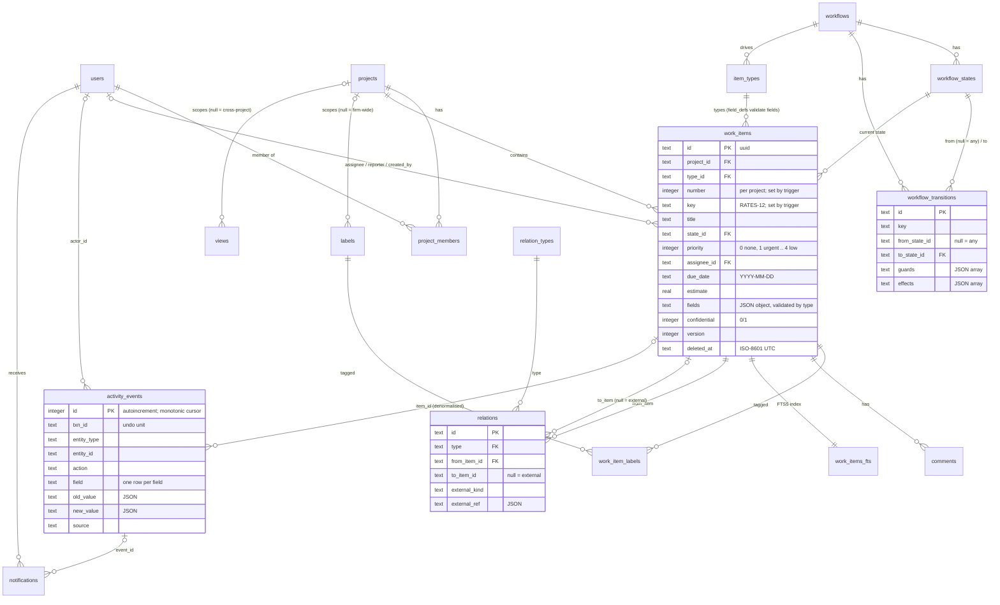

# Data Model

The whole model is one file: [`packages/db/migrations/0001_init.sql`](https://github.com/jamjorf/pm-tool/blob/main/packages/db/migrations/0001_init.sql) (about 1,070 lines of plain SQL for SQLite 3.38+, no extensions). You can apply it with `sqlite3 pmtool.db < 0001_init.sql` and use it without the rest of the monorepo; the application opens the same file through Node's built-in `node:sqlite` via the `@pm/db` runtime. The TypeScript in `@pm/core` mirrors it; it never replaces it. The full narrative, with every trigger body, the views and a set of audit queries, is [docs/01-data-model.md](https://github.com/jamjorf/pm-tool/blob/main/docs/01-data-model.md).

Conventions: UUID text primary keys (client-generatable; the SQL default generates a v4), `snake_case` everywhere, ISO-8601 UTC text timestamps and `YYYY-MM-DD` text dates, booleans as `0`/`1` with a CHECK, enums as CHECK constraints for closed vocabularies (`firm_role`, `project_members.role`, `state_category`), JSON stored as text validated with `json_valid`/`json_type`, soft deletes via `deleted_at`, and registries (rows) for vocabularies desks should extend (`item_types`, `relation_types`, `workflows`). SQLite has no SQL functions, so behaviour lives in triggers and views.

## The five pillars and their tables

| # | Pillar | Key tables and objects |
|---|---|---|
| 1 | One generic work item | `work_items`, `item_types` (`field_defs`), triggers `assign_item_number`, `work_items_validate_fields_ins`/`_upd`, `work_items_validate_state_ins`/`_upd`; FTS5 table `work_items_fts`; view `work_items_v` |
| 2 | Workflows as data | `workflows`, `workflow_states` (`category`, one `is_initial`), `workflow_transitions` (`from_state_id` null = any, `guards`, `effects` as JSON arrays) |
| 3 | Relations as a typed graph | `relation_types` registry, `relations` edge table, triggers `relations_no_cycle_ins`/`_upd`, views `item_parents`, `item_ancestry`, `open_blockers`, `item_rollups` |
| 4 | Append-only activity log | `activity_events` with `activity_events_no_update` / `activity_events_no_delete` triggers, grouped by `txn_id` |
| 5 | Permissions decided early | `users.firm_role`, `project_members.role`, `projects.visibility`, `work_items.confidential`; views `effective_roles`, `visible_items` |

Two more pillars the tool needs and the SQL carries for free: **views are saved queries** (`views.spec`) and **every synced table has `version` and `deleted_at`** for local-first sync, stamped from the one-row `sync_state` table.

## Entity overview



### Table catalogue

| Section in the SQL | Objects | Role |
|---|---|---|
| 0 | `sync_state` | One-row global version counter for sync |
| 1 | `users`, `sessions`, `api_keys`, `teams`, `team_members` | Principals |
| 2 | `workflows`, `workflow_states`, `workflow_transitions` | State machines as data |
| 3 | `item_types` | Type registry with `field_defs` |
| 4 | `projects`, `project_members` | Permission backbone |
| 5 | `work_items`, `work_items_fts`, numbering and validation triggers, `labels`, `work_item_labels`, `comments`, `attachments` | The generic entity and its satellites |
| 6 | `relation_types`, `relations`, cycle triggers, graph views | Typed edges |
| 7 | `activity_events` | Append-only log |
| 8 | `views` | Saved queries |
| 9 | `item_watchers`, `notification_preferences`, `notifications`, `notification_deliveries` | Low-noise notifications |
| 10 | `webhook_endpoints`, `webhook_deliveries`, `integration_configs`, `inbound_events` | Integrations |
| 11 | `sync_client_groups`, `sync_clients` | Replicache-style bookkeeping |
| 12 | views `effective_roles`, `visible_items` | Permissions |
| 13 | `settings` | Firm-level key/value |
| 14 | `<table>_version_ins` / `_upd` triggers | Version and `updated_at` stamping for every synced table |
| 15 | seeded `standard` and `simple` workflows; `task`, `bug`, `initiative`, `request` types (fixed UUIDs `…a01`/`…a02`, `…b01`–`…b14`, `…d01`–`…d04`) | Usable immediately |
| 16 | `work_items_v` | Display view with resolved joins |

The migration runner adds `schema_migrations(name, applied_at)`; a database created by hand with `sqlite3` is adopted (recorded as applied) the first time `pnpm db:migrate` sees it.

## The work item

A column is for what *every* type has and every view sorts or filters on cheaply: `title`, `description`, `state_id`, `priority` (0 none, 1 urgent to 4 low), `assignee_id`, `reporter_id`, `start_date`, `due_date`, `estimate`, `confidential`, `sort_order`, timestamps (`completed_at`, `canceled_at`, `archived_at`). Everything type-specific goes in `fields`, a JSON object validated against `item_types.field_defs`:

- the triggers `work_items_validate_fields_ins`/`_upd` reject unknown keys, missing required keys and wrong JSON types with `raise(abort, 'field "severity" is required')`; the API maps that to a 400 `validation` error;
- `validateFields()` in `@pm/core` adds option membership, user existence and `min`/`max` before the write;
- `work_items_validate_state_ins`/`_upd` refuse a `state_id` outside the type's workflow.

Field kinds: `text`, `long_text`, `number`, `bool`, `date`, `datetime`, `select`, `multi_select`, `user`, `url`; any kind may be `multi: true` (stored as an array). Inside `fields`, booleans are JSON `true`/`false` (0/1 is only for columns). Read a field in SQL with `json_extract(fields, '$.severity')`.

The key `RATES-12` is assigned by the AFTER INSERT trigger `assign_item_number` from `projects.item_seq`. Because SQLite triggers cannot rewrite the row before it exists, `number` and `key` are nullable at the column level and `insert … returning` shows them as `NULL`; the application reads the row back in the same transaction. Clients choose UUIDs, never keys.

`work_items_v` adds `type_key`, `type_name`, `state_key`, `state_name`, `state_category`, `project_key`, `project_name`, `assignee_name`, `label_names` (a JSON array), `parent_id` and `is_blocked` (0/1). It is the query target for the API and the row shape webhooks deliver. The `@pm/db` runtime hydrates these rows: JSON columns are parsed and 0/1 booleans become `true`/`false`.

## Full-text search

`work_items_fts` is an FTS5 virtual table over `key`, `title` and `description` (`tokenize = 'porter unicode61'`), kept in sync by three triggers on `work_items`. Query it with `work_items_fts match ?` and rank with `bm25(work_items_fts, 10.0, 5.0, 1.0)` (key, title, description weights; lower is better). The search route falls back to `LIKE` on key/title for partial words. Details in [docs/01-data-model.md §8.1](https://github.com/jamjorf/pm-tool/blob/main/docs/01-data-model.md#81-full-text-search-work_items_fts).

## Relations and graph helpers

`relation_types` is seeded with `parent_of` (hierarchy), `blocks` (blocking), `duplicates` (symmetric), `relates_to` (symmetric) and `links_to` (external). An edge is `from_item_id -(type)-> to_item_id`, or, for external entities, `to_item_id = null` plus `external_kind` and `external_ref` (a generated `external_key` makes re-linking idempotent). A partial unique index gives every item at most one parent; `relations_no_cycle_ins`/`_upd` walk the graph of any `is_hierarchy` or `is_blocking` type with a recursive CTE before accepting an edge, and reject the reverse of an existing symmetric edge.

The graph helpers are views (SQLite has no SQL functions), so you filter them instead of calling them:

```sql
item_parents(item_id, parent_id)                        -- direct parent
item_ancestry(ancestor_id, item_id, depth)              -- every (ancestor, descendant) pair via parent_of, depth <= 100
open_blockers(item_id, blocker_id)                      -- `blocks` sources not in done/canceled
item_rollups(root_id, total, done, in_progress, todo, canceled, estimate_total, estimate_done)

select * from item_rollups where root_id = ?;                     -- was item_rollup(root)
select item_id, depth from item_ancestry where ancestor_id = ?;   -- was item_descendants(root)
select ancestor_id, depth from item_ancestry where item_id = ?;   -- was item_ancestors(leaf)
select blocker_id from open_blockers where item_id = ?;           -- was item_open_blockers(item)
```

Guards (`no_open_blockers`, `children_in_category`) and effects (`transition_parent_if`, `transition_children`) reuse these views. Worked queries (transitive blockers, rollup by quarter with `json_extract`, breadcrumbs) are in [docs/01-data-model.md §5.3](https://github.com/jamjorf/pm-tool/blob/main/docs/01-data-model.md#53-graph-views).

## The activity log

`activity_events(id integer primary key autoincrement, txn_id, entity_type, entity_id, item_id, project_id, actor_kind, actor_id, actor_label, action, field, old_value, new_value, mutation_name, source, created_at)`.

- **One row per changed field.** Tracked columns (`TRACKED_ITEM_FIELDS` in `@pm/core`): `title`, `description`, `type_id`, `state_id`, `priority`, `assignee_id`, `reporter_id`, `start_date`, `due_date`, `estimate`, `confidential`, `completed_at`, `canceled_at`, `archived_at`, `project_id`, `sort_order`, plus every key of `fields` as `fields.<key>`.
- `actor_kind` is `user`, `api_key`, `integration`, `system` or `agent`; `source` is `app`, `api`, `mcp`, `slack`, `email`, `github` or `system`.
- `id` is a monotonic cursor for feeds, webhooks and notifications; `autoincrement` guarantees ids are never reused.
- The only writer is `applyMutation`. UPDATE and DELETE raise `activity_events is append-only (… denied)`; SQLite has no TRUNCATE.
- `old_value`/`new_value` are JSON text; compare them with `json_extract(old_value, '$')`.

Undo replays `old_value` for a `txn_id` as a *new* mutation. Analytics (cycle time, throughput) are queries over `state_id` events. See [ADR-004](https://github.com/jamjorf/pm-tool/blob/main/docs/adr/ADR-004-append-only-activity-log.md).

## Permissions

Per-project roles with three modifiers. Resolution order:

1. An explicit, non-deleted `project_members` row wins (`admin` / `editor` / `viewer`).
2. Otherwise firm `owner` / `admin` are `admin` on every project.
3. Otherwise firm `member` is `editor` on every `firm`-visible project and has no access to `private` projects.
4. Otherwise (`guest`, or `member` on a private project) no access.
5. A `confidential` item is visible only to project admins and its assignee, reporter or creator.

```sql
effective_roles(user_id, project_id, role)   -- one row per (active user, live project) pair with access
visible_items(user_id, item_id)              -- role + the confidential rule

select role from effective_roles where user_id = ? and project_id = ?;                 -- was effective_project_role()
select project_id from effective_roles where user_id = ?;                              -- was visible_project_ids()
select exists (select 1 from visible_items where user_id = ? and item_id = ?);         -- was can_view_item()
… and exists (select 1 from visible_items vi where vi.user_id = ? and vi.item_id = w.id)  -- appended to every item read
```

`permissions.can()` in `@pm/core` mirrors the lattice for the UI with a minimum role per action (`item.edit` needs `editor`, `project.edit` needs `admin`, `workflow.manage` needs a firm admin, and so on; the table is `ACTION_MIN_ROLE` in `packages/core/src/permissions/types.ts`). Attribute-style rules ("only risk can approve") live in workflow guards, not here. See [ADR-005](https://github.com/jamjorf/pm-tool/blob/main/docs/adr/ADR-005-permissions-per-project-roles.md).

## Sync columns

Every synced table carries `version integer`, `created_at`, `updated_at` and `deleted_at`. A pair of triggers per table (`<table>_version_ins`, `<table>_version_upd`) does `update sync_state set version = version + 1` and stamps the row with the new value, bumping `updated_at` on updates. Because every write transaction is `BEGIN IMMEDIATE` and SQLite has one write lock, version order is commit order with no extra lock. Rows are never hard-deleted from synced tables; `deleted_at` is a tombstone the client receives as a `del`. The synced set (`SYNCED_TABLES` in `@pm/core`) is `users`, `teams`, `workflows`, `workflow_states`, `workflow_transitions`, `item_types`, `projects`, `project_members`, `work_items`, `labels`, `work_item_labels`, `comments`, `relations`, `views`, `item_watchers`, `notifications`, `notification_preferences`. Details in [[Sync]].

## How to iterate

| Change | What you do | Migration? |
|---|---|---|
| Add a field to a type | `update item_types set field_defs = json_insert(field_defs, '$[#]', json('{"key":"desk","label":"Desk","kind":"text"}')) where key = 'task'` | No; make it `required` only after backfilling |
| Rename a label, add select options | `json_set(...)` on the element, or rewrite the array | No |
| Remove a field | first `update work_items set fields = json_remove(fields, '$.desk') where type_id = …`, then remove the def (the trigger rejects unknown keys on the next write) | No |
| Add an item type | one `insert into item_types` pointing at an existing or new workflow | No |
| Add a state or change guards/effects | `insert into workflow_states` plus transitions; `update workflow_transitions set guards = …` | No |
| Add a relation kind | `insert into relation_types` (set `is_hierarchy` / `is_blocking` for cycle protection) | No |
| Add a new guard or effect *type* | code in `@pm/core` (the JSON is opaque to SQL) | No (code) |
| Add a column every type needs | `alter table work_items add column …`, index; `work_items_v` selects `w.*`; add to `BUILTIN_FIELDS` | Yes |
| New enum member, new `state_category`, new visibility model | SQLite cannot alter a CHECK: rebuild the table; `drop view` + `create view` for the permission views | Yes |

Rule of thumb: if it is a row, it is a product decision; if it is DDL, it is an engineering decision with a migration file `000N_*.sql` (see [[Development]]).

## Standalone use

```bash
sqlite3 pmtool.db < packages/db/migrations/0001_init.sql
sqlite3 pmtool.db "select key, name from item_types"
```

[docs/01-data-model.md §10](https://github.com/jamjorf/pm-tool/blob/main/docs/01-data-model.md#10-standalone-quick-start) walks through inserting users, projects, items (booleans as 0/1, JSON as text), a hierarchy with blockers and an external link, then shows the validation and cycle triggers firing and the graph, permission and FTS queries that work in the `sqlite3` shell.
