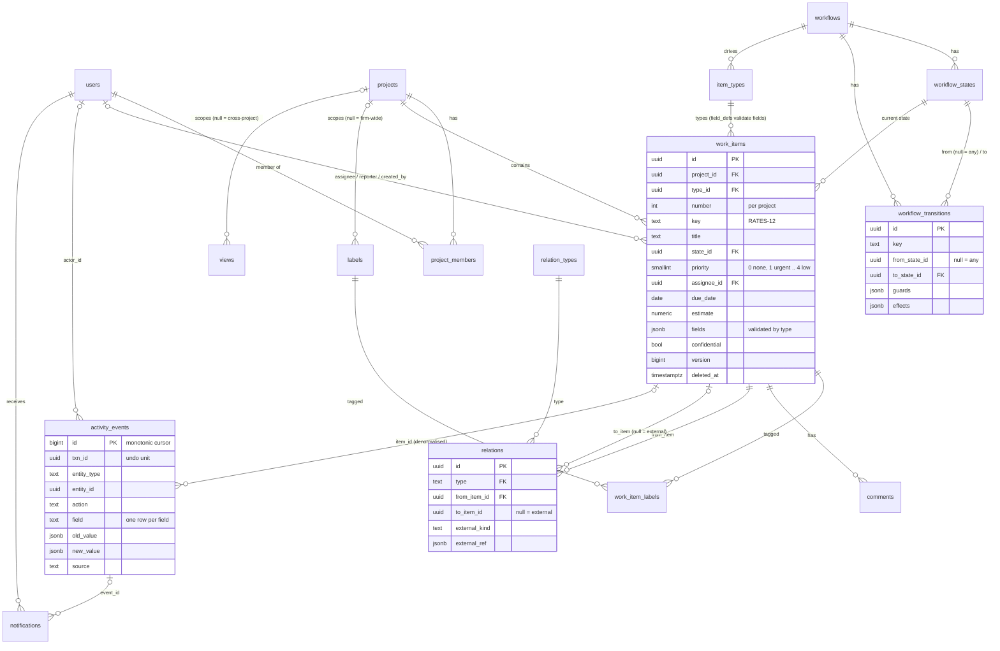

# Data Model

The whole model is one file: [`packages/db/migrations/0001_init.sql`](https://github.com/jamjorf/pm-tool/blob/main/packages/db/migrations/0001_init.sql) (about 950 lines of plain SQL, Postgres 15+, extensions `pgcrypto` and `pg_trgm` only). You can apply it with `psql -f` and use it without the rest of the monorepo. The TypeScript in `@pm/core` mirrors it; it never replaces it. The full narrative, with every trigger body and a set of audit queries, is [docs/01-data-model.md](https://github.com/jamjorf/pm-tool/blob/main/docs/01-data-model.md).

Conventions: UUID primary keys (client-generatable), `snake_case` everywhere, `timestamptz`, soft deletes via `deleted_at`, Postgres enums for closed vocabularies (`firm_role`, `project_role`, `state_category`) and registries (rows) for vocabularies desks should extend (`item_types`, `relation_types`, `workflows`).

## The five pillars and their tables

| # | Pillar | Key tables and objects |
|---|---|---|
| 1 | One generic work item | `work_items`, `item_types` (`field_defs`), triggers `trg_assign_item_number`, `trg_validate_item_fields`, `trg_validate_item_state`; view `work_items_v` |
| 2 | Workflows as data | `workflows`, `workflow_states` (`category`, one `is_initial`), `workflow_transitions` (`from_state_id` null = any, `guards`, `effects`) |
| 3 | Relations as a typed graph | `relation_types` registry, `relations` edge table, trigger `trg_relations_no_cycle`, functions `item_descendants`, `item_ancestors`, `item_open_blockers`, `item_rollup` |
| 4 | Append-only activity log | `activity_events` with `trg_append_only` on UPDATE / DELETE / TRUNCATE, grouped by `txn_id` |
| 5 | Permissions decided early | `users.firm_role`, `project_members.role`, `projects.visibility`, `work_items.confidential`; functions `effective_project_role`, `can_view_item`, `visible_project_ids` |

Two more pillars the tool needs and the SQL carries for free: **views are saved queries** (`views.spec`) and **every synced table has `version` and `deleted_at`** for local-first sync.

## Entity overview



### Table catalogue

| Section in the SQL | Tables | Role |
|---|---|---|
| 0 | `sync_version_seq`, `trg_set_version()`, `install_sync_trigger()` | Global version stamping for sync |
| 1 | `users`, `sessions`, `api_keys`, `teams`, `team_members` | Principals |
| 2 | `workflows`, `workflow_states`, `workflow_transitions` | State machines as data |
| 3 | `item_types` | Type registry with `field_defs` |
| 4 | `projects`, `project_members` | Permission backbone |
| 5 | `work_items`, `labels`, `work_item_labels`, `comments`, `attachments` | The generic entity and its satellites |
| 6 | `relation_types`, `relations`, graph functions | Typed edges |
| 7 | `activity_events` | Append-only log |
| 8 | `views` | Saved queries |
| 9 | `item_watchers`, `notification_preferences`, `notifications`, `notification_deliveries` | Low-noise notifications |
| 10 | `webhook_endpoints`, `webhook_deliveries`, `integration_configs`, `inbound_events` | Integrations |
| 11 | `sync_client_groups`, `sync_clients` | Replicache-style bookkeeping |
| 12 | `effective_project_role()`, `can_view_item()`, `visible_project_ids()` | Permissions |
| 13 | `settings` | Firm-level key/value |
| 14 | seeded `standard` and `simple` workflows; `task`, `bug`, `initiative`, `request` types | Usable immediately |
| 15 | `work_items_v` | Display view with resolved joins |

## The work item

A column is for what *every* type has and every view sorts or filters on cheaply: `title`, `description`, `state_id`, `priority` (0 none, 1 urgent to 4 low), `assignee_id`, `reporter_id`, `start_date`, `due_date`, `estimate`, `confidential`, `sort_order`, timestamps (`completed_at`, `canceled_at`, `archived_at`). Everything type-specific goes in `fields jsonb`, validated against `item_types.field_defs`:

- the trigger `trg_validate_item_fields` rejects unknown keys, missing required keys and wrong JSON types (errcode `23514`);
- `validateFields()` in `@pm/core` adds option membership, user existence and `min`/`max` before the write;
- `trg_validate_item_state` refuses a `state_id` outside the type's workflow.

Field kinds: `text`, `long_text`, `number`, `bool`, `date`, `datetime`, `select`, `multi_select`, `user`, `url`; any kind may be `multi: true` (stored as an array). The key `RATES-12` is assigned by `trg_assign_item_number` from `projects.item_seq`; clients choose UUIDs, never keys.

`work_items_v` adds `type_key`, `type_name`, `state_key`, `state_name`, `state_category`, `project_key`, `project_name`, `assignee_name`, `label_names`, `parent_id` and `is_blocked`. It is the query target for the API and the row shape webhooks deliver.

## Relations and graph helpers

`relation_types` is seeded with `parent_of` (hierarchy), `blocks` (blocking), `duplicates` (symmetric), `relates_to` (symmetric) and `links_to` (external). An edge is `from_item_id -(type)-> to_item_id`, or, for external entities, `to_item_id = null` plus `external_kind` and `external_ref` (a generated `external_key` makes re-linking idempotent). A partial unique index gives every item at most one parent; `trg_relations_no_cycle` walks the graph of any `is_hierarchy` or `is_blocking` type before accepting an edge.

```sql
item_descendants(root uuid)   returns table(item_id uuid, depth int)   -- subtree via parent_of, depth <= 100
item_ancestors(leaf uuid)     returns table(item_id uuid, depth int)   -- parent, grandparent, ...
item_open_blockers(item uuid) returns setof uuid                        -- `blocks` sources not in done/canceled
item_rollup(root uuid)        returns table(total, done, in_progress, todo, canceled, estimate_total, estimate_done)
```

Guards (`no_open_blockers`, `children_in_category`) and effects (`transition_parent_if`, `transition_children`) reuse these functions. Worked queries (transitive blockers, rollup by quarter, breadcrumbs) are in [docs/01-data-model.md §5.3](https://github.com/jamjorf/pm-tool/blob/main/docs/01-data-model.md#53-graph-functions).

## The activity log

`activity_events(id bigint identity, txn_id, entity_type, entity_id, item_id, project_id, actor_kind, actor_id, actor_label, action, field, old_value, new_value, mutation_name, source, created_at)`.

- **One row per changed field.** Tracked columns (`TRACKED_ITEM_FIELDS` in `@pm/core`): `title`, `description`, `type_id`, `state_id`, `priority`, `assignee_id`, `reporter_id`, `start_date`, `due_date`, `estimate`, `confidential`, `completed_at`, `canceled_at`, `archived_at`, `project_id`, `sort_order`, plus every key of `fields` as `fields.<key>`.
- `actor_kind` is `user`, `api_key`, `integration`, `system` or `agent`; `source` is `app`, `api`, `mcp`, `slack`, `email`, `github` or `system`.
- `id` is a monotonic cursor for feeds, webhooks and notifications.
- The only writer is `applyMutation`. UPDATE, DELETE and TRUNCATE raise `42501`.

Undo replays `old_value` for a `txn_id` as a *new* mutation. Analytics (cycle time, throughput) are queries over `state_id` events. See [ADR-004](https://github.com/jamjorf/pm-tool/blob/main/docs/adr/ADR-004-append-only-activity-log.md).

## Permissions

Per-project roles with three modifiers. Resolution order:

1. An explicit, non-deleted `project_members` row wins (`admin` / `editor` / `viewer`).
2. Otherwise firm `owner` / `admin` are `admin` on every project.
3. Otherwise firm `member` is `editor` on every `firm`-visible project and has no access to `private` projects.
4. Otherwise (`guest`, or `member` on a private project) no access.
5. A `confidential` item is visible only to project admins and its assignee, reporter or creator.

```sql
effective_project_role(p_user uuid, p_project uuid) returns project_role   -- null = no access
can_view_item(p_user uuid, p_item uuid) returns boolean                     -- role + confidential rule
visible_project_ids(p_user uuid) returns setof uuid                         -- drives sync pull scope
```

`permissions.can()` in `@pm/core` mirrors the lattice for the UI with a minimum role per action (`item.edit` needs `editor`, `project.edit` needs `admin`, `workflow.manage` needs a firm admin, and so on; the table is `ACTION_MIN_ROLE` in `packages/core/src/permissions/types.ts`). Attribute-style rules ("only risk can approve") live in workflow guards, not here. See [ADR-005](https://github.com/jamjorf/pm-tool/blob/main/docs/adr/ADR-005-permissions-per-project-roles.md).

## Sync columns

Every synced table carries `version bigint`, `created_at`, `updated_at` and `deleted_at`. `install_sync_trigger('<table>')` attaches `trg_set_version`, which stamps `version = nextval('sync_version_seq')` on every insert or update and bumps `updated_at`. Rows are never hard-deleted from synced tables; `deleted_at` is a tombstone the client receives as a `del`. The synced set (`SYNCED_TABLES` in `@pm/core`) is `users`, `teams`, `workflows`, `workflow_states`, `workflow_transitions`, `item_types`, `projects`, `project_members`, `work_items`, `labels`, `work_item_labels`, `comments`, `relations`, `views`, `item_watchers`, `notifications`, `notification_preferences`. Details in [[Sync]].

## How to iterate

| Change | What you do | Migration? |
|---|---|---|
| Add a field to a type | `update item_types set field_defs = field_defs \|\| '[{"key":"desk","label":"Desk","kind":"text"}]'::jsonb where key = 'task'` | No; make it `required` only after backfilling |
| Rename a label, add select options | edit the JSON element | No |
| Remove a field | first `update work_items set fields = fields - 'desk' where type_id = …`, then remove the def (the trigger rejects unknown keys on the next write) | No |
| Add an item type | one `insert into item_types` pointing at an existing or new workflow | No |
| Add a state or change guards/effects | `insert into workflow_states` plus transitions; `update workflow_transitions set guards = …` | No |
| Add a relation kind | `insert into relation_types` (set `is_hierarchy` / `is_blocking` for cycle protection) | No |
| Add a new guard or effect *type* | code in `@pm/core` (the JSON is opaque to SQL) | No (code) |
| Add a column every type needs | `alter table work_items add column …`, index, add to `work_items_v` and `BUILTIN_FIELDS` | Yes |
| New enum member, new `state_category`, new visibility model | DDL and function changes | Yes |

Rule of thumb: if it is a row, it is a product decision; if it is DDL, it is an engineering decision with a migration file `000N_*.sql` (see [[Development]]).

## Standalone use

```bash
createdb pmtool
psql pmtool -v ON_ERROR_STOP=1 -f packages/db/migrations/0001_init.sql
```

[docs/01-data-model.md §10](https://github.com/jamjorf/pm-tool/blob/main/docs/01-data-model.md#10-standalone-quick-start) walks through inserting users, projects, items, a hierarchy with blockers and an external link, then shows the validation and cycle triggers firing.
