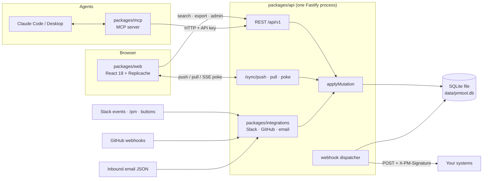

# pm-tool

A firm-wide project management tool for desks, strategies and functions. One SQLite file (no database server, no containers, no `sudo`), one TypeScript monorepo, a local-first React app, an MCP server for agents, and Slack / GitHub / email integrations. It is built so that desk-specific tooling (trade ideas, model changes, client onboarding) is **data you insert**, not code you ship.

> **Start here**
>
> New to the repo? Follow [[Quick Start]]: ten minutes from clone to a running app with seeded data, an API key and the MCP server wired into Claude Code.
> Reading for architecture? Go to [[Data Model]], then [[Architecture Decisions]], then [[Sync]].

## The five pillars

**1. One generic work item.** Every task, bug, initiative, request or trade idea is a row in `work_items` with a `type_id`. Columns hold what every type shares (title, state, priority, assignee, dates, estimate, confidential); everything type-specific lives in a `fields` JSON column validated against the type's `field_defs` by database triggers and by `@pm/core` before the write. Adding a type or a field is an insert, not a migration.

**2. Workflows as data.** States, transitions, guards and effects are rows in `workflows`, `workflow_states` and `workflow_transitions`. A closed, typed vocabulary of guards (`require_field`, `no_open_blockers`, `require_role`, ...) and effects (`set_field`, `notify`, `webhook`, `transition_parent_if`, ...) is evaluated by the same pure engine on the client (to grey out buttons) and on the server (authoritatively, inside the write transaction). State changes happen only through `transitionItem`.

**3. Relations as a typed graph.** Parent/child, blocks, duplicates, relates-to and links to external systems (GitHub PRs, Slack threads, documents) are one `relations` edge table with a `relation_types` registry. Triggers enforce acyclicity and single parent; rollups and dependency checks are views (`item_parents`, `item_ancestry`, `open_blockers`, `item_rollups`).

**4. Append-only activity log.** `activity_events` gets one row per changed field, grouped by `txn_id`, written only by `applyMutation`. Triggers raise on UPDATE and DELETE. History, audit, notifications, webhooks, undo and analytics all derive from this one table, so they cannot disagree.

**5. Views are saved queries.** Lists, boards, timelines and dashboards are one `QuerySpec` grammar plus presentation. The same spec compiles to SQL on the server and evaluates in memory on the client over the Replicache store, with a parity test suite keeping the two executors honest.

## How the pieces fit

Everything that writes converges on `applyMutation` in `packages/api/src/mutations`; everything that reads goes through the same visibility views (`effective_roles`, `visible_items`). See [[Sync]] and [[API]].

## Pages

| Page | What it covers |
|---|---|
| [[Quick Start]] | Prerequisites, install, first login, a five-minute tour, API key, MCP setup, troubleshooting |
| [[Data Model]] | The five pillars table by table, ERD, graph and permission views, FTS5 search, sync columns, how to iterate |
| [[Workflows and Item Types]] | Guard and effect catalogs, the seeded Standard workflow, adding a desk workflow with INSERTs, the Admin UI and API |
| [[Views and Queries]] | The QuerySpec grammar, fields, ops, macros, ViewSpec examples, URL state and Save view, filter builder |
| [[Sync]] | Local-first sync: Replicache mutators, push/pull/poke, global version, tombstones, resync, rejections |
| [[Keyboard and Palette]] | The keyboard map, palette modes and actions, bulk edit, search behaviour |
| [[API]] | Auth, error envelope, the full route catalog, response shapes, curl examples |
| [[Integrations]] | Webhooks out with HMAC verification, Slack, GitHub, email in and out, where secrets go |
| [[MCP Server]] | The 23 tools, resources and prompts, setup for Claude Code and Claude Desktop, security notes |
| [[Operations]] | Deployment topology, environment variables, backups, audit, monitoring, scaling path, retention |
| [[Development]] | Repo layout, commands, build order, test suites, conventions, CI, migrations |
| [[Architecture Decisions]] | One row per ADR (001 to 009) with the decision and the reason |

## Status

| Package | npm name | Role | Tests |
|---|---|---|---|
| `packages/db` | `@pm/db` | SQLite runtime layer (`openDb`, `sql` tag, transactions, hydration), SQL migrations (`0001_init.sql` stands alone), runner, seed, reset | 7 |
| `packages/core` | `@pm/core` | Browser-safe shared logic: schemas, QuerySpec compiler + evaluator, workflow engine, permissions, field validation, activity diffs | 155 (78 are SQL/local parity cases) |
| `packages/api` | `@pm/api` | Fastify 5 server: auth, REST v1, sync, activity log, notifications, webhooks, search | 31 |
| `packages/web` | `@pm/web` | React 18 SPA: palette, saved-query views, bulk edit, item detail, inbox, admin | 14 |
| `packages/mcp` | `@pm/mcp` | MCP server (stdio + Streamable HTTP), 23 tools, resources, prompts | 9 |
| `packages/integrations` | `@pm/integrations` | Slack, GitHub, email inbound handlers and outbound senders | 25 |

Stack: SQLite via Node's built-in `node:sqlite` (one file, WAL mode, no server), TypeScript monorepo (pnpm 10, Node 22.13+), Fastify 5, React 18 + Replicache 15, zod 3, vitest. Single region, single process, single writer by design ([ADR-008](https://github.com/jamjorf/pm-tool/blob/main/docs/adr/ADR-008-monolith-single-region.md), [ADR-009](https://github.com/jamjorf/pm-tool/blob/main/docs/adr/ADR-009-sqlite-over-postgres.md)).

## Where the depth is

This wiki is the task-oriented layer. The full documentation set lives in the repository:

| Document | Read it for |
|---|---|
| [docs/ARCHITECTURE.md](https://github.com/jamjorf/pm-tool/blob/main/docs/ARCHITECTURE.md) | The contract every package is built against: layout, query layer, mutation pipeline, sync protocol, HTTP API v1, webhooks, notifications |
| [docs/01-data-model.md](https://github.com/jamjorf/pm-tool/blob/main/docs/01-data-model.md) | Every table, trigger and view, with audit queries and a `sqlite3` quick start |
| [docs/02-design.md](https://github.com/jamjorf/pm-tool/blob/main/docs/02-design.md) | Tool design: QuerySpec executors, mutation catalog, engine runtime, sync design, search, notifications |
| [docs/03-ux.md](https://github.com/jamjorf/pm-tool/blob/main/docs/03-ux.md) | UX spec: screens, palette, keyboard map, bulk edit, inbox, filter builder, admin editors |
| [docs/04-integrations.md](https://github.com/jamjorf/pm-tool/blob/main/docs/04-integrations.md) | Using it from outside: API, webhooks, Slack, GitHub, email, MCP |
| [docs/05-operations.md](https://github.com/jamjorf/pm-tool/blob/main/docs/05-operations.md) | Running it: deployment, env vars, backups, monitoring, security, retention, scaling, roadmap |
| [docs/adr/](https://github.com/jamjorf/pm-tool/blob/main/docs/adr) | Nine decision records |
| [docs/BUILD-PROMPT.md](https://github.com/jamjorf/pm-tool/blob/main/docs/BUILD-PROMPT.md) | A self-contained prompt that rebuilds the whole system with a coding agent |

When documents disagree, the SQL migration and the `@pm/core` contract files win, then `ARCHITECTURE.md`, then the numbered documents.
