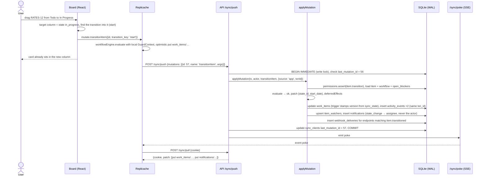

# Sync

The web app is local-first. Every read comes from a Replicache store in IndexedDB; every write is an optimistic mutator that the server replays authoritatively. The protocol is three HTTP routes and two bookkeeping tables, implemented in `packages/api/src/sync` and `packages/web/src/sync`. Decision record: [ADR-007](https://github.com/jamjorf/pm-tool/blob/main/docs/adr/ADR-007-sync-global-version.md). Design narrative: [docs/02-design.md §6](https://github.com/jamjorf/pm-tool/blob/main/docs/02-design.md#6-sync-design-replicache-style). Contract: [docs/ARCHITECTURE.md](https://github.com/jamjorf/pm-tool/blob/main/docs/ARCHITECTURE.md#sync-protocol-replicache-compatible).

## What it means for users

- **Instant navigation.** Projects, views, items, labels, workflows, types, relations, comments, watchers and notifications are already in the browser. Route changes render synchronously; nothing waits on the network except deep search and dashboards over data you have not synced.
- **Optimistic writes.** Create an item and the row appears with a placeholder key `RATES-?`; drag a card and it moves before the request leaves the tab. The server's row replaces the optimistic one on the next pull.
- **Rejections are visible, never silent.** If the server disagrees (a guard failed because someone added a blocker a second earlier), the next pull reverts the local row and an inbox row of kind `mutation_rejected` says why. The web app also turns unread rejections into a toast.
- **Fresh within about a second.** Every committed write pokes connected clients over SSE; they pull the delta. There is no manual refresh in the UI.
- **Offline works.** Reads and writes keep working; the push queue drains on reconnect in order. A subtle banner shows "Offline, changes will sync when you reconnect".
- **Cold start.** The shell renders immediately with a progress indicator until the first full pull; a returning user starts from the persisted store and pulls only the delta.

## The pieces

### Client: one mutator per mutation

`packages/web/src/sync/mutators.ts` implements one Replicache mutator per key of `MutationArgs` in `@pm/core`. Each validates its args with the shared zod schema and applies the same write the server would, against KV keys `rowKey(table, row)` = `"<table>/<pk1>[/<pk2>]"` (`work_items/<id>`, `work_item_labels/<item>/<label>`, `relations/<id>`, `item_watchers/<item>/<user>`).

- `createItem` writes a full `work_items` row with `number: 0`, key `<PROJECT>-?`, the workflow's initial state, field defaults, label rows, an optional `parent_of` relation and a reporter watcher.
- `transitionItem` loads the type's workflow from the local store, builds a best-effort `GuardContext` (open blockers from local relations and states, children categories, label names, effective role via `permissions.effectiveRole`) and runs `workflowEngine.evaluate`. If guards pass it applies the engine's `patch` plus local label effects; otherwise it throws `GuardError`, which the UI shows as a toast and a snap-back.
- Server-only mutations (`upsertWorkflow`, `upsertItemType`, membership) still write optimistically where simple; the pull is the source of truth.

The Replicache instance is `name: pm-<userId>`, `pushURL: /sync/push`, `pullURL: /sync/pull`, `pullInterval: 60s`, `schemaVersion: '1'`. It subscribes to `GET /sync/poke` and calls `pull()` on every `poke` event, reconnecting with exponential backoff (1 s to 30 s). A 401 on push or pull drops the session.

### Server: push

`POST /sync/push` receives `{ pushVersion: 1, clientGroupID, mutations: [{ id, clientID, name, args }] }`. For each mutation, in its own transaction:

1. `sql.begin()` opens the transaction with `BEGIN IMMEDIATE`, taking SQLite's single write lock for its whole duration.
2. Read `sync_clients.last_mutation_id`. Skip if `mutation.id <= last` (already applied); error if `> last + 1` (gap).
3. `parseMutation(name, args)` and `applyMutation(tx, actor, mutation, meta)` with `meta.source = 'app'`.
4. Set `last_mutation_id = mutation.id` and the client's `version = sql.nextVersion()` (`update sync_state set version = version + 1 returning version`).

Errors inside a mutation are logged, the mutation is **still marked applied** (Replicache semantics: the client's optimistic change is rolled back by the next pull), and a `notifications` row of kind `mutation_rejected` is written for the user. After the push, poke.

### Server: pull

`POST /sync/pull` receives `{ pullVersion: 1, clientGroupID, cookie }` where `cookie` is the last `version` the client saw (null means 0). The whole pull runs inside `sql.snapshot()`, a deferred read transaction that under WAL sees the database as of the last commit and never blocks the writer. The server reads `sync_state.version` inside that snapshot and returns it as the new cookie: `{ cookie: <sync_state.version>, lastMutationIDChanges, patch: [clear | put | del] }`.

- If the cookie is 0 or the client group has `resync_required`, the server sends `{op:'clear'}` followed by a `put` for every visible row and clears the flag.
- Otherwise, for each table in `SYNCED_TABLES`, it selects rows with `version > cookie` and emits `put` when the row is visible to the user and `deleted_at is null`, otherwise `del`.

Visibility per table:

| Tables | Visible when |
|---|---|
| `users`, `teams`, `workflows`, `workflow_states`, `workflow_transitions`, `item_types`, `labels` (firm-wide plus visible projects) | always |
| `projects`, `project_members` | project in `select project_id from effective_roles where user_id = ?` |
| `work_items` | `exists (select 1 from visible_items where user_id = ? and item_id = ?)` |
| `comments`, `relations` (either end visible), `work_item_labels`, `item_watchers` | parent item visible |
| `views` | `owner_id = user`, or `is_shared` and the project is visible (or null project) |
| `notifications`, `notification_preferences` | `user_id = user` |

### Server: poke

`GET /sync/poke` is a Server-Sent Events stream. The API emits `event: poke` after any committed push or REST write (`pokeAfterCommit`). Single region, single process: an in-memory `EventEmitter` is enough; a second process is the point at which the deployment moves to Postgres ([ADR-009](https://github.com/jamjorf/pm-tool/blob/main/docs/adr/ADR-009-sqlite-over-postgres.md)) and poke to `LISTEN/NOTIFY`.

## Global version and write serialisation

Every synced row gets its `version` from the one-row `sync_state` table: the `<table>_version_ins`/`_upd` triggers run `update sync_state set version = version + 1` and stamp the row with the result. A pull is "rows with `version > cookie`". That is only correct if version order equals commit order: if transaction A could take version 100, transaction B version 101 and commit first, a client could pull with `cookie = 101`, and A's row would never be sent. SQLite guarantees it by construction: a transaction opened with `BEGIN IMMEDIATE` holds the database's single write lock until it commits, so no other writer can touch `sync_state` in between. There is no advisory lock and no sequence. The `@pm/db` runtime adds an async mutex so transactions inside one process queue instead of spinning on `SQLITE_BUSY` (`busy_timeout = 5000` is the backstop across processes). Writers are serialised; at a firm's scale (tens of writes per second at peak) this is invisible.

The pull reads inside a deferred transaction. Under WAL that is a consistent snapshot, so `sync_state.version` read there is exactly the highest version any row in the patch can carry, which is what the cookie must mean.

## Tombstones and visibility changes

Rows in synced tables are never hard-deleted. `deleted_at` is set, the version bumps, and the next pull emits `del` for that key. The same `del` carries a row that became invisible to a user when it changed (an item turned `confidential`).

Changes that can hide **unchanged** rows cannot be expressed as per-row `del`s cheaply: removing a project membership, making a project private, moving an item between projects. These set `sync_client_groups.resync_required = true` for affected users inside `applyMutation`, and their next pull is a `clear` plus a full snapshot.

## Dragging a card on the board, end to end

If the server's evaluation disagrees, the push still marks mutation 57 applied, writes a `mutation_rejected` notification ("Start: no_open_blockers: RATES-9 is open"), and the pull returns the card to Todo. Nothing was lost, and the attempt is not in `activity_events` because no field changed.

## Limits and the path to row versioning

| Symptom | Rule of thumb | Move |
|---|---|---|
| Initial snapshot too large | more than about 200k visible rows per user or 50 MB | page the snapshot per table; archive old items (`archived_at`) and exclude them from the snapshot |
| Writer contention | sustained more than about 50 writes/s, push p95 above 500 ms | Replicache's row-versioning strategy: a `client_view_records` table tracks which (key, version) each client group has seen, the global counter goes away, diffs are computed per client group. SQLite still serialises writers, so past this point the next row applies |
| Frequent resyncs | membership churn causing full snapshots many times a day | same move; row versioning makes visibility changes incremental |
| Second API process or host | horizontal scale | move the data to Postgres ([ADR-009](https://github.com/jamjorf/pm-tool/blob/main/docs/adr/ADR-009-sqlite-over-postgres.md) describes the mechanical path), poke to `LISTEN/NOTIFY`, version order via an advisory lock or row versioning |

None of these moves change the client protocol; only the server's `pull` implementation changes. Monitoring signals for them are in [[Operations]].

## Debugging sync

- `select version from sync_state;` is the current global version; a pull cookie can never be higher.
- `select count(*) from sync_client_groups where resync_required = 1;` sustained high counts mean churn.
- `select * from notifications where kind = 'mutation_rejected' order by created_at desc limit 20;` shows what the server refused and why.
- `select id, client_group_id, last_mutation_id, version from sync_clients order by version desc;` shows where each client is.
- The API tests in `packages/api/test/sync.test.ts` cover push ordering and idempotency, the first full pull and incremental `put` / `del` by version, confidentiality-driven resync, the `mutation_rejected` path and SSE pokes; run them with `pnpm --filter @pm/api test`.
