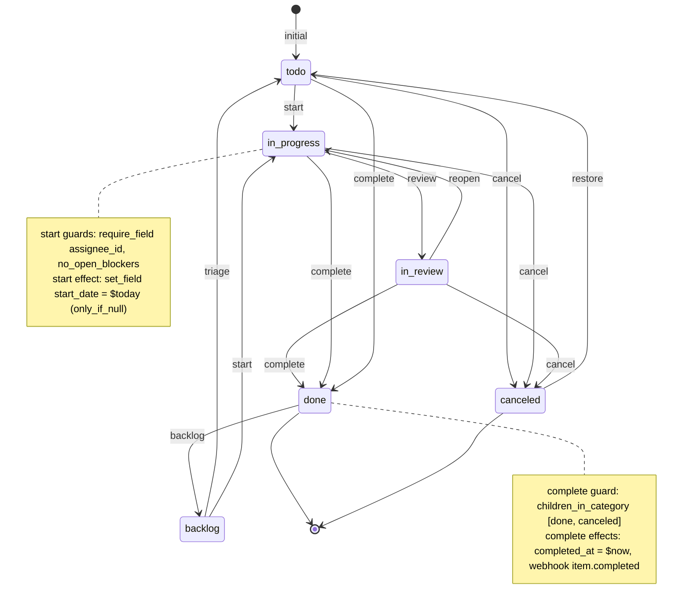

# Workflows and Item Types

Workflows are rows: `workflows` → `workflow_states` → `workflow_transitions`. Each item type points at one workflow. Guards and effects are JSON arrays validated by zod unions in `@pm/core` and evaluated by the pure `workflowEngine` on the client (to grey out buttons) and on the server (authoritatively). State changes happen only through `transitionItem`; `updateItem` cannot set `state_id`.

Source: [`packages/core/src/schema/entities.ts`](https://github.com/jamjorf/pm-tool/blob/main/packages/core/src/schema/entities.ts) (the `Guard` and `Effect` unions), [`packages/core/src/workflow/engine.ts`](https://github.com/jamjorf/pm-tool/blob/main/packages/core/src/workflow/engine.ts), and [docs/01-data-model.md §4](https://github.com/jamjorf/pm-tool/blob/main/docs/01-data-model.md#4-workflows-as-data).

## States and categories

Every state has a `category` from a closed enum: `backlog`, `todo`, `in_progress`, `done`, `canceled`. Boards, rollups, "not done" filters and the `children_in_category` guard reason about categories, so a desk can rename or add states without breaking anything generic. Exactly one state per workflow is `is_initial`.

## Guard catalog

A transition is allowed when every guard passes. Failures come back as `{ guard, reason }` so the UI and agents can explain them.

| Guard | JSON | Passes when | Typical use |
|---|---|---|---|
| `require_field` | `{"type":"require_field","field":"assignee_id"}` | the column or `fields.<key>` is non-null and non-empty | "needs an assignee before Start" |
| `field_equals` | `{"type":"field_equals","field":"fields.risk_signoff","value":true}` | the value equals `value` | sign-off flag must be true |
| `field_in` | `{"type":"field_in","field":"fields.severity","values":["s1","s2"]}` | the value is in `values` | only high severities may escalate |
| `no_open_blockers` | `{"type":"no_open_blockers"}` | `item_open_blockers(id)` is empty | dependency gating |
| `children_in_category` | `{"type":"children_in_category","categories":["done","canceled"]}` | every direct child's state category is in the list | cannot complete an initiative with open children |
| `require_role` | `{"type":"require_role","roles":["admin"]}` | the actor's effective project role is in `roles` | only desk heads approve |
| `require_assignee_is_actor` | `{"type":"require_assignee_is_actor"}` | `assignee_id` equals the actor | only the owner marks it done |
| `require_label` | `{"type":"require_label","label":"approved"}` | the item carries the label | needs the `approved` label |

## Effect catalog

Effects run after the guards pass. `set_field` is applied in the same patch as `state_id`; the rest are "deferred effects" the server executes inside the same transaction.

| Effect | JSON | Does | Executed by |
|---|---|---|---|
| `set_field` | `{"type":"set_field","field":"start_date","value":"$today","only_if_null":true}` | patches a column or `fields.<key>`; macros `$now`, `$today`, `$actor`; `null` clears | engine (client and server) |
| `notify` | `{"type":"notify","audience":["project_admins"],"template":"review_requested"}` | notification to `watchers`, `assignee`, `reporter` and/or `project_admins` | server |
| `webhook` | `{"type":"webhook","event":"item.completed"}` | enqueue an outbound webhook with the named event kind | server |
| `add_label` / `remove_label` | `{"type":"add_label","label":"desk-approved"}` | by label name (project first, then firm-wide) | server |
| `transition_parent_if` | `{"type":"transition_parent_if","all_children_category":["done","canceled"],"to":"done"}` | if all the parent's children are in those categories, run the parent's transition into state key `to` | server, recursive |
| `transition_children` | `{"type":"transition_children","to":"canceled"}` | run the transition into `to` on every direct child; children whose guards fail are skipped and reported | server, recursive |

Recursion is bounded by the hierarchy depth (`item_descendants` caps at 100).

## The seeded Standard workflow

Types `task`, `bug` and `initiative` use `standard`; `request` uses `simple` (Todo → Doing → Done + Canceled, all transitions from any state).



Transitions with `from_state_id = null` (`start`, `complete`, `cancel`, `backlog`) are allowed from any state; the diagram draws the edges that make sense in practice. As inserted by the migration:

| key | from | to | guards | effects |
|---|---|---|---|---|
| `triage` | backlog | todo | none | none |
| `start` | any | in_progress | `require_field assignee_id`, `no_open_blockers` | `set_field start_date = $today only_if_null` |
| `review` | in_progress | in_review | none | `notify watchers, template review_requested` |
| `reopen` | in_review | in_progress | none | none |
| `complete` | any | done | `children_in_category [done, canceled]` | `set_field completed_at = $now`, `webhook item.completed` |
| `cancel` | any | canceled | `require_role [admin, editor]` | `set_field canceled_at = $now` |
| `restore` | canceled | todo | none | `set_field canceled_at = null` |
| `backlog` | any | backlog | none | `set_field completed_at = null` |

States: `backlog` (backlog), `todo` (todo, initial), `in_progress` (in_progress), `in_review` (in_progress), `done` (done), `canceled` (canceled).

## Adding a desk type with a four-eyes approval, INSERTs only

A model-change workflow for a quant library: Proposed → Implemented → Validated → Approved → Released, with Rejected as the exit. Four eyes means two separate admin-gated steps (validate, approve), each stamping the actor into a `user` field so the audit log shows who did what. No migration, no code; the UI buttons and the API's guard evaluation follow the rows.

```sql
begin;

insert into workflows (id, key, name, description) values
  ('22222222-0000-0000-0000-000000000001', 'model_change', 'Model change',
   'Proposed -> Implemented -> Validated -> Approved (4-eyes) -> Released | Rejected');

insert into workflow_states (id, workflow_id, key, name, category, color, sort, is_initial) values
  ('22222222-0000-0000-0000-000000000011', '22222222-0000-0000-0000-000000000001', 'proposed',    'Proposed',    'todo',        '#9ca3af', 0, true),
  ('22222222-0000-0000-0000-000000000012', '22222222-0000-0000-0000-000000000001', 'implemented', 'Implemented', 'in_progress', '#60a5fa', 1, false),
  ('22222222-0000-0000-0000-000000000013', '22222222-0000-0000-0000-000000000001', 'validated',   'Validated',   'in_progress', '#f59e0b', 2, false),
  ('22222222-0000-0000-0000-000000000014', '22222222-0000-0000-0000-000000000001', 'approved',    'Approved',    'in_progress', '#a78bfa', 3, false),
  ('22222222-0000-0000-0000-000000000015', '22222222-0000-0000-0000-000000000001', 'released',    'Released',    'done',        '#10b981', 4, false),
  ('22222222-0000-0000-0000-000000000016', '22222222-0000-0000-0000-000000000001', 'rejected',    'Rejected',    'canceled',    '#6b7280', 5, false);

insert into workflow_transitions (workflow_id, key, name, from_state_id, to_state_id, guards, effects, sort) values
  -- the implementer moves it forward; must own it and name the model
  ('22222222-0000-0000-0000-000000000001', 'implement', 'Mark implemented',
   '22222222-0000-0000-0000-000000000011', '22222222-0000-0000-0000-000000000012',
   '[{"type":"require_assignee_is_actor"},{"type":"require_field","field":"fields.model"}]',
   '[{"type":"notify","audience":["project_admins"],"template":"review_requested"}]', 0),
  -- first pair of eyes: a project admin validates; needs the backtest and the label
  ('22222222-0000-0000-0000-000000000001', 'validate', 'Validate',
   '22222222-0000-0000-0000-000000000012', '22222222-0000-0000-0000-000000000013',
   '[{"type":"require_role","roles":["admin"]},{"type":"require_field","field":"fields.backtest_url"},{"type":"require_label","label":"backtested"}]',
   '[{"type":"set_field","field":"fields.validator","value":"$actor"},{"type":"set_field","field":"fields.validated_at","value":"$now"}]', 1),
  -- second pair of eyes: a project admin approves; nothing may block it
  ('22222222-0000-0000-0000-000000000001', 'approve', 'Approve',
   '22222222-0000-0000-0000-000000000013', '22222222-0000-0000-0000-000000000014',
   '[{"type":"require_role","roles":["admin"]},{"type":"no_open_blockers"}]',
   '[{"type":"set_field","field":"fields.approver","value":"$actor"},{"type":"add_label","label":"approved"},{"type":"webhook","event":"item.transitioned"}]', 2),
  -- release: needs the approved label and a production date; rolls up into the parent initiative
  ('22222222-0000-0000-0000-000000000001', 'release', 'Release',
   '22222222-0000-0000-0000-000000000014', '22222222-0000-0000-0000-000000000015',
   '[{"type":"require_label","label":"approved"},{"type":"require_field","field":"fields.prod_date"}]',
   '[{"type":"set_field","field":"completed_at","value":"$now"},{"type":"webhook","event":"item.completed"},{"type":"transition_parent_if","all_children_category":["done","canceled"],"to":"done"}]', 3),
  ('22222222-0000-0000-0000-000000000001', 'reject', 'Reject',
   null, '22222222-0000-0000-0000-000000000016',
   '[{"type":"require_role","roles":["admin","editor"]}]',
   '[{"type":"set_field","field":"canceled_at","value":"$now"},{"type":"remove_label","label":"approved"}]', 4),
  ('22222222-0000-0000-0000-000000000001', 'reopen', 'Back to proposed',
   '22222222-0000-0000-0000-000000000016', '22222222-0000-0000-0000-000000000011',
   '[]', '[{"type":"set_field","field":"canceled_at","value":null}]', 5);

insert into item_types (key, name, plural_name, icon, color, workflow_id, is_container, sort, field_defs) values
  ('model_change', 'Model change', 'Model changes', 'git-branch', '#a78bfa', '22222222-0000-0000-0000-000000000001', false, 11,
   '[{"key":"model","label":"Model","kind":"select","required":true,
      "options":[{"value":"curve","label":"Curve builder"},{"value":"vol","label":"Vol surface"},{"value":"xva","label":"XVA engine"}]},
     {"key":"change_class","label":"Change class","kind":"select",
      "options":[{"value":"parameter","label":"Parameter"},{"value":"methodology","label":"Methodology"},{"value":"bugfix","label":"Bug fix"}]},
     {"key":"backtest_url","label":"Backtest","kind":"url"},
     {"key":"validator","label":"Validated by","kind":"user"},
     {"key":"validated_at","label":"Validated at","kind":"datetime"},
     {"key":"approver","label":"Approved by","kind":"user"},
     {"key":"prod_date","label":"Production date","kind":"date"}]');

commit;
```

What the vocabulary cannot express today: "the validator may not also be the approver". `field_equals` compares against a literal, not against `$actor`. Enforcing that needs a new guard type in `@pm/core` (for example `require_field_not_actor {field}`), which is a code change with no migration. Until then the audit log still shows both actors, so compliance can check after the fact.

The trade-idea version of this example (Draft → Desk review → Risk review → Approved → Live) is in [docs/01-data-model.md §4.4](https://github.com/jamjorf/pm-tool/blob/main/docs/01-data-model.md#44-adding-a-desk-specific-workflow-with-inserts-only).

## The same thing in the Admin UI

Firm admins (`firm_role` owner or admin) see **Admin** in the sidebar.

- **Workflows** (`/admin/workflows`): state list (key, name, category, colour, initial, order) and a transition editor (key, name, from = any or a state, to, guards, effects, order). Guard and effect editors are typed forms over the unions above; a graph preview renders the state diagram. `workflowEngine.validateDefinition` runs before save and rejects definitions without exactly one initial state, with unknown state references, duplicate keys or unreachable states.
- **Item types** (`/admin/types`): name, plural, icon, colour, workflow, container flag, active; a field builder with key (locked once used), label, kind, required, multi, options, min/max, default, show-in-list. Removing a field warns that existing values must be cleared first.

Both editors write the admin mutations `upsertWorkflow` and `upsertItemType`, which are logged like any other change.

## The same thing over the API

`PUT /api/v1/workflows/:key` and `PUT /api/v1/types/:key` are firm-admin routes. The workflow body accepts state keys in `from` / `to` (or `from_state_id` / `to_state_id`); the type body accepts a workflow key in `workflow` (or `workflow_id`).

```bash
H=(-H "authorization: Bearer $PM_API_KEY" -H 'content-type: application/json')

curl -s "${H[@]}" -X PUT $API/api/v1/workflows/model_change -d '{
  "name": "Model change",
  "states": [
    { "key": "proposed",    "name": "Proposed",    "category": "todo",        "is_initial": true, "sort": 0 },
    { "key": "implemented", "name": "Implemented", "category": "in_progress", "sort": 1 },
    { "key": "validated",   "name": "Validated",   "category": "in_progress", "sort": 2 },
    { "key": "approved",    "name": "Approved",    "category": "in_progress", "sort": 3 },
    { "key": "released",    "name": "Released",    "category": "done",        "sort": 4 },
    { "key": "rejected",    "name": "Rejected",    "category": "canceled",    "sort": 5 }
  ],
  "transitions": [
    { "key": "implement", "name": "Mark implemented", "from": "proposed", "to": "implemented",
      "guards": [ { "type": "require_assignee_is_actor" }, { "type": "require_field", "field": "fields.model" } ] },
    { "key": "validate", "name": "Validate", "from": "implemented", "to": "validated",
      "guards": [ { "type": "require_role", "roles": ["admin"] }, { "type": "require_label", "label": "backtested" } ],
      "effects": [ { "type": "set_field", "field": "fields.validator", "value": "$actor" } ] },
    { "key": "approve", "name": "Approve", "from": "validated", "to": "approved",
      "guards": [ { "type": "require_role", "roles": ["admin"] }, { "type": "no_open_blockers" } ],
      "effects": [ { "type": "set_field", "field": "fields.approver", "value": "$actor" }, { "type": "add_label", "label": "approved" } ] },
    { "key": "release", "name": "Release", "from": "approved", "to": "released",
      "guards": [ { "type": "require_label", "label": "approved" } ],
      "effects": [ { "type": "set_field", "field": "completed_at", "value": "$now" }, { "type": "webhook", "event": "item.completed" } ] },
    { "key": "reject", "name": "Reject", "from": null, "to": "rejected",
      "guards": [ { "type": "require_role", "roles": ["admin", "editor"] } ],
      "effects": [ { "type": "set_field", "field": "canceled_at", "value": "$now" } ] },
    { "key": "reopen", "name": "Back to proposed", "from": "rejected", "to": "proposed" }
  ]
}'

curl -s "${H[@]}" -X PUT $API/api/v1/types/model_change -d '{
  "name": "Model change", "plural_name": "Model changes", "icon": "git-branch", "color": "#a78bfa",
  "workflow": "model_change",
  "field_defs": [
    { "key": "model", "label": "Model", "kind": "select", "required": true,
      "options": [ { "value": "curve", "label": "Curve builder" }, { "value": "vol", "label": "Vol surface" } ] },
    { "key": "backtest_url", "label": "Backtest", "kind": "url" },
    { "key": "validator", "label": "Validated by", "kind": "user" },
    { "key": "approver", "label": "Approved by", "kind": "user" },
    { "key": "prod_date", "label": "Production date", "kind": "date" }
  ]
}'
```

Clients receive the new states, transitions and `field_defs` on the next sync pull; the type shows up in the quick-create picker and the transitions appear as buttons without a deploy.

## Evaluating transitions at runtime

- `GET /api/v1/items/:key/transitions` returns the transitions available from the item's current state with `allowed` and `failures` per transition.
- `POST /api/v1/items/:key/transitions/:transitionKey {comment?}` runs one; a blocked transition is `409 guard_failed` with `details.failures`.
- `POST /api/v1/items/bulk-transition {keys, transition_key}` evaluates each item independently and returns `{ok:[], failed:[{id, failures}]}`.
- Over sync, a transition the server rejects is rolled back on the next pull and explained by a `mutation_rejected` inbox row (see [[Sync]]).

The engine's `GuardContext` is `{ actorId, actorRole, now, openBlockerCount, childrenCategories, labelNames }`; the server loads it from `effective_project_role()`, `item_open_blockers()`, the direct children's states and `work_item_labels`. See [docs/02-design.md §4](https://github.com/jamjorf/pm-tool/blob/main/docs/02-design.md#4-workflow-engine-at-runtime).
